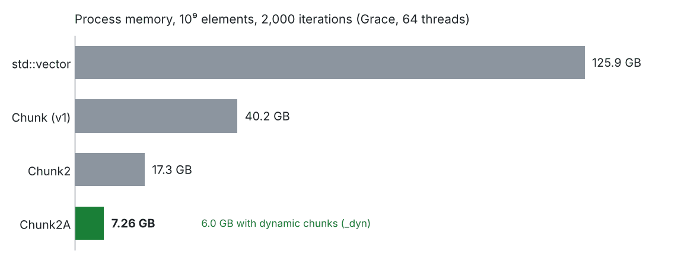
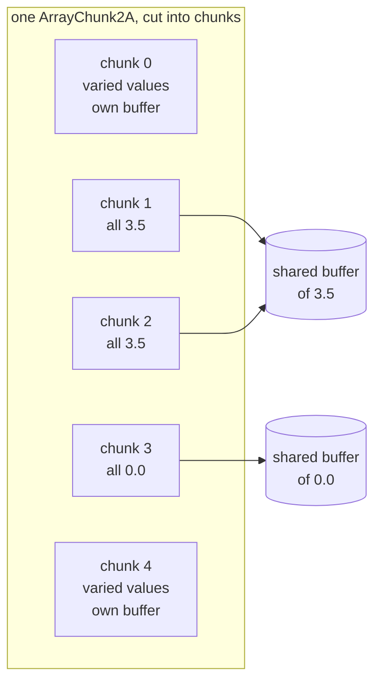

# shrink-array: your `std::vector`, minus the repeated values

> Version française : [README_fr.md](README_fr.md).

[](.github/workflows/ci.yml)
[](LICENSE)
[](docs/getting_started.md)
[](docs/getting_started.md)
[](docs/formal_models.md)

**shrink-array** gives C++ HPC codes arrays that read and write like a `std::vector` -- same
`[]`, same loops, same OpenMP threads (or `std::thread`s, TBB) -- but stop paying for the parts that hold the same value.
On the reference benchmark, a billion-element workload that needs **125.9 GB** with
`std::vector` runs in **6 to 7.3 GB**: up to 20 times less memory, with no change to the loops.

- **Drop-in**: `a[i] = v`, `a[i] += x`, `resize`, `push_back`, range-for. No new indexing, no
  rebuild step, no loss.
- **Compresses while the program runs**: a chunk that becomes uniform gives its buffer back;
  one that is written again gets a new one.
- **Any repeated value**, not only zero (Chunk2A), for any trivially copyable type: `double`,
  `std::complex`, your own structures.
- **Built for many threads**: no lock on the write path, arrays of 10⁹ elements, a few hundred
  threads -- OpenMP's, or the program's own `std::thread`s and TBB tasks with the std backend
  (`CHUNK_THREADS=std`, no OpenMP needed). C++20, Linux, CMake, Spack.

*The project is `shrink-array` (repository, Spack package); the C++ namespace is
`shrink_array`; the installed CMake package is `chunk` (`find_package(chunk)`, targets
`chunk::…`).*

## At a glance

The loops of a code written for `std::vector` stay as they are; only the array type changes:

```diff
-#include <vector>
+#include "chunk/array_chunk2A.h"

-std::vector<double> a(n);
+shrink_array::ArrayChunk2A<double> a(n);

 #pragma omp parallel for
 for (int i = 0; i < n; ++i)
     a[i] = field(i);
```

(The bare `#pragma omp parallel for` needs an OMPT build; with GCC's `libgomp`, open the
region with `parallel_phase()`, see [A first program, parallel and multi-threaded](#a-first-program-parallel-and-multi-threaded).)



*Reference benchmark ([`shrink_bench`](examples/shrink_bench)): about 10⁹ elements of a dozen
types, static chunks of 256, whole-process memory at the end. The price is access time, see
[In numbers](#in-numbers).*

## A first program, parallel and multi-threaded

```cpp
#include <cstdio>
#include "chunk/array_chunk2A.h"   // shrink_array::ArrayChunk2A
#include "chunk/chunk_std.h"       // release_chunk_pools, destroy_block_chunk
#include "chunk/manage_ompt.h"     // parallel_phase
#include "chunk/param_chunk.h"     // ParamChunk::init_indexes

namespace sa = shrink_array;

int main()
{
    sa::ParamChunk::init_indexes(true);       // optional: the first array runs it otherwise
    {
        const int                n = 1 << 24;
        sa::ArrayChunk2A<double> a(n);        // every element 0.0, no buffer yet

        // parallel_phase opens the `omp parallel` region and runs the lambda in it, on every
        // thread; the `omp for` shares the loop over that team (see below)
        sa::parallel_phase([&] {
#pragma omp for
            for (int i = 0; i < n / 2; ++i)
                a[i] = (i < n / 8) ? 1.0 + i % 7 : 3.5;   // the 3.5 run compresses
        });

        a.shrink_to_fit();                    // fold the chunks that became constant
        std::printf("chunks holding a buffer: %.1f %%\n", a.stats());
    }                                         // the array releases its chunks here
    sa::release_chunk_pools();                // optional: give the pools back before the end
    sa::destroy_block_chunk();
}
```

`parallel_phase()` takes the body of the parallel region as a lambda. The `#pragma omp
parallel` is inside it, so the `#pragma omp for` of the lambda is an orphaned worksharing
directive: it binds to the team `parallel_phase()` opened. Around the region it also marks
the phase boundaries the library defers its work to (the writes queued on compressed chunks,
the compression of the chunks that became uniform). The example needs no OMPT: by default
`parallel_phase()` makes those calls itself, and in an OMPT build (`CHUNK_OPT_OMPT`) the
OpenMP runtime makes them and `parallel_phase()` is a plain parallel region. Written by hand,
without OMPT, it is:

```cpp
#pragma omp parallel
{
    sa::begin_parallel_phase();      // every thread, before its first write
#pragma omp for
    for (int i = 0; i < n / 2; ++i)
        a[i] = (i < n / 8) ? 1.0 + i % 7 : 3.5;
}
sa::finalize_parallel_phase();       // outside the region: flush the queued writes, compress
```

Without OpenMP the lambda simply runs once, serially.

**Parallel multi-threaded loops with OMPT: nothing of the library around them.** In an OMPT build (Clang, oneAPI: the
library carries an OMPT tool, `CHUNK_OPT_OMPT`), the OpenMP runtime tells the library where
each region begins and ends, so the loop is written as for a `std::vector` -- the same
function fills both:

```cpp
template <typename Array>
void fill(Array& t, int n)
{
#pragma omp parallel for
    for (int i = 0; i < n / 2; ++i)
        t[i] = (i < n / 8) ? 1.0 + i % 7 : 3.5;
}

std::vector<double>      v(n);
sa::ArrayChunk2A<double> a(n);
fill(v, n);                          // the reference
fill(a, n);                          // the same loop: no parallel_phase(), no phase calls
```

[examples/getting_started/getting_started_ompt.cpp](examples/getting_started/getting_started_ompt.cpp)
is that program, which then compares the two arrays element by element. It needs an OMPT
build: it does not compile against a library built with GCC's libgomp, where the phases would
never be marked.

Link it with `chunk::chunk_v2a` (see [Install](#install)). The complete version, which checks
what it reads back, is [examples/getting_started](examples/getting_started/getting_started.cpp);
[docs/getting_started.md](docs/getting_started.md) walks through it, then through the rules
below.

## How it works



An array is cut into **chunks** of `S` consecutive elements (`S` a power of two or a multiple
of 64). A chunk whose elements all hold one constant keeps no buffer: it points to a shared
buffer of that constant and costs a few bytes of metadata. Three variants decide which
constants count:

| variant | class | a chunk is compressed when it is uniform at… |
|---|---|---|
| Chunk (v1) | `ArrayChunk<T>` | `T{}` (zero) only |
| Chunk2 | `ArrayChunk2<T>` | `T{}`, or **one** second value per array, declared with `set_second_value()` |
| Chunk2A | `ArrayChunk2A<T>` | `T{}`, or **any** value, chunk by chunk, with nothing to declare -- **start here** |

The variant and the chunk size (256, 1024, or dynamic and adaptive: `_dyn`) are chosen by the
library you link: `chunk::chunk_v2a_256`, `chunk::chunk_v2a_dyn`, ...
[docs/variants.md](docs/variants.md) says what each one costs;
[docs/algo_chunk2.md](docs/algo_chunk2.md) how reads, writes and compression run side by side.

**Checked, not only tested.** The three lock-free handshakes -- element writers against the
compression pass, the pass against the deferred-write flush, pure readers against buffer
reclamation -- are model-checked: reduced models of them ([formal/](formal/)) are explored
exhaustively by [GenMC](https://github.com/MPI-SWS/genmc) under the C11 memory model (RC11 and
IMM), with no lost write, no use-after-free, no data race and no unbounded wait, and the models
refuse twelve mutations, six of them the library as it once was. The `membarrier()` shape
rests on the argument of [docs/synchronisation_dekker.md](docs/synchronisation_dekker.md)
section 4.2; everything else is the checker's ([docs/formal_models.md](docs/formal_models.md)).

## In numbers

`shrink_bench` ([examples/shrink_bench](examples/shrink_bench), `--mode perf`): arrays of about
10⁹ elements of a dozen types, mostly zero or a few repeated values, rewritten piece by piece
over 2,000 iterations. Whole-process memory at the end, on Grace, 64 threads
([how it is measured](docs/performance_measurement.md)):

| | static chunks of 256 (`_256`) | dynamic chunks (`_dyn`) |
|---|---|---|
| Chunk2A | **7.26 GB** | **6.0 GB** |
| Chunk2 | 17.3 GB | 16.3 GB |
| Chunk (v1) | 40.2 GB | 40.3 GB |
| `std::vector` | 125.9 GB | — |

The price is access time. In loops that do nothing but access (the worst case,
[examples/access_cost](examples/access_cost)), a read costs about 1.9 times a vector's, a
rewrite 7 to 16 times depending on the variant; in a real code the computation around the
accesses absorbs part of it.

Thread scaling, at three times the size (`--multiply 3`, 3·10⁹ elements: the 64-bit index
builds `shrink_bench_*_int64_*`), clang/libomp, Grace (288 cores), compute time against 1
thread ([python/omp_speedup.py](python/omp_speedup.py)): every variant follows the ideal line
up to 16 threads (a speedup of 14 there, 26 to 28 at 32), reaches 48 to 70 at 128 threads and
stays between 43 and 66 up to 288, where `std::vector` falls back to about 26.


**Use it** on data that is mostly zero or made of runs of a few values: sparse fields, material
masks, multi-material quantities, flags. **Don't** on data where every chunk holds varied
values: there it costs a little more memory than a `std::vector`, and is slower. Sparse
formats, hash tables, zfp / Blosc2 or OpenVDB may fit better:
[docs/alternatives.md](docs/alternatives.md) compares them.

## Install

Requirements: **Linux** (x86-64 or aarch64), a **C++20** compiler (GCC 13 or 14 and Clang 18
tested; oneAPI, AOCC and NVHPC built), **CMake 3.20**, and optionally **OpenMP**.

```shell
cmake -S . -B build -DCMAKE_BUILD_TYPE=Release -DOMP=ON -DCMAKE_INSTALL_PREFIX=$HOME/opt/shrink-array
cmake --build build
ctest --test-dir build
cmake --install build
```

Then, in your project:

```cmake
find_package(chunk 0.1 REQUIRED)            # -DCMAKE_PREFIX_PATH=<install prefix>
target_link_libraries(my_app PRIVATE chunk::chunk_v2a)
```

`add_subdirectory(shrink-array)` works too, and so does `FetchContent`, with nothing to
install (libraries only, nothing written into your cache):

```cmake
include(FetchContent)
FetchContent_Declare(shrink_array
  GIT_REPOSITORY https://github.com/cea-hpc/shrink-array.git
  GIT_TAG        main)                 # or a commit, to pin the version
set(OMP ON)                            # build the OpenMP libraries
FetchContent_MakeAvailable(shrink_array)

target_link_libraries(my_app PRIVATE chunk::chunk_v2a)
```

With Spack, the recipe is in the repository:

```shell
spack repo add <clone>/spack/spack_repo/shrink_array
spack install shrink-array threads=openmp sizes=256,1024 %gcc@15   # threads=std: written from std::threads or TBB
```

The CMake options (`OMP`, `CHUNK_THREADS`, `CHUNK_STATIC_SIZES`, `CHUNK_VARIANTS`, `CHUNK_BUILD_DYN`,
`CHUNK_STD_ALLOC`...) and the environment variables:
[docs/environment_variables.md](docs/environment_variables.md).

## Good to know

- **`T v = a[i];`, not `auto`**: the non-const `[]` returns a write proxy, not a `T&`; pass
  `double(a[i])` to `printf`, `std::format` or `std::max`.
- **Threads**: different elements need no synchronisation, even in the same chunk; anything that
  rebuilds the storage (`resize`, `shrink_to_fit`, `assign`, a re-chunk) is a sequential point.
  Use the arrays from OpenMP threads; a team larger than 256 threads and than the cores needs
  `CHUNK_THREAD_CAPACITY` set before the first array;
  without OMPT (GCC's `libgomp`), open the regions with `parallel_phase()`.
- **One per process**: the library's state -- type registries, allocators, per-thread
  structures, the phase -- is the process's, shared by every part of the program that uses it:
  one top-level team writing arrays at a time (nested regions are fine), the shutdown calls once
  at the end ([docs/getting_started.md](docs/getting_started.md), section 5).
- **Not there, by construction**: `data()` (a compressed chunk has no buffer), `T&` and mutable
  iterators, `insert` / `erase` in the middle.
- **Faster bulk writes**: `fill_range`, `copy_range` and their `_mt` versions decide once per
  chunk instead of once per element.
- **Messages**: warnings and errors only, on stderr, one line each; `CHUNK_LOG=warn,rechunk=info`
  shows more, `CHUNK_LOG_FILE` writes them to a file, `shrink_array::logging::set_sink()` hands
  them to your own logger ([docs/api.md](docs/api.md), section 9).

Every call, by task: [docs/api.md](docs/api.md).

## In progress

One development branch, not in a release yet:

- **`cpp23` -- C++23 and `mdspan`.** A multidimensional view on any array: `f[i, j]` goes
  through the same write proxy, and a tiled layout (16 x 16 tiles for 256-element chunks) makes
  a uniform 2D or 3D region compress whatever its width. Needs GCC 14 or Clang 18.
  [docs/mdspan.md](https://github.com/cea-hpc/shrink-array/blob/cpp23/docs/mdspan.md).

`develop` is merged into it as it moves; it is also a Spack version
(`spack install shrink-array@cpp23`).

## Going further

| I want to… | read |
|---|---|
| install, link, write a first program, follow the OpenMP rules | [docs/getting_started.md](docs/getting_started.md) |
| find a call | [docs/api.md](docs/api.md) |
| choose a variant | [docs/variants.md](docs/variants.md) |
| compare with sparse formats, compressors, sparse grids | [docs/alternatives.md](docs/alternatives.md) |
| understand reads, writes, in-flight compression, deferred writes | [docs/algo_chunk2.md](docs/algo_chunk2.md) |
| know why the write path needs no lock | [docs/synchronisation_dekker.md](docs/synchronisation_dekker.md) |
| check a handshake with a model checker | [docs/formal_models.md](docs/formal_models.md) |
| use dynamic chunk sizes | [docs/adaptive_rechunk.md](docs/adaptive_rechunk.md) |
| measure memory and time reliably | [docs/performance_measurement.md](docs/performance_measurement.md) |
| submit and follow runs on the cluster from a window | [docs/shrink_gui.md](docs/shrink_gui.md) |
| contribute | [CONTRIBUTING.md](CONTRIBUTING.md) |

Examples: [simple_array](examples/simple_array) (the same computation on a `std::vector` and on
an array), [multi-mat](examples/multi-mat) (multi-material fields, loops written once for both),
[validation](examples/validation) (one harness per property, run by `ctest`). Every document
exists in French ([docs/README.md](docs/README.md)); the changes from one version to the next:
[CHANGELOG.md](CHANGELOG.md).

## Status and contributing

shrink-array is at version 0.1: before 1.0, a minor release may change the interface
([versioning policy](CHANGELOG.md)). Every push runs the source checks, the GCC 14 builds
(OpenMP, serial and std threads with oneTBB), the validation harnesses, the std backend under
ThreadSanitizer and the GenMC models
([CI](.github/workflows/ci.yml)).

Trying it on your own data is the most useful feedback: if it saves memory in your code -- or
does not -- [open an issue](https://github.com/cea-hpc/shrink-array/issues) with the type, the
size and what the array holds. Bug reports and pull requests follow
[CONTRIBUTING.md](CONTRIBUTING.md). If the library is useful to you, a star on the repository
helps others find it.

## License

Apache License 2.0, see [LICENSE](LICENSE). Copyright CEA.
