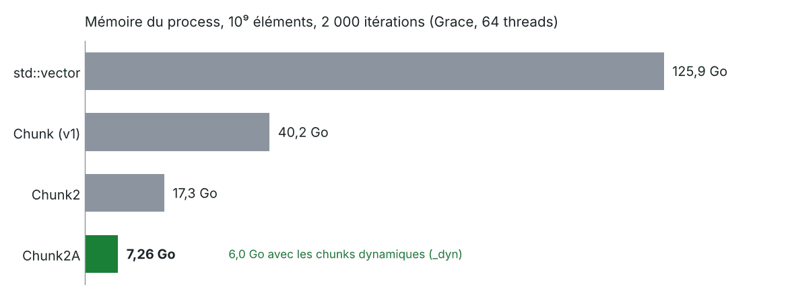
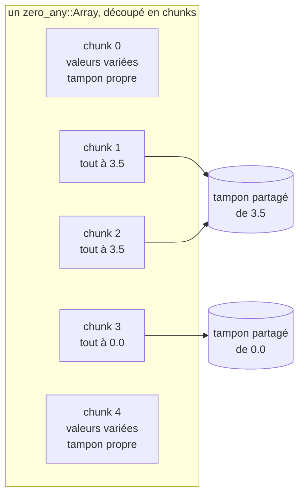
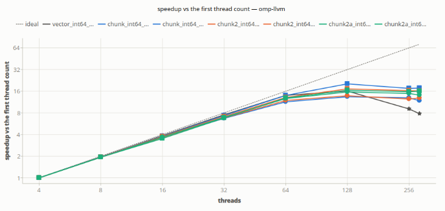
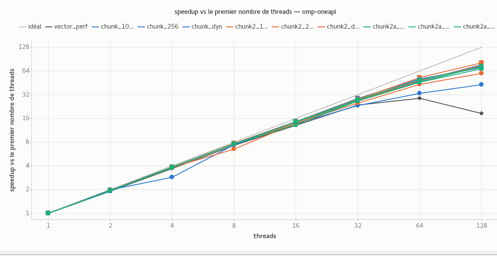

# shrink-array : votre `std::vector`, sans les valeurs répétées

> English version: [README.md](README.md).

[](.github/workflows/ci.yml)
[](LICENSE)
[](docs/getting_started_fr.md)
[](docs/getting_started_fr.md)
[](docs/formal_models_fr.md)

**shrink-array** donne aux codes de calcul C++ des tableaux qui se lisent et s'écrivent comme un
`std::vector` -- mêmes `[]`, mêmes boucles, mêmes threads OpenMP (ou `std::thread`, TBB) -- mais cessent de payer pour
les parties qui contiennent la même valeur. Sur le banc de référence, une charge d'un milliard
d'éléments qui demande **125,9 Go** en `std::vector` tient dans **6 à 7,3 Go** : jusqu'à 20 fois
moins de mémoire, sans toucher aux boucles.

- **Remplacement direct** : `a[i] = v`, `a[i] += x`, `resize`, `push_back`, range-for. Pas de
  nouvelle indexation, pas d'étape de reconstruction, aucune perte.
- **Compresse pendant que le programme tourne** : un chunk qui devient uniforme rend son
  tampon ; un chunk réécrit en reprend un.
- **N'importe quelle valeur répétée**, pas seulement zéro (Chunk2A), pour tout type trivialement
  copiable : `double`, `std::complex`, vos propres structures.
- **Fait pour beaucoup de threads** : aucun verrou à l'écriture, des tableaux de 10⁹ éléments,
  quelques centaines de threads -- ceux d'OpenMP, ou les propres `std::thread` et tâches TBB du
  programme avec le backend std (`CHUNK_THREADS=std`, sans OpenMP). C++23, Linux, CMake, Spack.

*Le projet s'appelle `shrink-array` (dépôt, paquet Spack) ; le namespace C++ est
`shrink_array` ; le paquet CMake installé est `chunk` (`find_package(chunk)`, cibles
`chunk::…`).*

## En un coup d'œil

Les boucles d'un code écrit pour `std::vector` restent telles quelles ; seul le type du tableau
change :

```diff
-#include <vector>
+#include "chunk/zero_any_array.h"

-std::vector<double> a(n);
+shrink_array::zero_any::Array<double> a(n);

 #pragma omp parallel for
 for (int i = 0; i < n; ++i)
     a[i] = field(i);
```

(La forme nue `#pragma omp parallel for` demande un build OMPT ; avec le `libgomp` de GCC,
ouvrez la région avec `parallel_phase()`, voir [Un premier programme, parallèle et multi-thread](#un-premier-programme-parallèle-et-multi-thread).)



*Banc de référence ([`shrink_bench`](examples/shrink_bench)) : environ 10⁹ éléments d'une
douzaine de types, chunks statiques de 256, mémoire du process entier à la fin. Le prix est le
temps d'accès, voir [En chiffres](#en-chiffres).*

## Un premier programme, parallèle et multi-thread

```cpp
#include <cstdio>
#include "chunk/zero_any_array.h"   // shrink_array::zero_any::Array
#include "chunk/zero_chunk.h"       // release_chunk_pools, destroy_block_chunk
#include "chunk/manage_ompt.h"     // parallel_phase
#include "chunk/param_chunk.h"     // ParamChunk::init_indexes

namespace sa = shrink_array;

int main()
{
    sa::ParamChunk::init_indexes(true);       // facultatif : le premier tableau le fait sinon
    {
        const int                n = 1 << 24;
        sa::zero_any::Array<double> a(n);        // tous les éléments à 0.0, aucun tampon encore

        // parallel_phase ouvre la région `omp parallel` et y exécute la lambda, sur chaque
        // thread ; le `omp for` partage la boucle entre cette équipe (voir plus bas)
        sa::parallel_phase([&] {
#pragma omp for
            for (int i = 0; i < n / 2; ++i)
                a[i] = (i < n / 8) ? 1.0 + i % 7 : 3.5;   // la plage de 3.5 se compresse
        });

        a.shrink_to_fit();                    // replier les chunks devenus constants
        std::printf("chunks holding a buffer: %.1f %%\n", a.stats());
    }                                         // le tableau rend ses chunks ici
    sa::release_chunk_pools();                // facultatif : rendre les pools avant la fin
    sa::destroy_block_chunk();
}
```

`parallel_phase()` reçoit le corps de la région parallèle sous forme de lambda. Le `#pragma omp
parallel` est à l'intérieur : le `#pragma omp for` de la lambda est donc une directive de
partage orpheline, qui se rattache à l'équipe ouverte par `parallel_phase()`. Autour de la
région, elle marque aussi les frontières de phase où la bibliothèque fait son travail différé
(les écritures mises en file sur des chunks compressés, la compression des chunks devenus
uniformes). L'exemple n'a pas besoin d'OMPT : par défaut `parallel_phase()` fait ces appels
elle-même, et dans un build OMPT (`CHUNK_OPT_OMPT`) c'est le runtime OpenMP qui les fait et
`parallel_phase()` n'est plus qu'une région parallèle. Écrit à la main, sans OMPT, cela donne :

```cpp
#pragma omp parallel
{
    sa::begin_parallel_phase();      // chaque thread, avant sa première écriture
#pragma omp for
    for (int i = 0; i < n / 2; ++i)
        a[i] = (i < n / 8) ? 1.0 + i % 7 : 3.5;
}
sa::finalize_parallel_phase();       // hors de la région : vider les écritures en file, compresser
```

Sans OpenMP, la lambda est simplement exécutée une fois, en série.

**Boucles parallèles multi-thread avec OMPT : rien de la bibliothèque autour.** Dans un build OMPT (Clang, oneAPI : la
bibliothèque embarque un outil OMPT, `CHUNK_OPT_OMPT`), le runtime OpenMP indique à la
bibliothèque où chaque région commence et finit ; la boucle s'écrit donc comme pour un
`std::vector` -- la même fonction remplit les deux :

```cpp
template <typename Array>
void fill(Array& t, int n)
{
#pragma omp parallel for
    for (int i = 0; i < n / 2; ++i)
        t[i] = (i < n / 8) ? 1.0 + i % 7 : 3.5;
}

std::vector<double>      v(n);
sa::zero_any::Array<double> a(n);
fill(v, n);                          // la référence
fill(a, n);                          // la même boucle : ni parallel_phase(), ni appels de phase
```

[examples/getting_started/getting_started_ompt.cpp](examples/getting_started/getting_started_ompt.cpp)
est ce programme, qui compare ensuite les deux tableaux élément par élément. Il demande un build
OMPT : il ne compile pas contre une bibliothèque construite avec la libgomp de GCC, où les phases
ne seraient jamais marquées.

Le lier à `chunk::chunk_v2a` (voir [Installer](#installer)). La version complète, qui vérifie
ce qu'elle relit, est [examples/getting_started](examples/getting_started/getting_started.cpp) ;
[docs/getting_started_fr.md](docs/getting_started_fr.md) la commente pas à pas, puis les règles
ci-dessous.

## Comment ça marche



Un tableau est découpé en **chunks** de `S` éléments consécutifs (`S` une puissance de deux ou
un multiple de 64). Un chunk dont tous les éléments valent la même constante ne garde aucun
tampon : il pointe sur un tampon partagé de cette constante et coûte quelques octets de
métadonnées. Trois variantes décident quelles constantes comptent :

| variante | classe | un chunk est compressé quand il est uniforme à… |
|---|---|---|
| Chunk (v1) | `zero::Array<T>` | `T{}` (zéro) seulement |
| Chunk2 | `zero_one_value::Array<T>` | `T{}`, ou **une** seconde valeur par tableau, déclarée par `set_second_value()` |
| Chunk2A | `zero_any::Array<T>` | `T{}`, ou **n'importe quelle** valeur, chunk par chunk, sans rien déclarer -- **commencer par elle** |

La variante et la taille de chunk (256, 1024, ou dynamique et adaptative : `_dyn`) sont choisies
par la bibliothèque liée : `chunk::chunk_v2a_256`, `chunk::chunk_v2a_dyn`, ...
[docs/variantes_fr.md](docs/variantes_fr.md) dit ce que coûte chacune ;
[docs/algo_chunk2_fr.md](docs/algo_chunk2_fr.md) comment lectures, écritures et compression
tournent ensemble.

**Sans verrou, et vérifié plutôt que seulement testé.** Aucun thread ne prend de verrou pour
lire ou écrire un élément. Les écrivains, la passe de compression qui reprend le tampon d'un
chunk, le flush des écritures différées et les lecteurs se coordonnent uniquement par des
atomiques et des barrières : des poignées de main à la Dekker
([docs/synchronisation_dekker_fr.md](docs/synchronisation_dekker_fr.md)). C'est de là que
vient la montée en threads, et c'est aussi là qu'est l'essentiel de la complexité de la
bibliothèque. Chaque protocole n'est correct qu'avec l'ordre mémoire exact d'une poignée de
lectures et d'écritures. Sur un processeur à ordre faible comme Grace, une erreur se manifeste
par une écriture perdue ou un accès à un tampon rendu une fois sur des milliers d'exécutions,
et l'histoire de la bibliothèque en compte plusieurs. Les tests seuls ne peuvent pas trancher.

Les trois protocoles -- écrivains d'éléments
contre passe de compression, passe contre flush des écritures différées, lecteurs purs contre
réemploi des tampons -- sont vérifiés par model checking : des modèles réduits ([formal/](formal/))
en sont explorés exhaustivement par [GenMC](https://github.com/MPI-SWS/genmc) sous le modèle
mémoire C11 (RC11 et IMM), sans écriture perdue, sans accès à un tampon rendu, sans course de
données et sans attente non bornée, et les modèles refusent douze mutations, dont six états
passés de la bibliothèque. La forme à `membarrier()` repose sur l'argument de la section 4.2 de
[docs/synchronisation_dekker_fr.md](docs/synchronisation_dekker_fr.md) ; tout le reste est au
vérificateur ([docs/formal_models_fr.md](docs/formal_models_fr.md)). Ce que cela couvre,
précisément : toutes les exécutions que le modèle mémoire autorise, pour de petites
configurations (jusqu'à 5 écrivains ou 3 lecteurs, un chunk, une passe). Ce n'est pas une
preuve pour un nombre quelconque de threads, et un modèle est une réduction du source écrite à
la main, que les mutations qu'il doit refuser gardent honnête.

## En chiffres

`shrink_bench` ([examples/shrink_bench](examples/shrink_bench), `--mode perf`) : des tableaux
d'environ 10⁹ éléments d'une douzaine de types, surtout zéro ou quelques valeurs répétées,
réécrits par morceaux pendant 2 000 itérations. Mémoire du processus entier à la fin, sur
Grace, 64 threads ([comment c'est mesuré](docs/mesures_performance_fr.md)) :

| | chunks statiques de 256 (`_256`) | chunks dynamiques (`_dyn`) |
|---|---|---|
| Chunk2A | **7,26 Go** | **6,0 Go** |
| Chunk2 | 17,3 Go | 16,3 Go |
| Chunk (v1) | 40,2 Go | 40,3 Go |
| `std::vector` | 125,9 Go | — |

Le prix est le temps d'accès. Dans des boucles qui ne font qu'accéder (le pire cas,
[examples/access_cost](examples/access_cost)), une lecture coûte environ 1,9 fois celle d'un
vector, une réécriture 7 à 16 fois selon la variante ; dans un vrai code, le calcul autour des
accès en absorbe une partie.

Montée en threads, à trois fois la taille (`--multiply 3`, 3·10⁹ éléments : les builds à index
64 bits `shrink_bench_*_int64_*`), clang/libomp, Grace (288 cœurs), temps de calcul par rapport
à 1 thread ([python/omp_speedup.py](python/omp_speedup.py)) : toutes les variantes suivent la
droite idéale jusqu'à 16 threads (un speedup de 14, puis 26 à 28 à 32), atteignent 48 à 70 à
128 threads et restent entre 43 et 66 jusqu'à 288, là où `std::vector` retombe vers 26.



Sur x86, AMD EPYC 7763 (Milan, 2 sockets × 64 cœurs), Intel oneAPI, à la taille de référence
(`--multiply 1`) : même tableau. Toutes les variantes restent sur la droite idéale jusqu'à 16
threads et atteignent 43 à 80 à 128, là où `std::vector` plafonne vers 28 à 64 threads et
retombe vers 18 à 128.



**Une référence équitable.** Le `std::vector` de ces mesures (`shrink_bench_vector_*`) est un
vrai `std::vector`, dont la mise à zéro est parallèle
([examples/shrink_bench/baseline_vector.h](examples/shrink_bench/baseline_vector.h)). Un
`std::vector<T> v(n)` ordinaire initialise ses `n` éléments sur le seul thread qui le
construit : la création est séquentielle, et sur un nœud à plusieurs sockets toutes les pages
atterrissent sur le nœud NUMA de ce thread (premier contact), si bien que chaque boucle
parallèle qui suit lit de la mémoire distante. Les tableaux par chunks n'allouent rien à la
création et ne paient aucun de ces deux coûts. Face à un `std::vector` non modifié, les runs
OpenMP de `shrink_bench` seraient plus rapides que le vector sur quelques milliers
d'itérations, pour une raison qui n'a rien à voir avec la compression. La référence alloue donc
sans écrire, puis met ses éléments à zéro dans une boucle parallèle à l'ordonnancement statique
des boucles du banc, chaque page touchée en premier par le thread qui y travaille ; ses
éléments valent `T{}` exactement comme ceux d'un `std::vector`. Seul change qui écrit les zéros.

**À utiliser** sur des données surtout nulles ou faites de plages de quelques valeurs : champs
creux, masques de matériaux, grandeurs multi-matériaux, drapeaux. **À éviter** sur des données
où chaque chunk contient des valeurs variées : elles y coûtent un peu plus de mémoire qu'un
`std::vector`, et sont plus lentes. Formats creux, tables de hachage, zfp / Blosc2 ou OpenVDB
peuvent mieux convenir : [docs/alternatives_fr.md](docs/alternatives_fr.md) les compare.

## Installer

Prérequis : **Linux** (x86-64 ou aarch64), un compilateur **C++23** (GCC 14 ou plus, Clang 18
ou plus, oneAPI ; NVHPC et AOCC 5 n'ont pas de C++23 utilisable), **CMake 3.20**, et en option
**OpenMP**.

```shell
cmake -S . -B build -DCMAKE_BUILD_TYPE=Release -DOMP=ON -DCMAKE_INSTALL_PREFIX=$HOME/opt/shrink-array
cmake --build build
ctest --test-dir build
cmake --install build
```

Puis, dans votre projet :

```cmake
find_package(chunk 0.1 REQUIRED)            # -DCMAKE_PREFIX_PATH=<préfixe d'installation>
target_link_libraries(my_app PRIVATE chunk::chunk_v2a)
```

`add_subdirectory(shrink-array)` marche aussi, et `FetchContent` aussi, sans rien installer
(bibliothèques seulement, rien d'écrit dans votre cache) :

```cmake
include(FetchContent)
FetchContent_Declare(shrink_array
  GIT_REPOSITORY https://github.com/cea-hpc/shrink-array.git
  GIT_TAG        main)                 # ou un commit, pour figer la version
set(OMP ON)                            # compiler les bibliothèques OpenMP
FetchContent_MakeAvailable(shrink_array)

target_link_libraries(my_app PRIVATE chunk::chunk_v2a)
```

Avec Spack, la recette est dans le dépôt :

```shell
spack repo add <clone>/spack/spack_repo/shrink_array
spack install shrink-array threads=openmp sizes=256,1024 %gcc@15   # threads=std : écrits depuis des std::thread ou TBB
```

Les options CMake (`OMP`, `CHUNK_THREADS`, `CHUNK_STATIC_SIZES`, `CHUNK_VARIANTS`, `CHUNK_BUILD_DYN`,
`CHUNK_STD_ALLOC`...) et les variables d'environnement :
[docs/variables_environnement_fr.md](docs/variables_environnement_fr.md).

## Bon à savoir

- **`T v = a[i];`, pas `auto`** : le `[]` non const renvoie un proxy d'écriture, pas un `T&` ;
  passer `double(a[i])` à `printf`, `std::format` ou `std::max`.
- **Threads** : des éléments différents n'ont besoin d'aucune synchronisation, même dans le même
  chunk ; tout ce qui reconstruit le stockage (`resize`, `shrink_to_fit`, `assign`, un rechunk)
  est un point séquentiel. Utiliser les tableaux depuis des threads OpenMP ; une équipe de plus
  de 256 threads et de plus que les cœurs demande `CHUNK_THREAD_CAPACITY` fixé avant le premier
  tableau ; sans OMPT (le `libgomp` de GCC), ouvrir les
  régions par `parallel_phase()`.
- **Un par processus** : l'état de la bibliothèque -- registres de types, allocateurs,
  structures par thread, la phase -- est celui du processus, partagé par toutes les parties du
  programme qui l'utilisent : une seule équipe de premier niveau qui écrit des tableaux à la fois
  (les régions imbriquées ne posent pas de problème), les appels d'arrêt une fois à la fin
  ([docs/getting_started_fr.md](docs/getting_started_fr.md), section 5).
- **Absents, par construction** : `data()` (un chunk compressé n'a pas de tampon), `T&` et les
  itérateurs mutables, `insert` / `erase` au milieu.
- **Écritures en masse plus rapides** : `fill_range`, `copy_range` et leurs versions `_mt`
  décident une fois par chunk au lieu d'une fois par élément.
- **Messages** : seulement les avertissements et les erreurs, sur stderr, une ligne chacun ;
  `CHUNK_LOG=warn,rechunk=info` en montre plus, `CHUNK_LOG_FILE` les écrit dans un fichier,
  `shrink_array::logging::set_sink()` les confie à votre propre logger
  ([docs/api_fr.md](docs/api_fr.md), section 9).

Chaque appel, par tâche : [docs/api_fr.md](docs/api_fr.md).

## En cours

Une branche de développement, pas encore dans une version :

- **`cpp23` -- C++23 et `mdspan`.** Une vue multidimensionnelle sur n'importe quel tableau :
  `f[i, j]` passe par le même proxy d'écriture, et une disposition en tuiles (tuiles de 16 x 16
  pour des chunks de 256 éléments) fait qu'une région 2D ou 3D uniforme se compresse quelle que
  soit sa largeur. Demande GCC 14 ou Clang 18.
  [docs/mdspan_fr.md](https://github.com/cea-hpc/shrink-array/blob/cpp23/docs/mdspan_fr.md).

`develop` y est fusionnée au fil de l'eau ; c'est aussi une version Spack
(`spack install shrink-array@cpp23`).

## Pour aller plus loin

| je veux… | lire |
|---|---|
| installer, lier, écrire un premier programme, suivre les règles OpenMP | [docs/getting_started_fr.md](docs/getting_started_fr.md) |
| trouver un appel | [docs/api_fr.md](docs/api_fr.md) |
| choisir une variante | [docs/variantes_fr.md](docs/variantes_fr.md) |
| comparer aux formats creux, aux compresseurs, aux grilles creuses | [docs/alternatives_fr.md](docs/alternatives_fr.md) |
| comprendre lecture, écriture, compression en vol, écritures différées | [docs/algo_chunk2_fr.md](docs/algo_chunk2_fr.md) |
| savoir pourquoi l'écriture n'a besoin d'aucun verrou | [docs/synchronisation_dekker_fr.md](docs/synchronisation_dekker_fr.md) |
| vérifier un protocole avec un vérificateur de modèles | [docs/formal_models_fr.md](docs/formal_models_fr.md) |
| utiliser les tailles de chunk dynamiques | [docs/rechunk_adaptatif_fr.md](docs/rechunk_adaptatif_fr.md) |
| indexer un tableau en 2D ou 3D (`mdspan`), en tuiles qui se compressent | [docs/mdspan_fr.md](docs/mdspan_fr.md) |
| mesurer mémoire et temps sans se tromper | [docs/mesures_performance_fr.md](docs/mesures_performance_fr.md) |
| soumettre et suivre des runs sur le calculateur depuis une fenêtre | [docs/shrink_gui_fr.md](docs/shrink_gui_fr.md) |
| contribuer | [docs/contributing_fr.md](docs/contributing_fr.md) |

Exemples : [simple_array](examples/simple_array) (le même calcul sur un `std::vector` et sur un
tableau), [multi-mat](examples/multi-mat) (champs multi-matériaux, boucles écrites une fois pour
les deux ; `multi-mat-md`, la même chose en 2D par `mdspan`), [validation](examples/validation) (un harnais par propriété, lancé par `ctest`).
Chaque document existe en anglais et en français ([docs/README.md](docs/README.md)) ; ce qui a
changé d'une version à l'autre : [CHANGELOG.md](CHANGELOG.md) (en anglais).

## État du projet et contributions

shrink-array en est à la version 0.1 : avant la 1.0, une version mineure peut changer
l'interface ([politique de versions](CHANGELOG.md)). Chaque push lance les vérifications des
sources, les builds GCC 14 (OpenMP, série et threads std avec oneTBB), les harnais de validation, le backend std
sous ThreadSanitizer et les modèles GenMC
([CI](.github/workflows/ci.yml)).

L'essai sur vos propres données est le retour le plus utile : si la bibliothèque économise de
la mémoire dans votre code -- ou n'en économise pas --
[ouvrez une issue](https://github.com/cea-hpc/shrink-array/issues) en indiquant le type, la
taille et ce que contient le tableau. Les rapports de bugs et les pull requests suivent
[docs/contributing_fr.md](docs/contributing_fr.md). Si la bibliothèque vous sert, une étoile sur
le dépôt aide d'autres personnes à la trouver.

## Licence

Apache License 2.0, voir [LICENSE](LICENSE). Copyright CEA.
