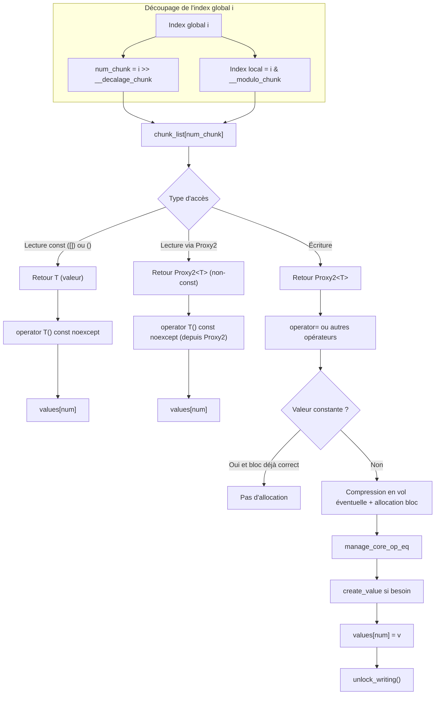
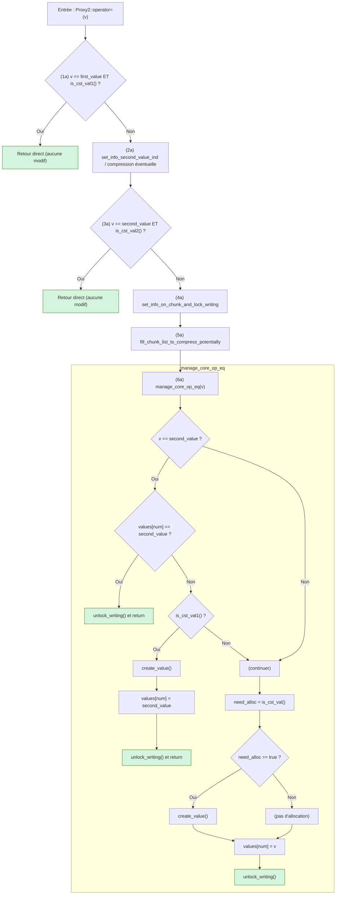
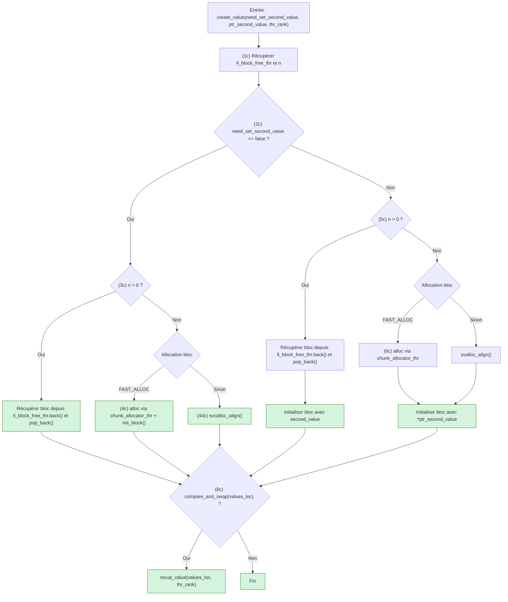
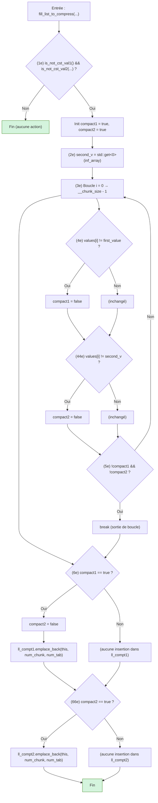

# Présentation de l'algorithme Implémenté Dans ArrayChunk2


## Objectif

L'objet `ArrayChunk2` implémente une structure de données optimisée pour gérer de grands tableaux en les divisant en sous-unités appelées **chunks**. Cela permet :

- Un gain en mémoire sur les tableaux contenant beaucoup de zéro ou une autre valeur identique (comme par exemple 1)
- Des accès rapides via des opérations "bitwise"
- Un fonctionnement en multi-thread ("OpenMP") performant

Ce document présente l'algorithme : en décrivant et expliquant à chaque étape de l'utilisation en lecture et écriture de cet objet ArrayChunk2

## Exemple de déclaration et initialisation du tableau 

```cpp
ArrayChunk2<int> tab_int(sz);
tab_int.set_second_value(1);

ArrayChunk2<double> tab_double(sz);
tab_double.set_second_value(2);
```
L'utilisation se fait quasiment comme un vector STL C++

```cpp
 for (int i = begin_i; i < end_i; ++i)
 {
     tab_int[i] = 1;
	 tab_double[i] = 2 * tab_int[i];
 }
```

## Principe général

Chaque index `i` est décomposé en deux parties :

- **Numéro du chunk** : `i >> __decalage_chunk`
- **Index local dans le chunk** : `i & __modulo_chunk`

Ces opérations permettent d’accéder rapidement au bon sous-tableau et à la bonne position dans ce sous-tableau. Remarque : ces instructions de décalage de bit ne coute qu'un cycle d'horloge sur un processeur

Les valeurs __decalage_chunk et __modulo_chunk sont calculées à partir de la variable chunk_size 
chunk_size doit être une puissance de 2 (par défaut 64)

```cpp

    static void setDecalageChunk(unsigned int chunk_size)
    {
        __decalage_chunk = log2int(chunk_size);
    }

    static void setModuloChunk(unsigned int chunk_size)
    {
        __modulo_chunk = chunk_size - 1;
    }
```


---

## Méthodes principales


Dans cette partie on décrit les principales méthodes de l'algorithme dans le même ordre que l’exécution du programme

On présente ici les principaux accesseurs des tableaux de type ArrayChunk2

### `operator[]` (lecture constante)

```cpp
template <typename T, typename ind_type>
Inlinable T ArrayChunk2<T, ind_type>::operator[](ind_type i) const noexcept
{
    const auto& chunk = chunk_list[i >> __decalage_chunk];
    return chunk[i & __modulo_chunk];
}
```
### operator() (forçage lecture (*) : même si l'utilisation du tableau appellerait l’opérateur en écriture on force le mode lecture )

```cpp
template <typename T, typename ind_type>
Inlinable T ArrayChunk2<T, ind_type>::operator()(ind_type i) noexcept
{
    const auto& chunk = chunk_list[i >> __decalage_chunk];

    T& val = chunk[i & __modulo_chunk];

    return val;

}
```
### `operator[]` (retourne un objet de type Proxy2<T>)

```cpp
template <typename T, typename ind_type>
Inlinable Proxy2<T> ArrayChunk2<T, ind_type>::operator[](ind_type i) noexcept
{
    const Proxy2<T>& val = chunk_list[i >> __decalage_chunk][i & __modulo_chunk]; \\ (1)
    val.set_this_and_num_chunk(this, i >> __decalage_chunk);

    return val; \\ (2)
}
```

Le premier point important de cet algorithme est le distinguo entre l'opérateur de lecture qui retourne un T simple et l'opérateur d'écriture qui retourne un Proxy2<T>.
Cette classe Proxy2 va permettre de savoir si le tableau accèdé est à droite de l'affectation (par exemple =) ou à gauche. Elle va aussi permettre de connaître la valeur à droite de l’opérateur d'affectation.

Connaître cette valeur est important, car si celle-ci correspond au valeur de compression, il ne sera pas nécessaire d'allouer un bloc. 
Si le tableau est de type const alors il n'y a pas d’ambiguïté : on utilise l'opérateur const []
L'opérateur () ((*) forçage lecture) est une astuce qui permet de ne pas utiliser l'opérateur d'écriture lorsque l'on sait que l'opération ne va pas changer la valeur constante : typiquement sqrt

 A la ligne de code (1) on appelle l’opérateur [] de Chunk2

```cpp
template <typename T>
Inlinable Proxy2<T> Chunk2<T>::operator[](int i) noexcept
{
    return Proxy2<T>(values, i, *this); \\ (3)
}
```
Le pointeur values (std::atomic<T*>) pointe soit sur un bloc de données de taille (chunk_size) ou sur un premier tableau de aussi taille chunk_size contenant umiquement la première valeur constante (0) ou sur un deuxième contenant uniquement la deuxième valeur de compression. Ces deux tableaux ne sont alloués qu'une fois chacun : ils n'occupent que 2 * chunk_size comme place mémoire. C'est ce mécanisme qui permet de gagner en place mémoire.

 A la ligne de code (3) on appelle le constructeur ci-dessous : en initialisant les champs nécessaires à proxy2
```cpp
inline explicit Proxy2(std::atomic<T*>& values_, int num_, Chunk2<T>& chunk_) noexcept
        : values(values_), num(num_), chunk(chunk_)
    {
    }
```

A la ligne de code (3) au niveau du return. Il y a 2 chemins possible qui correspondent au mode écriture ou mode lecture : le mode écriture est beaucoup plus complexe et va être décrit ci dessous. Le mode lecture est juste l’accès au tableau, celui-ci est donc beaucoup plus rapide. On va décrire l’opérateur d'affectation = mais avec cette technique de classe "proxy", il faut recoder l'ensemble des opérateurs (+=, *= , /= etc...)  sachant qu'il y a des différences de comportement entre chaque operateur, on va regrouper le codage par similitude : par exemple /= et *= ou += et -= 

 ### Mode lecture

 On appelle l’opérateur de conversion

```cpp
inline operator T() const noexcept
{
    return values[num];
}
```

 ### Mode écriture


```cpp 
template <typename T>
Inlinable T Proxy2<T>::operator=(T v) noexcept
{
    // Si la valeur a affecté est égale à la première valeur et
    // si le pointeur sur le bloc est déjà égale au tableau contenant
    // ces valeurs alors il n'y a rien à faire.

    if (v == static_cast<T>(Chunk2<T>::first_value) && is_cst_val1())
    {
        return v;
    }
	
    // Permet de récupérer la valeur de la seconde valeur de compression 
    // et de initialiser celle-ci dans l'objet "Chunk2". 
    // On récupère aussi un indice qui permet d'utiliser 
    // le tableau de valeur constante correspondant à la seconde valeur.
 
    set_info_second_value_ind();
	
    // Si la valeur a affecté est égale à la deuxième valeur et si le pointeur sur le bloc est déjà égale au tableau contenant ces valeurs alors il n'y a rien à faire.
	
    if (is_cst_val2()) 
    {
        if (v == second_value)
        {
            return v;
        }
    }
    else
    {   
        // Identique a set_info_second_value_ind()
        // mais ajoute l'initialisation de pointeur utile a la construction de la liste de bloc a comprimer
        set_info_on_chunk();
        manage_compression(inf_array); // Gestion de la compression "en vol" sera expliquée ultérieurement
    }
    // Identique a set_info_on_chunk() mais avec un lock OpenMP thread
    set_info_on_chunk_and_lock_writing();
	
    // Remplissage en vol de la liste des blocs a éventuellement comprimé "en vol" 
    mark_for_compression(num, v, second_value); 
    
	// Voir - ci dessous : cette partie de l'algorithme est dans une méthode car celui-ci est réutilisée pour d'autres opérateurs.
    manage_core_op_eq(v)

    return v;
}
```
Détails de l'algorithme en mode écriture :

(1a)  On utilise une technique qui permet de ne pas utiliser de déclarations statiques dans la classe "ArrayChunk2".   L'utilisation de statique n'aurait pas été possible
   dans le cas d'un programme utilisant différent "ArrayChunk2". 
  On limite aussi au maximum la place mémoire consommée par chaque "Chunk2"


```cpp
template <typename T>
Inlinable void Proxy2<T>::manage_core_op_eq(T v) const noexcept
{
    bool need_alloc;

    if (v == second_value) // (1b)
    {
        if (values[num] == second_value)
        {
            unlock_writing(); (11b)
            return;
        }
        if (is_cst_val1()) // (2b)
        {
            create_value(); // (3b)

            values[num] = second_value;

            unlock_writing();

            return;
        }
    }

    need_alloc = is_cst_val(); // (4b)

    if (need_alloc)
    {
        create_value(); (3b)
    }

    values[num] = v; (5b)

    unlock_writing();
}
```

Suite détails de l'algorithme en mode écriture :

(1b) Si la valeur est égale à la seconde valeur de compression et que l'on veut affecter cette même valeur alors il n'y a rien faire.

(11b) Verrou pour le mode multi-thread : expliqué ultérieurement.

(2b) Le bloc pointe sur le bloc contenant que des premières valeurs (de taille chunk_size et contenant que des zéros). On veut affecter la seconde valeur : donc il faut créer un nouveau bloc

(3b) Création d'un nouveau bloc (voir ci-dessous) affectation à la seconde valeur et retour.

(4b) Si le bloc pointe sur l'une des valeurs constantes : il faut créer un bloc car on veut affecter une valeur qui ne correspond à aucune de celles-ci.

(5b) Affectation de la valeur

```cpp
template <typename T>
void Chunk2<T>::create_value(bool need_set_second_value, const T* ptr_second_value, int thr_rank) noexcept
{
    T*    values_loc;
    auto& ll_block_free_thr = manager_chunk2::get_list_block_free_thr(thr_rank);\\ (1c)
    const int n = manager_chunk2::get_list_block_free_thr_size(thr_rank);

    if (!need_set_second_value) \\ (2c)
    {
       if (n) \\ (3c)
       {
            values_loc = ll_block_free_thr.back();
            ll_block_free_thr.pop_back();
       }
       else
       {
#ifdef FAST_ALLOC
            values_loc = chunk_allocator_thr[thr_rank].alloc(); \\ (4c)
            init_block(values_loc);
#else
            svcalloc_align(values_loc, T, __chunk_size); \\ (44c)
#endif // CHUNK_STD_ALLOC
        }
    }
    else
    {
        if (n) \\ (5c)
        {
            values_loc = ll_block_free_thr.back();

            ll_block_free_thr.pop_back();

            const T second_value = *ptr_second_value;

            for (unsigned int i = 0; i < __chunk_size; ++i)
            {
                values_loc[i] = second_value;
            }
        }
        else \\ (6c)
        {
#ifdef FAST_ALLOC
            values_loc = chunk_allocator_thr[thr_rank].alloc();
#else
            svalloc_align(values_loc, T, __chunk_size);
#endif
            for (unsigned int i = 0; i < __chunk_size; ++i)
            {
                values_loc[i] = *ptr_second_value;
            }
        }
    }
 
    if (compare_and_swap(values_loc)) \\ (8c)
    {
        recup_value(values_loc, thr_rank);
    }
}
```
Détails création d'un bloc de valeur non constante :

(1c) Récupération de la liste des blocs liberés et de la taille de celle-ci : permet de faire re-circuler les blocs sans allocation dynamique.

(2c) Test pour savoir si on doit initialiser le bloc à la seconde valeur : c'est le cas où le bloc pointe sur le bloc constant de seconde valeur.

(3c) Récupération du pointeur sur le bloc et suppression de la liste

(4c) Allocation d'un bloc (si la liste des blocs libres est vide) soit via un allocateur spécialisé (**) soit avec une allocation allignée

(5c) identique à (3c) mais avec initialisation à la seconde valeur.

(6c) identique à (4c) mais avec aussi initialisation à la seconde valeur.

## La compression "en vol"

Un point clé de cet algorithme est cette compression "en vol". Cela rajoute de la complexité mais c"est néanmoins nécessaire. ci-dessous l'exemple de boucle très simple qui poserait problème si on ne faisait pas cette compression :

```cpp
    for (int i = 0; i < sz; ++i)
    {
        tab[i] = second_value;
    }
```
Ci-dessus on effectue l'initialisation de tab sur l'ensemble de ces éléments à la seconde valeur. Le problème, si on ne faisait pas la compression en vol, serait le suivant : la mémoire serait entièrement allouée et donc l'intérêt de la compression nul. Pourquoi on a ce problème ? : à la déclaration du tableau tous les blocs sont positionnés sur la première valeur de compression (initialisation à zéro du tableau). A chaque itération de la boucle, on constate à chaque début de bloc qu'il y a 0 alors il faudra avoir 1 0 0 0 0 0 0 0 (si chunk_size vaut 8 et la seconde valeur 1) et cela entraine systématiquement la création d'un bloc. C'est donc pour contrer ce problème que l'on implémente cet algorithme de compression en vol.

Ci-dessous on va détailler cet algorithme de compression.


```cpp
template <typename T>
Inlinable void Proxy2<T>::manage_compression(const inf_array_t& inf_array) noexcept
{
    const int thr_rank     = CHUNK_PMP_THREAD_RANK;
    const T   second_value = std::get<0>(inf_array); \\ (1d)
    auto*     vec_tuple_p  = manager_chunk2::map_chunk2_to_compress_potentially_thr[thr_rank][second_value].get(); \\ (2d)

    auto& vec_tuple = *vec_tuple_p;

    const int sz = static_cast<int>(vec_tuple.size()); \\ (3d)
    const int szm = manager_chunk2::get_size_max_number_of_chunk_to_check_compress(); \\ (4d)

    if (sz > szm) \\ (5d)
    {
        auto& ml = manager_chunk2::map_chunk2_to_compress_potentially_thr[thr_rank];

        for (auto& elm : ml) \\ (6d)
        {
            const T second_value = elm.first;

            Chunk2<T>::make_block_compression(thr_rank, *share_info_array.find_inf_array(second_value), this); \\ (7d)
        }

        set_info_on_chunk();
    }
}
```
(1d) Récupération de la seconde valeur
(2d) Récupération d'un vecteur de "tuple" chaque tuple contenant les infos nécéssaires à la compression du bloc.
(3d) Récupération de la taille de ce vecteur
(4d) Récupération de la taille maximum acceptée pour la liste des blocs à comprimer (trop petite on appelerait trop fréquement La compression, trop grande on gaspillerait de la mémoire) 
(5d) Activation de la compression si on dépasse la taille maximum.
(6d) Boucle 
(7d) Appel de la compression 

```cpp
template <typename T>
void Chunk2<T>::make_block_compression(int thr, const inf_array_t& inf_array, Proxy2<T>* proxy2)
{
    const T second_value = std::get<0>(inf_array);

    auto& vec_tuple_to_compress = *(manager_chunk2::map_chunk2_to_compress_potentially_thr[thr][second_value]);
    vec_tuple_chunk2p_int2 ll_compt1; \\ (1d)
    vec_tuple_chunk2p_int2 ll_compt2; \\ (11d)

    const int sz = vec_tuple_to_compress.size();

    fill_list_chunk_to_compress_in_par(thr, ll_compt1, ll_compt2, inf_array, proxy2); // (2d)

    for (const auto& tup : ll_compt1) // (3d)
    {
        const int num_chunk = std::get<1>(tup);
        const int num_tab   = std::get<2>(tup);

        auto* chunk_t = std::get<0>(tup);

        chunk_t->clear_reversible(0, std::get<1>(inf_array), num_chunk, num_tab, proxy2, vec_tuple_remind, thr);
    }

    for (int k = 0; k < nn2; ++k) // (4d)
    {
        const auto& tup     = ll_compt2[k];
        auto* chunk_t = std::get<0>(tup);

        const int num_chunk = std::get<1>(tup);
        const int num_tab   = std::get<2>(tup);

        chunk_t->clear_reversible(1, std::get<1>(inf_array), num_chunk, num_tab, proxy2, vec_tuple_remind, thr);
    }
 
}

```
Dans le source ci-dessus : on a supprimé la partie gérant le multi-thread pour des raisons de simplification : on y reviendra plus loin

(1d) Déclaration d'un vecteur de "tuple" pour contenir les blocs à comprimer sur la première valeur (0)
(11d) Même déclaration que ci-dessus pour les blocs à comprimer sur la deuxième valeur
(2d) Appel de la méthode pour remplir les vecteur ll_compt1 et ll_compt2 : description de la méthode ci-dessous.
(3d) Boucle pour appeler la méthode qui va comprimer le bloc sur la première valeur
(4d) Même boucle mais pour la compression sur la deuxième valeur


```cpp
template <typename T>
void Chunk2<T>::fill_list_to_compress(vec_tuple_chunk2p_int2& ll_compt1,
                                      vec_tuple_chunk2p_int2& ll_compt2,
                                      const inf_array_t&      inf_array,
                                      int                     num_chunk,
                                      int                     num_tab)
{ 
    // Test pour savoir si le bloc pointe sur le bloc contenant les premières valeurs ou
    // sur le bloc contenant les deuxièmes valeurs (si c'est le cas il n'y a rien à faire)
    // L'argument de is_not_cst_val2 est utilisé pour récupérer le tableau correspondant à la deuxième valeur
    // de compression
    if (is_not_cst_val1() && is_not_cst_val2(std::get<1>(inf_array))) // (1e)
    {
        bool compact1 = true;
        bool compact2 = true;

        const T second_v = std::get<0>(inf_array); // Récupération de la seconde valeur

       //  Boucle sur l'ensemble du bloc pour inspecter la valeur de chaque élément
        for (unsigned int i = 0; i < __chunk_size; ++i)
        {
            if (values[i] != first_value) // (4e)
            {
                compact1 = false;
            }
            if (values[i] != second_v) // (44e)
            {
                compact2 = false;
            }
  
            if (!compact1 && !compact2) // (5e)
            {
                break;
            }
        }

        if (compact1) // (6e)
        {
            compact2 = false;

            ll_compt1.emplace_back(std::make_tuple(this, num_chunk, num_tab));
        }
        if (compact2) // (66e)
        {
            ll_compt2.emplace_back(std::make_tuple(this, num_chunk, num_tab));
        }
    }
}
```

(4e) Si la valeur de l'élément n'est pas égale à la première valeur de compression alors on se positionne pour arêter la boucle
(44e) Même test que ci-dessus mais pour la seconde valeur
(5e) Si les deux tests ci-dessus sont vérifiés alors on arrête la boucle
(6e) Si tous les éléménts sont égaux à la première valeur, alors on ajoute ce bloc dans la liste des blocs à comprimer
(66e) Même opération que ci-dessus mais pour la seconde valeur

```cpp
template <typename T>
Inlinable void Chunk2<T>::clear_reversible(int                               num_compress_value,
                                           int                               ind,
                                           int                               num_chunk,
                                           int                               num_tab,
                                           const Proxy2<T>*                  proxy2,
                                           int                               thr_rank)
{
 
    auto& ll_block_free_comp_thr = get_list_block_free_comp_thr(thr_rank); \\ (1f)

    if (num_compress_value == 0)  \\ (2f)
    {
	    ll_block_free_comp_thr.push_back(values); \\ (3f)

        set_cst_val_to_cst_val1(); \\ (4f)
        init_values_cst_val(); \\ (5f)
    }
    else if (num_compress_value == 1) \\ (22f)
    {
	    ll_block_free_comp_thr.push_back(values);\\ (33f)

        set_cst_val_to_cst_val2(ind); \\ (44f)
        init_values_cst_val(); \\ (55f)
    }
}

```
(1f) Récupération de la liste qui vont être libre.
(2f) Test pour savoir si on va initialiser le pointeur du bloc sur le tableau de première valeur.
(3f) Ajout du bloc dans la liste des blocs libres.
(4f) Positionnement du pointeur de valeur constante sur le bloc de valeur constante contenant la première valeur.
(5f) Positionnement du pointeur de valeur sur le bloc de valeur constante contenant la première valeur.

(22f) (33f) (44f) (55f) même séquence pour la deuxième valeur.


## Présentation de l'algorithme a partir de plusieurs diagrammes de flux

Suite a la présentation linéaire a partir d'extrait de source : on présente les principaux parties de l’algorithme avec des diagrammes de flux, en réutilisant les annotations ci-dessus.

### Diagramme de flux de l'algorithme général


### Diagramme de flux de la méthode manage_core_op_eq avec jonction avec le précédent diagramme


### 🔍 Lecture rapide
- **(1a)** Si `v` est égal à `first_value` **et** que le bloc pointe déjà sur le tableau de cette valeur → **sortie immédiate**, rien à faire.
- **(2a)** Récupération de la valeur de `second_value` sans déclaration statique, pour optimiser la mémoire et permettre plusieurs instances indépendantes d'`ArrayChunk2`.
- **(3a)** Si `v` est égal à `second_value` **et** que le bloc pointe déjà dessus → **sortie immédiate**.
- **(4a)** Préparer les informations sur le chunk et verrouiller l’écriture.
- **(5a)** Mettre à jour la liste des chunks à compresser “en vol”.
- **(6a)** Appeler `manage_core_op_eq(v)` :
  - Si `v == second_value` **et** que `values[num] == second_value` → déverrouiller et sortir.
  - Si `v == second_value` mais bloc sur `first_value` → créer un bloc, assigner `second_value`, déverrouiller et sortir.
  - Sinon, tester `is_cst_val()` → si vrai, créer un bloc vide ; si faux, réutiliser l’existant.
  - Assigner `v` à `values[num]` puis déverrouiller.
  
### Diagramme de flux de la méthode create_value


---

### 🔍 Lecture rapide
- **Branches hautes** : cas `need_set_second_value == false` → soit on réutilise un bloc libre `(3c)`, soit on alloue `(4c)/(44c)`.
- **Branches basses** : cas `need_set_second_value == true` → soit on réutilise un bloc libre et on l’initialise `(5c)`, soit on alloue et on initialise `(6c)`.
- **Fin** : on tente un `compare_and_swap` `(8c)` puis éventuellement `recup_value`.

---


### 🔍 Lecture rapide
- **(1e)** On traite uniquement si le bloc n’est ni le bloc constant de première valeur (`first_value`), ni celui de seconde valeur (`second_value`).  

- **(2e)** Récupérer la seconde valeur `second_v` depuis `inf_array`.  

- **(3e)** Parcourir tous les éléments du bloc (`__chunk_size`).  

- **(4e)** Si un élément est différent de `first_value` → `compact1 = false`.  

- **(44e)** Si un élément est différent de `second_v` → `compact2 = false`.  

- **(5e)** Si `compact1` et `compact2` sont déjà `false` → sortir de la boucle.  

- **(6e)** Si `compact1` est encore `true` → forcer `compact2 = false` et ajouter le bloc à `ll_compt1`.  

- **(66e)** Si `compact2` est encore `true` → ajouter le bloc à `ll_compt2`.

  


## Le Multi Threading OpenMP

Un des challenges c'est la parallélisation performante en multi - thread de cet algorithme. On utilise le modèle OpenMP. A ce jour, on a pas trouve de solution satisfaisante.
