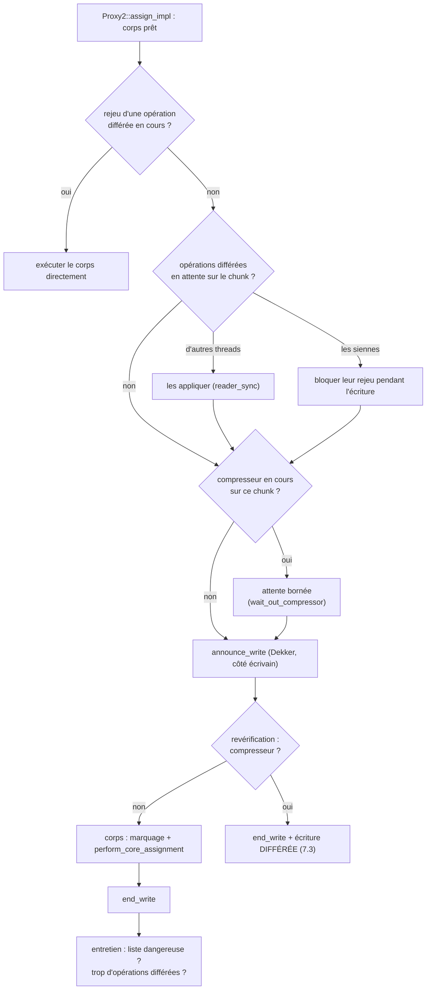
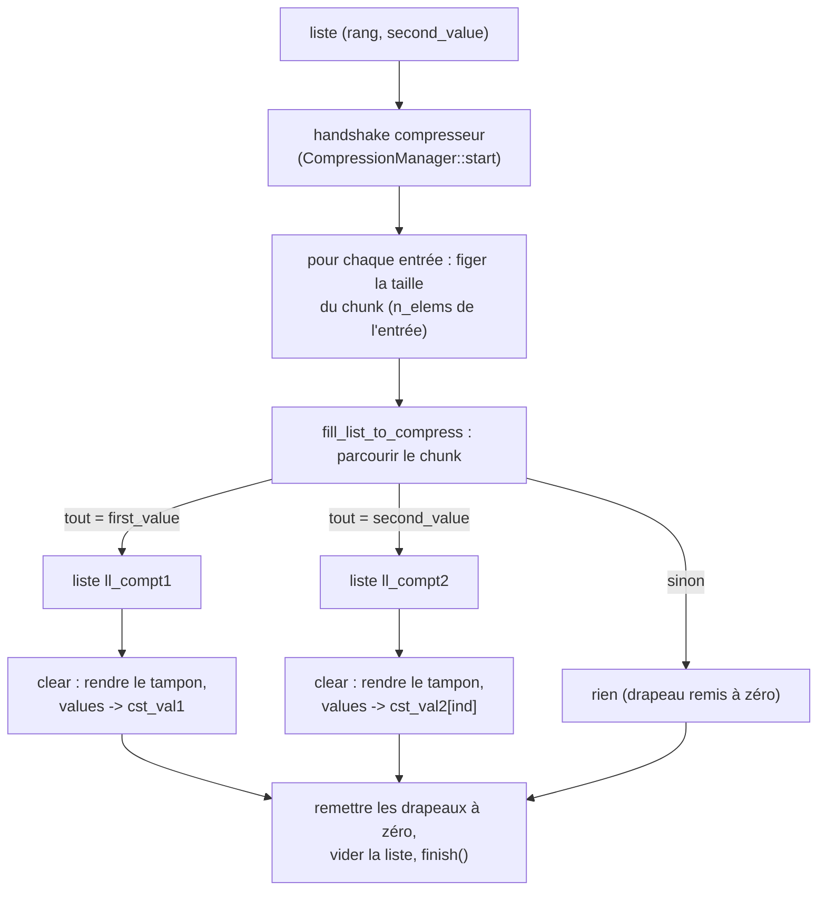

# L'algorithme d'ArrayChunk2

> English version: [algo_chunk2.md](algo_chunk2.md).

> État du code : début octobre 2026. La géométrie dynamique est détaillée dans
> [rechunk_adaptatif_fr.md](rechunk_adaptatif_fr.md), la synchronisation sans verrou entre
> écrivains, compresseurs et lecteurs dans [synchronisation_dekker_fr.md](synchronisation_dekker_fr.md),
> la méthode de mesure dans [mesures_performance_fr.md](mesures_performance_fr.md), et l'index
> de la documentation dans [README.md](README.md). Ce document remplace l'ancienne présentation, qui décrivait
> une version antérieure (verrous par élément, `__decalage_chunk` global, taille de chunk fixée
> à 64, parallélisation « sans solution satisfaisante »). Les noms de fonctions et de fichiers
> cités sont ceux de l'arbre actuel ; en cas de doute, c'est le code qui fait foi.

***

## 1. Objectif

`ArrayChunk2<T>` est un tableau découpé en **chunks** (blocs de taille fixe, puissance de 2)
qui se **compressent** dès que tous leurs éléments valent l'une de **deux constantes** :

- la **première valeur** `first_value` (0, la valeur d'initialisation) ;
- une **seconde valeur**, **commune à tout le tableau**, déclarée par `set_second_value()`.

Un chunk compressé n'a pas de tampon propre : il pointe vers un tampon constant partagé.
Le gain mémoire vient de là.

Les trois variantes de la bibliothèque se distinguent par ce qu'elles savent compresser :

| variante | constantes compressibles | métadonnée de seconde valeur |
|---|---|---|
| `ArrayChunk` (v1) | `first_value` seulement | aucune |
| **`ArrayChunk2`** | `first_value` **et une seconde valeur par tableau** | une entrée par tableau |
| `ArrayChunk2A` | `first_value` et **une seconde valeur par chunk** | une entrée par chunk |

`ArrayChunk2` est donc le bon choix quand les données ont **une seule valeur dominante
non nulle** : ses métadonnées sont plus légères que celles de Chunk2A.

---

## 2. Utilisation

```cpp
ArrayChunk2<double> tab(n);
tab.set_second_value(1.0);      // à déclarer avant les phases parallèles

#pragma omp parallel for
for (long i = 0; i < n; ++i)
    tab[i] = f(i);              // écriture : passe par un proxy

double s = std::as_const(tab)[i];   // lecture : renvoie un T
```

L'interface est proche d'un `std::vector` : `size()`, `resize()`, `at()`, itérateurs constants,
`swap()`, etc. Trois points diffèrent :

- **`operator[]` non constant renvoie un proxy** (`Proxy2<T>`), pas une référence. C'est par
  lui que passent toutes les écritures. Les opérateurs composés (`+=`, `*=`, …) sont
  reprogrammés sur le proxy.
- **`set_second_value()` doit être appelé hors région parallèle**, avant les écritures : il
  enregistre la seconde valeur dans le registre et crée les listes de candidats à la
  compression pour cette valeur. Un tableau qui ne déclare jamais de seconde valeur se
  comporte comme un `ArrayChunk` (compression vers 0 seulement).
- **Les opérations sur plages** (`fill_range`, `copy_range`, `fill_range_mt` dans
  `array_chunk_range_ops.h`) écrivent une plage en une décision par chunk, et
  `fill_range_mt` peut être appelée par plusieurs threads à la fois (section 10).

---

## 3. Géométrie : taille de chunk et découpage de l'indice

La taille de chunk est portée **par chaque tableau** (`size_policy_`, voir
`chunk_size_policy.h`), et non par une variable globale :

- **géométrie fixe** : la taille est une constante de compilation, une bibliothèque par
  taille (`chunk_v2_256`, …, liste `CHUNK_STATIC_SIZES`, la première donnant
  `CHUNK_DEFAULT_SIZE`) ;
- **géométrie dynamique** (`CHUNK_DYNAMIC`, bibliothèques `_dyn`) : la taille est fixée à
  l'exécution et peut **changer au cours de la vie du tableau** (`rechunk_to()`, section 9),
  jusqu'à `chunk_dyn_max_size` (4096 par défaut).

L'indice global `i` se décompose en deux opérations d'un cycle :

```cpp
const int num_chunk = i >> size_policy_.decalage();   // numéro du chunk
const int num       = i &  size_policy_.modulo();     // position dans le chunk
```

---

## 4. Les états d'un chunk et les structures partagées

### 4.1 Trois états

Chaque `Chunk2<T>` contient essentiellement un pointeur atomique `values`. Selon sa cible,
le chunk est dans l'un de trois états :

| état | `values` pointe vers | test |
|---|---|---|
| compressé à la première valeur | le tampon constant `cst_val1` (que des 0) | `is_cst_val1()` |
| compressé à la seconde valeur | le tampon constant `cst_val2[ind]` | `is_cst_val2(ind)` |
| matérialisé | un tampon privé, alloué pour ce chunk | `written(ind)` |

Les tampons constants sont **alloués une seule fois** et partagés par tous les chunks
concernés. Leur taille est `cst_buffer_size` (la taille de chunk en géométrie fixe,
`chunk_dyn_max_size` en géométrie dynamique). Il existe un tampon `cst_val2` par seconde
valeur déclarée, repéré par un **indice** `ind`.

> Attention : `Chunk2::written()` **sans argument** est réservé à `bool` et renvoie `false`
> pour tout autre type. Pour savoir si un chunk non booléen est matérialisé, il faut
> `written(ind)` avec l'indice de la seconde valeur du tableau
> (`ArrayChunk2::chunk_written(j)` le fait).

### 4.2 Le registre des secondes valeurs

La seconde valeur **n'est pas stockée dans le tableau** : elle vit dans le registre partagé
<tt>Proxy2\<T\>\::share_info_array</tt>, indexé par l'**adresse** du tableau. Chaque entrée est un
triplet `inf_array_t` :

```
(second_value, ind, num_tab)
```

- `ind` : l'indice du tampon constant `cst_val2` de cette valeur ;
- `num_tab` : le numéro du tableau, qui indexe les tables de métadonnées par tableau
  (par exemple les drapeaux « déjà candidat à la compression »).

Le registre reste la source de vérité, mais chaque tableau en garde un **miroir**
(`ArrayChunk2::inf_array`), relu (`sync_registry_mirror()`) après les trois seuls endroits qui
écrivent le registre : `create()`, `set_second_value()` et l'échange d'identité du rechunk.
L'`operator[]` d'écriture **arme chaque proxy avec l'adresse de ce miroir**
(`registry_mirror()`, `arm_inf_array()`) : le chemin d'écriture copie le triplet au lieu de
chercher dans le registre. En build de vérification (`any_check`), chaque lecture du miroir
est comparée au registre.

---

## 5. La lecture

L'opérateur de lecture renvoie une **valeur**, jamais une référence :

```cpp
CHUNK_FLATTEN CHUNK_FORCE_INLINE T operator[](ind_type i) const noexcept
{
    const int num_chunk = i >> size_policy_.decalage();
    const int num       = i & size_policy_.modulo();
    const auto& chunk_t = chunk_list[num_chunk];
    sync_chunk(chunk_t, num_chunk, num);      // barrière de lecture (OpenMP)
    return chunk_t[num];
}
```

Lire un chunk compressé ne coûte rien de plus : on lit dans le tampon constant.

**La barrière de lecture** (`sync_chunk`, compilée à vide sans OpenMP) garantit qu'une
lecture voit les écritures **différées** (section 7.3) déjà émises sur ce chunk :

1. un **filtre grossier** par chunk (le « dirty bitset ») : un bit à zéro signifie qu'aucune
   écriture différée n'a jamais visé ce chunk, et la lecture repart immédiatement. C'est le
   cas de loin le plus fréquent ;
2. sinon, le **compteur précis** d'opérations en attente du chunk décide s'il faut appliquer
   ces opérations (`reader_sync`) avant de lire.

Il existe aussi `operator()` const (même lecture, utile quand le contexte appellerait sinon
l'opérateur d'écriture) et `T& operator()(i)` non const, qui donne une référence brute dans
le tampon : **à n'utiliser que sur un chunk matérialisé**, puisqu'il contourne le proxy.

---

## 6. L'écriture

### 6.1 L'`operator[]` d'écriture : un proxy armé

```cpp
proxy_type operator[](ind_type i) noexcept
{
    const int num_chunk = i >> size_policy_.decalage();
    const int num       = i & size_policy_.modulo();
    const proxy_type& val = chunk_list[num_chunk][num];
    val.set_this_and_num_chunk(&derived(), num_chunk, num_tab);   // tableau, chunk, num_tab
    val.arm_inf_array(derived().registry_mirror());                // Chunk2 : le miroir
    return val;
}
```

Le proxy sait donc, sans aucune recherche, **quel tableau**, **quel chunk**, **quelle
position** et **quel triplet de seconde valeur** il concerne. Il permet surtout de connaître
**la valeur écrite avant de décider** : si c'est une constante que le chunk contient déjà,
il n'y a rien à faire, et surtout rien à allouer.

### 6.2 L'affectation (`assign_impl`)

```cpp
const T* values_loc = chunk.values_load();

// 1. first_value sur un chunk déjà à first_value : rien à faire
if (is_cst_val1_and_v_equal_first_value(values_loc, v)) return v;

set_info_second_value_ind();   // second_value et ind, depuis le miroir

// 2. second_value sur un chunk à cst_val2, ou sur un élément qui la contient déjà :
//    rien à faire -- sauf si des écritures différées sont en attente sur le chunk
//    (une ancienne opération rejouée plus tard écraserait la valeur laissée en place)
if (!chunk.pending_any())
    if (v == second_value && (values_loc == chunk.get_cst_val2(ind) || values_loc[num] == second_value))
        return v;

// 3. sinon : le corps de l'écriture, confié au moteur d'écriture
auto body = [this, &v] { mark_for_compression_if_needed(v); perform_core_assignment(v); };
const bool deferred = write_with_optional_lock_with_set_ptr(body);
if (deferred) { /* capturer l'opération pour la rejouer plus tard (7.3) */ }
```

### 6.3 Le corps : `perform_core_assignment`

- **seconde valeur écrite dans un chunk à `cst_val1`** : on matérialise le chunk
  (`create_value()`, pré-rempli de 0), puis on écrit la valeur ;
- **chunk compressé (l'une ou l'autre constante) et valeur différente** : on matérialise le
  chunk, pré-rempli **avec la constante qu'il quitte**, puis on écrit ;
- **chunk matérialisé** : simple écriture dans le tampon.

Dans les builds **séquentiels** seulement, des compteurs par chunk (nombre d'éléments égaux à
chaque constante) déclenchent directement la compression quand un chunk devient uniforme.
Avec OpenMP, ces compteurs n'existent pas : c'est la compression « en vol » de la section 8
qui s'en charge.

### 6.4 La matérialisation : `create_value`

1. prendre un tampon dans la **liste de réutilisation du thread** (tampons libérés par des
   compressions précédentes), ou en allouer un auprès de l'allocateur rapide
   (`fast_allocators`, section 9.1) ;
2. le **pré-remplir** avec la constante que le chunk quitte ;
3. le **publier par CAS** sur `values`. Le CAS refuse une transition incohérente (par
   exemple si un autre thread a matérialisé ou compressé le chunk entre-temps) ; le perdant
   rend son tampon.

---

## 7. Le parallélisme OpenMP

L'ancienne version verrouillait chaque écriture. La version actuelle n'a **aucun verrou sur
le chemin d'écriture courant** : elle repose sur trois mécanismes.

### 7.1 Le moteur d'écriture et le protocole de Dekker asymétrique

Toutes les écritures passent par `ProxyBase::write_with_optional_lock_impl`
(`proxy_base_inline.h`). Le danger à éviter : un thread écrit dans le tampon d'un chunk
pendant qu'un compresseur le vole et le rend à la liste de réutilisation. Le moteur applique
une poignée de main de type **Dekker** entre écrivains et compresseurs
(`WriteCompressSyncPolicy`), sans aucun verrou :

- **côté écrivain (fréquent, léger)** : le thread publie l'adresse du chunk qu'il écrit dans
  son drapeau (`announce_write` : une écriture relâchée suivie d'une simple barrière de
  compilateur), **revérifie** que le chunk n'est pas réservé par une passe (sa marque
  `steal_mark_`, lue en *acquire*), écrit, puis baisse son drapeau (`end_write`). Si le chunk
  est réservé, l'écriture est différée (7.3) ;
- **côté compresseur (rare, lourd)** : il marque ses candidats, se déclare (`hard_inflight_`),
  appelle `membarrier`, qui fait exécuter une barrière complète à chaque cœur du processus et
  rend visibles toutes les annonces des écrivains, puis attend, de façon bornée, les seuls
  écrivains dont le drapeau désigne un chunk marqué. S'il attend trop, il renonce à sa passe.

L'un des deux côtés voit toujours l'autre : jamais les deux ne passent ensemble. Sans
`membarrier` (noyau trop ancien, seccomp, build TSan), la forme symétrique met une barrière
`seq_cst` des deux côtés. L'algorithme, la preuve des deux formes, les compteurs « garé » et
« voleur » du compresseur et les deux autres usages de la même brique (vidages et lecteurs)
sont détaillés dans [synchronisation_dekker_fr.md](synchronisation_dekker_fr.md).

### 7.2 Le déroulé d'une écriture dans le moteur



### 7.3 Les écritures différées

Quand un compresseur est en cours sur le chunk et que l'attente bornée n'a pas suffi,
l'écriture n'est pas perdue : elle est **capturée** (un contexte alloué dans un pool, qui
contient la position et l'opérande) et placée dans la file du thread. Elle sera **rejouée**
plus tard :

- par une **lecture** du chunk (barrière de lecture, section 5) ;
- aux **barrières** OpenMP : chaque rang vide sa propre file (`on_barrier_end`) ;
- en **fin de région parallèle** (`on_parallel_end` / `finalize_parallel_phase`), par un
  vidage en série qui n'ouvre une région que s'il reste des opérations ;
- dans le chemin d'écriture lui-même, quand la file d'un thread dépasse un seuil.

Le rejeu fige la géométrie de l'opération (en géométrie dynamique, un chunk est matérialisé à
**sa** taille, pas à celle du thread qui rejoue).

En fin de phase, le « dirty bitset » de chaque tableau (le filtre de la barrière de lecture,
section 5) est remis à zéro. Chaque bitset porte un mot supplémentaire, « au moins un bit a
été levé », que seule la mise en file d'une écriture différée lève : un tableau sans écriture
différée pendant la phase n'est pas réécrit. Sans ce mot, la remise à zéro réécrivait une ligne
de 128 octets par tranche de 64 chunks de chaque tableau, en série sur le maître, à chaque fin
de phase : ~21 s d'un run de ~30 s sur AMD Milan (GNU, 64 threads).

### 7.4 Les rappels OMPT

Avec OMPT, la bibliothèque s'accroche au runtime OpenMP : `on_implicit_task` (cache du rang
du thread), `on_barrier_end` et `on_parallel_end` (rejeu des opérations différées et passes de
compression). Sans OMPT (libgomp), le code appelant encadre ses régions par
`begin_parallel_phase()` / `finalize_parallel_phase()`, et le travail de fin de région est fait
par le **maître**, après la région : c'est là qu'une étape séquentielle coûteuse se voit
d'abord (les autres threads attendent dans `gomp_barrier_wait_end`).

---

## 8. La compression « en vol »

### 8.1 Pourquoi

Même exemple que dans l'ancienne version, toujours valable :

```cpp
for (long i = 0; i < n; ++i)
    tab[i] = second_value;
```

À la construction, tous les chunks sont à `cst_val1`. La première écriture de chaque chunk
le **matérialise** (il contient alors `1 0 0 0 …`). Sans compression pendant l'exécution, la
boucle finirait avec **tout le tableau alloué**, alors que chaque chunk est redevenu uniforme.
La compression en vol rend ces chunks à `cst_val2` au fil de l'eau.

### 8.2 Les listes de candidats

Chaque thread tient une **liste de chunks candidats par seconde valeur** :

```
manager_chunk2::map_chunk2_to_compress_potentially_thr[rang][second_value]
```

Chaque entrée porte `(chunk, num_chunk, num_tab, nombre d'éléments)`. Le nombre d'éléments
est celui de la géométrie du tableau **au moment de la mise en file** : le thread qui
traitera l'entrée peut avoir une autre taille « ambiante » (après un rechunk).

**Mise en file** (`mark_for_compression_if_needed`, dans le corps de l'écriture) : un chunk
entre dans la liste quand l'écriture **fait passer un élément à l'une des deux constantes**
(`old != first && new == first`, ou `old != second && new == second`), avec deux filtres
placés avant :

- une **pré-vérification**, bon marché (`pre_check_mark_for_compression_strict`) : la
  valeur écrite est **l'une des deux constantes, quel que soit l'état du chunk**. Jusqu'en
  septembre 2026, elle n'admettait que l'écriture d'une constante sur un chunk déjà à
  l'autre constante ; un chunk matérialisé par une valeur quelconque puis réécrit élément
  par élément à une constante n'était alors jamais mis en file, et restait matérialisé.
  Le coût de l'élargissement n'est payé que par les écritures d'une constante : une
  lecture de l'ancienne valeur, une comparaison et, à la première de chaque passe, la CAS
  du drapeau ;
- l'existence d'une **liste pour cette seconde valeur sur ce rang**
  (`has_candidate_list`) : un tableau qui n'a jamais appelé `set_second_value()` n'a pas de
  liste, et n'est jamais mis en file.

Un drapeau atomique par chunk (« déjà candidat », `tab_is_inside_chunk_list_to_compress`,
indexé par `num_tab`) garantit qu'un chunk n'est mis en file **qu'une fois** jusqu'à la
passe suivante.

### 8.3 Le déclenchement

Quand la liste d'un thread dépasse une taille seuil
(`get_size_max_number_of_chunk_to_check_compress()`), elle est marquée **« dangereuse »**.
Après sa prochaine écriture réussie, c'est **ce thread** qui lance la passe, sur son chemin
lent (`run_slow_path` → `perform_compression`). Les passes ont aussi lieu en fin de phase
parallèle.

### 8.4 La passe : `make_block_compression_impl`



Le **parcours** (`fill_list_to_compress`) ne concerne que les chunks matérialisés. Il
compare chaque élément aux deux constantes et s'arrête dès que les deux hypothèses sont
réfutées. Un chunk uniforme à 0 va dans `ll_compt1`, un chunk uniforme à la seconde valeur
dans `ll_compt2`.

La **libération** (famille `clear`) remet le tampon dans la liste de réutilisation du thread,
à la **taille propre du chunk**. C'est ce qui évite de ranger un tampon de 4096 éléments dans
la réserve des chunks de 512 quand la liste mélange un tableau et le tableau temporaire d'un
rechunk.

Avec les **marques de vol** (`use_chunk_steal_mark`), le compresseur marque les chunks qu'il
traite, et un écrivain n'attend que si **son** chunk est marqué, au lieu d'attendre la fin de
toute la passe.

---

## 9. Mémoire et géométrie dynamique

### 9.1 L'allocation des tampons

Les tampons de chunks viennent de `fast_allocators` : des **arènes de blocs** (slabs) par
rang et par taille de chunk, avec des **listes de réutilisation** alimentées par les
compressions. Un tampon libéré par un autre rang que son propriétaire est mis de côté
(« parked ») puis rendu à sa réserve d'origine. Les tableaux assez gros (au-delà de
`alloc_affinity_min_bytes`, 16 Mio par défaut) peuvent avoir leur propre jeu d'allocateurs
(clé d'affinité), ce qui permet de restituer leur mémoire d'un bloc quand ils sont
reconstruits ou détruits ; les slabs vides sont alors rendus au système (sauf build
`CHUNK_RECLAIM_EMPTY_SLABS=OFF`).

Pour Chunk2, ce jeu n'est créé qu'au **premier rechunk** du tableau (affinité paresseuse) :
chaque jeu coûte un slab entamé par rang et par taille, soit ~780 Mio sur les 16 tableaux de
`shrink_bench` à 64 threads, et un tableau jamais reconstruit n'en tire aucun bénéfice. Un
run dynamique consomme ainsi, au départ, exactement comme le statique à la même taille
(Chunk2 : 19 999 contre 20 009 Mo après l'initialisation). `CHUNK_ALLOC_AFFINITY_EAGER=1`
crée le jeu dès la création. Détails et mesures : [rechunk_adaptatif_fr.md](rechunk_adaptatif_fr.md) §5.

### 9.2 Le rechunk (géométrie dynamique)

`rechunk_to(new_size)` change la taille de chunk d'un tableau existant, par exemple sur
décision du **décideur** (`ChunkSizeAdvisor::analyze`, qui estime la mémoire à chaque taille
à partir de l'état des chunks). Les étapes :

1. à l'ancienne géométrie : vider les écritures différées du tableau, puis **compresser ses
   candidats** (le `compress()` de la variante, en série, sur le rang du thread appelant,
   chaque entrée avec son propre nombre d'éléments) avant de les retirer des listes. Ils
   étaient seulement retirés jusqu'en septembre 2026 : un chunk mis en file par l'écriture
   qui l'avait rendu uniforme restait alors matérialisé pendant la reconstruction, était
   recopié au lieu d'être replié, et n'était jamais remis en file. Mesuré sur
   `rechunk_validation` (1 thread) : Chunk2, 0 → 2 408 chunks repliés et 7 107 → 4 701 restés
   matérialisés ;
2. vider les listes de réutilisation et préparer les réserves à la nouvelle taille ;
3. construire un **tableau temporaire** à la nouvelle taille (initialisation des chunks en
   parallèle) ;
4. le **remplir en parallèle** par tranches (`rechunk_refill`, ordonnancement réglable par
   `CHUNK_RECHUNK_SCHEDULE`, `guided,16` par défaut) : une tranche dont toutes les sources
   sont à la première valeur est sautée ; sinon les valeurs sont relues puis réécrites par
   `copy_range`, et un nouveau chunk dont toutes les sources étaient compressées est
   **replié** tout de suite (`compress()` de la variante sur ce chunk, qui refuse si les
   constantes des sources diffèrent) ;
5. **échanger les identités** : `num_tab` et les clés du registre changent de main, et le
   miroir est relu des deux côtés ;
6. détruire l'ancien stockage.

L'ancien stockage est détruit sous son propre identifiant (`num_tab`), que rien ne réutilise :
tout ce qui lui était indexé doit être **libéré**, pas seulement vidé. Pour Chunk2, ce sont
les indicateurs « en liste de compression » (un octet par chunk), libérés à la fin de
`clear_core()`, après la purge des candidats. Le seuil de déclenchement des passes de
compression et le budget des réserves, qui dépendent du nombre total de chunks, sont
recalculés à la destruction comme à la création. Le décideur, ses critères et les résultats
mesurés sont décrits dans [rechunk_adaptatif_fr.md](rechunk_adaptatif_fr.md).

`CHUNK_RECHUNK_TRACE=1` affiche le temps de chaque phase et les compteurs de repliement.

---

## 10. Les opérations sur plages

`fill_range(a, first, last, v)` et `copy_range(a, first, last, src)` écrivent une plage en
prenant **une décision par chunk** : elles matérialisent le chunk par le chemin normal si
besoin, écrivent le reste **directement dans le tampon**, puis ne mettent en file que les
chunks qui **peuvent** être uniformes (premier, milieu et dernier éléments égaux) **à une
valeur que Chunk2 sait compresser** (la première valeur ou la seconde valeur du tableau).
Elles sont **séquentielles** : pas d'écrivain ni de compression concurrents sur le tableau.
Le rechunk passe par `copy_range` pour reconstruire le nouveau tableau.

`fill_range_mt(a, first, last, v)` peut être appelée **par plusieurs threads à la fois**, sur
des indices disjoints (un chunk peut être partagé) : elle reprend, une fois par morceau de
chunk, les étapes du moteur d'écriture (section 7.2) :

1. opérations différées en attente sur le chunk → ce morceau passe par le chemin élément
   par élément ;
2. compresseur en cours sur le chunk → attente bornée, avant de s'annoncer ;
3. annonce comme écrivain (Dekker) ;
4. revérification (compresseur, opérations en attente, chunk toujours matérialisé) ; au
   moindre doute, retrait et chemin élément par élément ;
5. écriture directe dans le tampon ;
6. retrait ;
7. mise en file si le chunk peut être uniforme.

Un chunk non matérialisé est d'abord matérialisé par le chemin normal, **hors session** (une
écriture par proxy à l'intérieur de la session effacerait l'annonce du thread en se
retirant), et un chunk n'est **jamais libéré** par `fill_range_mt` : un autre thread peut
être en train d'écrire d'autres éléments de ce même tampon.

`copy_range_mt(a, first, last, src_first)` et `transform_range_mt(a, first, last, src_first, op)`
suivent les mêmes étapes (un seul moteur, `internal::store_range_mt`). Les valeurs d'un morceau
sont calculées dans un tampon par thread **avant l'étape 3** : le code de l'appelant -- un
itérateur, éventuellement sur un autre tableau chunké, ou `op` -- ne s'exécute jamais dans la
session, où un calcul long tiendrait le compresseur à l'écart et une écriture par proxy
effacerait l'annonce. La décision de mise en file regarde les valeurs du morceau lui-même :
toutes égales, et d'une valeur que la variante sait comprimer (un remplissage est un tel
morceau, la règle est donc celle de `fill_range_mt`).

**Deux points propres à Chunk2**, corrigés en septembre 2026, qui justifiaient auparavant de
le laisser sur le chemin élément par élément :

- le test « ce chunk est-il matérialisé ? » doit appeler `written(ind)` avec l'indice de
  seconde valeur du tableau (`internal::materialised(a, ch, ind2)`) : `written()` sans argument
  est réservé à `bool` et renvoie `false` pour les autres types ;
- la mise en file (`internal::queue_for_compression`) doit **charger la seconde valeur** avant
  d'ajouter le chunk (`set_info_on_chunk()`), puisque les listes de Chunk2 sont indexées par
  elle. Sans ça, les chunks atterrissaient dans la liste de `T{}`, qu'aucune passe ne vide.

Seul `bool` (chunks compactés bit à bit) reste sur le chemin élément par élément.

**La décision de mise en file dans `fill_range_mt`** lit, pour savoir si le chunk peut être
uniforme, trois éléments (0, S/2, S−1) que d'autres threads peuvent être en train d'écrire.
Chunk2A écrit ces éléments en atomiques relâchés (`relaxed_element.h` :
`fill_span_relaxed_edges`, `may_be_uniform_relaxed`), ce qui rend la lecture sûre ; pour les
types sans atomique sans verrou, et pour Chunk et Chunk2, ce sont des lectures ordinaires.

**Points ouverts (septembre 2026).**

- Avec le chemin direct ouvert à Chunk2, `bench_and_test.py` a signalé sur Grace (8 threads et
  plus) des valeurs fausses **après compression** : `rechunk_validation_chunk2_dyn`
  (`scale-64-to-tgt`, POST-FAIL) et le mode check de `shrink_bench_chunk2_256`
  (« is_cst_val2 should be not »). Non reproduit sur une machine à un cœur, ni lors d'un
  second passage sur le cluster ; la piste est une passe qui compresse un chunk mis en file
  par une copie directe pendant que les écritures directes, non annoncées, d'un autre thread
  y arrivent encore. Le repli connu : exclure Chunk2 de `internal::raw_fillable_v`.
- TSan signale, pour Chunk et Chunk2 dans `fill_range_mt`, la lecture ordinaire des trois
  éléments ci-dessus contre l'écriture d'un autre thread sur le même chunk. Le correctif
  envisagé : décider sur la **valeur** écrite (la première valeur pour Chunk, la première ou
  la seconde pour Chunk2), comme le chemin élément par élément, sans rien lire.

---

## 11. Variables d'environnement utiles

La liste complète, avec les macros et les options CMake, est dans
[variables_environnement_fr.md](variables_environnement_fr.md). Celles qui concernent le plus
Chunk2 :

| variable | effet |
|---|---|
| `CHUNK_RECHUNK_SCHEDULE=kind[,chunk]` | ordonnancement de la reconstruction du rechunk (`guided,16` par défaut) |
| `CHUNK_RECHUNK_TRACE=1` | temps des phases du rechunk, repliements |
| `CHUNK_OMPT_STATS=1` | statistiques des régions de synchronisation (build OMPT) |
| `CHUNK_RECHUNK_DRY_RUN=1` | le décideur analyse et journalise, mais n'applique aucun rechunk (mesurer le coût des analyses) |
| `CHUNK_RECHUNK_MAX_COARSEN=<n>` | facteur maximal d'un grossissement (4 par défaut) |
| `CHUNK_ALLOC_AFFINITY_EAGER=1` | jeu d'allocateurs par tableau dès sa création (paresseux par défaut pour Chunk2) |

Pour la validation, le crochet de test « écritures différées forcées »
(`chunk/internal/test_hooks.h`, compilé avec les harnesses) envoie une écriture sur N
par le chemin différé ; `deferred_path_validation` l'allume (N = 7). L'option de
compilation `CHUNK_FORCE_DEFER_EVERY=N` le force dans tout l'arbre (à utiliser à 32
threads au plus).

Options CMake liées aux performances des bancs :

| option | effet |
|---|---|
| `SHRINK_INTEL_LIBM` (ON) | x86-64, hors icpx : lie les exécutables à la libm d'Intel (`libimf`) si elle est trouvée (`INTEL_LIBM_DIR`, `$CMPLR_ROOT/lib`, ou à côté d'`icpx`). AMD Milan, GNU : 15,7 s → 12,4 s sur `shrink_bench_chunk2a_256` |
| `SHRINK_ARM_LIBM` (OFF) | aarch64, GNU/Clang : lie `libamath` d'ArmPL (`ARMPL_LIBM_DIR`). Aucun gain mesuré sur Grace (RHEL 9.6) ; conservée pour refaire la mesure (`-DSHRINK_ARM_LIBM=ON -DARMPL_LIBM_DIR=<dir>`) |

---

## 12. Où lire le code

| sujet | fichiers |
|---|---|
| le tableau | `array_chunk2.h`, `internal/array_chunk2_inline.h`, `internal/array_chunk2_base.h` |
| base commune, lecture, `operator[]` | `internal/array_chunk_base.h`, `internal/array_chunk_base_inline.h` |
| le chunk, matérialisation, compression | `chunk2_std.h`, `internal/chunk2_std_inline.h`, `internal/chunk_base.h` |
| le proxy d'écriture | `internal/proxy2.h`, `internal/proxy2_inline.h`, `internal/proxy2_base.h` |
| le moteur d'écriture | `internal/proxy_base.h`, `internal/proxy_base_inline.h` |
| Dekker, écrivains / compresseurs | `internal/write_compress_sync_policy.h` (expliqué dans [synchronisation_dekker_fr.md](synchronisation_dekker_fr.md)) |
| lecteurs et récupération des tampons | `internal/read_reclaim.h` |
| compresseur, écritures différées | `internal/compression_manager.h` |
| géométrie | `internal/chunk_size_policy.h` |
| rechunk, décideur | `internal/array_chunk_rechunk_inline.h`, `chunk_size_advisor.h` |
| opérations sur plages | `array_chunk_range_ops.h` |
| harnais de validation | `examples/validation/` (`rechunk_validation`, `compress_roundtrip`, `deferred_path_validation`, `pool_accounting`, `fill_range_mt_validation`, …) |
