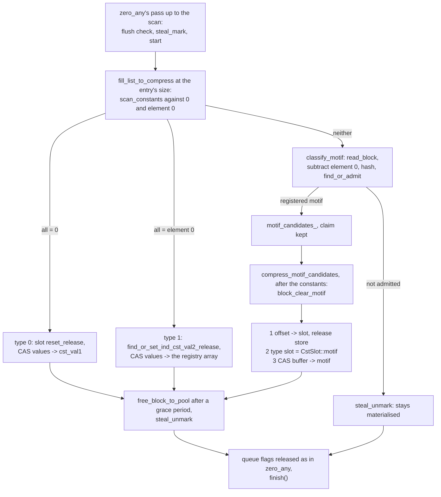
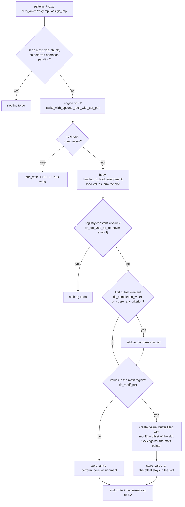

# The pattern::Array algorithm

> French version: [algo_pattern_fr.md](algo_pattern_fr.md).

> Status: end of October 2026. `pattern::Array` is a member of the `zero_any` family: this
> document describes what it does **differently** from `zero_any`, whose machinery it reuses
> in full (second-value registry, write engine, compression pass, read sections), described in
> [algo_zero_any.md](algo_zero_any.md) and [algo_zero_one_value.md](algo_zero_one_value.md). Its
> own lock-free handshake is model-checked: [formal_models.md](formal_models.md),
> section 7. When in doubt, the code is the reference.

***

## 1. What `pattern` compresses

`zero_any` compresses a chunk that is uniform, at any value. A mesh **connectivity** -- the node
numbers of each cell, cell after cell -- is never uniform, yet highly redundant: on a structured
mesh, cell `c + 1` has the node numbers of cell `c` plus one, and a chunk of whole cells is the
chunk before it plus a constant. `pattern::Array<T>` compresses such a chunk to a **motif plus
an offset**: element `j` of the chunk is `motif[j] + offset`, with `motif` a chunk-sized array
**shared** by every chunk (of every array of the type) that has the same shape, and `offset` the
chunk's own value.

| state | `values` points to | the element `j` |
|---|---|---|
| compressed to zero | `zero_any`'s shared constant buffer | 0 |
| compressed to a second value | `zero_any`'s registry array of the value | the value |
| compressed to a motif | an entry of the **motif region** (§3) | `motif[j] + offset` |
| materialised | a buffer owned by the chunk | the buffer's |

A motif is **normalised**: `motif[0] = 0`, so the offset is the chunk's element 0. The
arithmetic wraps on the unsigned type of the same width: a read gives back the exact bits, for
signed types and negative offsets too. Integers only (`static_assert`): a connectivity is
integer, and the wrapping arithmetic has no floating-point equivalent.

The class is `pattern::Array<T, IntType>`, built in the `zero_any` library
(`chunk::chunk_zero_any`, `CHUNK_VARIANT_ZERO_ANY`), static or dynamic geometry. Code:
`chunk/pattern_array.h`, `chunk/pattern_chunk.h`, `internal/pattern_proxy.h`,
`internal/motif_region.h` and their _inline.h companions; the family's shared code branches on
the trait `has_motif_state_v` (`chunk/chunk_traits.h`), always at compile time: `zero_any`'s
machine code is the same with or without `pattern` (checked function by function on its
libraries, benchmark and validation programs).

## 2. Per-chunk metadata: the offset in the second-value slot

`pattern` adds no bytes per chunk. A motif chunk has no second value, so its slot in
`zero_any`'s second-value row (`sizeof(T)`, already there for every chunk) holds its offset. The
alternative, the offset in the chunk object, would cost 8 bytes per chunk and save a cache line
per motif read (the row is another array); it is an open question (§10). Consequences:

- a read of a motif chunk needs the chunk's **index** to find its slot: the reads that know it
  pass the slot (`ArrayChunkBase::operator[]`, the iterator, `read_range`, `for_each_value`,
  the proxy's reads); a motif chunk read without its slot is an invariant failure, except in the
  relaxed scans (the marking filter);
- `CHUNK_SECOND_VALUE_INDEXED` is refused for element types wider than 4 bytes (their slot holds
  a registry identifier, not a `T`);
- a chunk materialised from its motif keeps the offset in its slot -- a reader that loaded the
  motif pointer may still read it (§6) -- and `zero_any`'s heuristics take it for the chunk's
  second value until the next compression: a missed shortcut at worst, never a wrong value.

The constants are `zero_any`'s, in the second-value registry it shares with `pattern` for the
same `T`: each member registers a mark function, and `reclaim_second_values()` frees what no
array of either names any more.

## 3. The motif registry

`internal/motif_region.h`, one per `T`: **one reserved virtual range** (1 GiB by default,
`CHUNK_MOTIF_REGION_BYTES`, `MAP_NORESERVE`: only the pages of the entries written are
touched), so that "this chunk is a motif" is a range test on its `values` pointer, on the read
path of every element.

- **Segments.** The range is cut into segments (64 MiB, `CHUNK_MOTIF_SEGMENT_BYTES`), each owned
  by **one** entry size, handed out on demand: a static build may use them all, the sizes of a
  dynamic build share them. An entry's size is its segment's. No segment left for a size: the
  motif is not registered (`MotifStats::full`) and the chunk stays materialised.
- **Lookup.** A 64-bit hash of the normalised motif (the size mixed in), **confirmed** by
  comparing the arrays, in an open-addressed index read without a lock; a registration takes the
  mutex. A grown index keeps its superseded tables until the next reclaim, so a reader never
  holds a freed table (the technique of `zero_any`'s registry).
- **Admission.** Registering every distinct shape would make random data cost more. A motif is
  registered the **second** time it is seen, **by another chunk**: the first sighting only
  records, in a probation table of 64 Ki entries of 16 bits, 8 more bits of its hash and an
  8-bit tag of the chunk. The same chunk seen again with the same contents (random data
  rewritten unchanged) stays on probation: a motif used by only one chunk saves nothing. A collision
  costs a missed or a useless entry, never a wrong value. With 8 bits instead of 16, the
  dynamic validation found random chunks registering their own motif by collision, one first
  sighting in a few hundred.
- **Reclaim.** `pattern::Array<T>::reclaim_second_values()`, at a sequential point: the
  constants as `zero_any` does, then the motifs no chunk points at; their identifiers are reused, the
  index is rebuilt and the probation table cleared.

## 4. When a chunk becomes a compression candidate

The only signal is the writes, and a connectivity is written once, often in order. To
`zero_any`'s criteria `pattern` adds the **completion rule**: a write of a chunk's **first or last
element** queues it (`pattern::Proxy::is_completion_write()`, in the fast pre-check and in the
predicate). The scan says whether the chunk is really a motif; one queued too early is examined
again at the next write of those positions. The rule also catches the uniform chunks
`zero_any`'s marking misses (a last write landing on an element whose old value was neither
constant). Known limit: a chunk filled in a random order, its first and last elements before
the rest, may stay materialised.

## 5. The compression pass

`zero_any`'s pass, with a third classification. A claimed chunk that is neither of `zero_any`'s
two constants is read in one block, normalised, hashed and submitted to the admission rule
(`Chunk::classify_motif()`); a match keeps the pass's claim. After the constants of the same pass,
`compress_motif_candidates()` compresses each, at its own chunk size, in this order:

1. the offset stored in the chunk's slot (release);
2. the type slot set to `CstSlot::motif`;
3. the values pointer switched by CAS from the buffer to the motif (acq_rel);
4. the buffer released to the pool after the grace period, as for a compression to a constant.

The course of the pass; the steps up to the scan are those of `zero_any`
([algo_zero_any.md](algo_zero_any.md) §5), compressed here:

`find_or_admit` returns a motif only from its second sighting, by another chunk (§3); the motif
CAS is made on a claimed chunk, and its failure is an invariant failure. The two constants use
the release forms of the slot writes (`reset_release`, `find_or_set_ind_cst_val2_release`), for
the readers of §6.

## 6. The read, and the rewrites of the slot

A reader loads the pointer, then the offset: two words. The slot is rewritten by a compression
pass, **before** its CAS: to a new offset (a compression to a motif), to a second value or to 0
(a compression to a constant). A reader holding an old motif pointer could then add another
state's slot to its motif -- a value the chunk never held. The read sections' grace period does
not help: it protects the buffer the pass frees, not the slot. The reduced GenMC model found it
in two executions (F5, [formal_models.md](formal_models.md) section 8.6); the rule as
implemented:

- the reader loads the slot with **acquire**, then the pointer **again**
  (`Chunk::motif_offset()`): if unchanged, the offset belongs to the state the two loads bracket;
  if it moved, it starts over;
- every rewrite of the slot of a chunk of a member with the motif state is a **release** atomic
  store (`SecondValueRef::reset_release()`, `set_from_array_release()`), made after the pass saw
  the materialised buffer: a reader that sees the new slot cannot see the old pointer again;
- the slot first, the pointer second; an ABA (compressed back to the same motif) is harmless.

Checked for every target, up to 3 readers or 3 reads, under RC11 and IMM; each part of the rule is
load-bearing (the model's mutations). Cost: one acquire load and a second load of the pointer,
from the same cache line, on the read of a motif chunk only.

## 7. The write

`zero_any`'s write path. A write into a motif chunk **materialises** it: a buffer filled with
`motif[j] + offset`, published by CAS against the motif pointer (a lost CAS recycles the buffer).
The slot is stable there, and the fill reads it once: the pass that marked the chunk stays
parked on the writer's flag (handshake 1) until `end_write`. `wait_before_materialise()` returns
at once on this path; its wait loop serves the callers without a flag (`alloc_chunk`, a flush
replay). The offset stays in the slot (§2).

The course of a write in an OpenMP build: the engine steps are those of §7.2 of
[algo_zero_one_value.md](algo_zero_one_value.md), the body that of `zero_any` (§6 of
[algo_zero_any.md](algo_zero_any.md)), both compressed here; the diagram shows where `pattern`
differs.

The completion rule widens both the pre-check (`pattern::Proxy::pre_check_mark_for_compression`)
and the predicate (`should_mark_for_compression`). On a motif chunk the old value the marking
reads is `motif[num] + offset`, through `Chunk::motif_offset()`.

## 8. Dynamic geometry: the rechunk and the advisor

A motif has its chunk's element count; the region holds one segment set per size (§3), and the
pass compresses each candidate at its own size.

- **Rechunk.** `rechunk_to()` rebuilds the array from the old chunks' values: a motif chunk is
  read as its motif plus its offset, never as `zero_any`'s "same second constant" shortcut
  (`is_cst_val2()` holds for a motif chunk since, for the write engine, it is compressed). The
  rebuilt chunks, written through the proxies, are queued by the completion rule and compressed
  to motifs of the new size by the next pass.
- **Advisor.** `ChunkSizeAdvisor` reads a motif chunk as data (motif plus offset), never as a
  constant: its constant forecasts are those `zero_any` makes on the same values. It forecasts
  no motif compression (§10): never optimistic.

## 9. Results

`shrink_bench` carries a mesh connectivity, `tab_conn` (`examples/shrink_bench/bench_phase_conn.cpp`,
`--no_conn` to leave it out): about `sz / 32` ints by default (`--conn_scale`), whole rows of 256
hexahedral cells; each iteration
gathers one band of rows in 16 and renumbers it (the node order rotated, or put back), so the
pass compresses a band to another shared motif at every iteration. It is a `pattern::Array<int>`
in the `zero_one_value` and `zero_any` builds (its machinery is `zero_any`'s, header-only: it
lives in either library), a `zero::Array<int>` in a `zero` build, a vector in the baseline; its
checksums are checked against the baseline's at every checkpoint, like every other array. On a
check run (`--divisor 50 --iter_max 40`, 4 threads), 384 of its 385 chunks are compressed in both
builds (1,536 of 1,537 at the dynamic size 64); the `zero` build compresses one.

`examples/access_cost/access_cost_pattern.cpp` (`access_cost_pattern_<size>`) times a
`std::vector<long>`, a `zero_any::Array<long>` and a `pattern::Array<long>` in the same binary,
and prints the memory of the connectivity of a structured hexahedral mesh (256 cells wide, 8
nodes per cell) in each. Indicative, on a shared 8-core container, 2^24 elements, chunk 256
(the reference runs remain to be made on the target machine):

| | vector | `zero_any` | `pattern` |
|---|---|---|---|
| connectivity memory | 134 MB | 136 MB (101 %) | 1.6 MB (1.2 %): 1 chunk materialised, 65,535 motif chunks, 1 motif |
| read-varied, 8 threads (ns per element) | 0.46 | 2.34 | 2.36 |
| read-conn, 8 threads | 0.46 | 2.35 | 1.60 |
| read-conn-random, 8 threads | 5.66 | 17.7 | 4.15 |
| write-conn, 8 threads | 4.79 | 8.61 | 9.51 |

The motif range test costs a materialised read almost nothing (read-varied); a motif read is
faster than `zero_any`'s materialised one, and a random one faster than the vector's, the motif
staying in cache; the write pays the classification of the chunks.

## 10. Limits and open points

- **Where the offset lives** (§2): the slot, against the chunk object (+8 bytes per chunk, a
  cache line fewer per motif read); to be measured with `access_cost_pattern` on motif-heavy reads.
- **The advisor's motif forecast** (§8): at a candidate size, a window would be compressed to a
  motif if its normalised content is shared with another window. An estimate from the sampled
  chunks is cheap, but changes `ChunkSizeEstimate` (a public struct) and the decider.
- **Motifs shorter than a chunk** (a stride that does not divide the chunk size, an offset growing
  inside the chunk) are not covered: `chunk[j] = P[j mod s] + (j div s) * step` would be a
  second kind of motif. Measure on real connectivities first.
- **`CHUNK_SECOND_VALUE_INDEXED`** is refused for types wider than 4 bytes (§2).
- **Random fill order** (§4) and **one entry size per segment** (§3).
