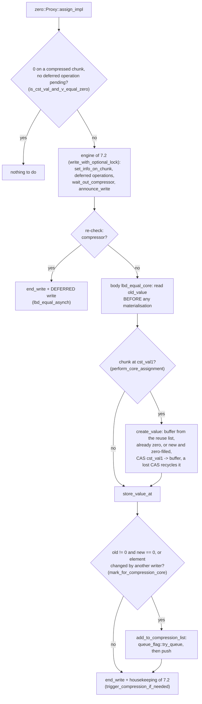
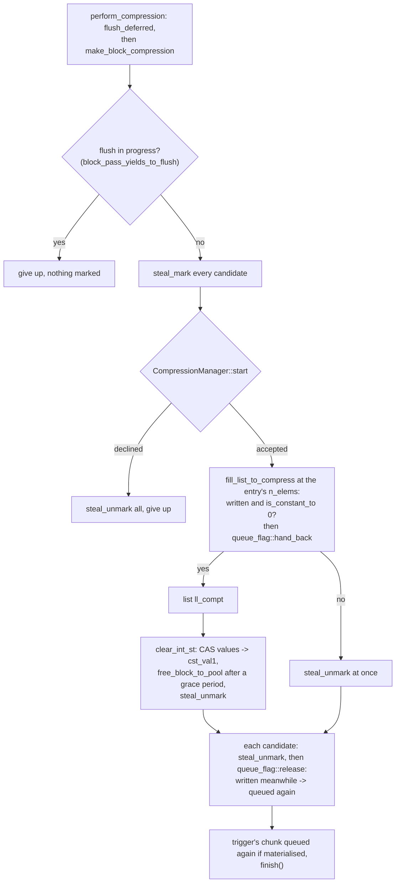

# The zero::Array algorithm

> French version: [algo_zero_fr.md](algo_zero_fr.md).

> Status: end of September 2026. This document describes what `zero` does **differently** from `zero_one_value`; the
> common machinery (proxies, deferred writes, read barrier, in-flight compression,
> range operations) is described in [algo_zero_one_value.md](algo_zero_one_value.md), and the
> dynamic geometry in [adaptive_rechunk.md](adaptive_rechunk.md). When in
> doubt, the code is the reference.

***

## 1. What `zero` compresses

`zero` is the simplest of the three variants: a chunk is either **compressed to zero** (`T{}`) or
**materialised**. There is no second value, either per array (`zero_one_value`) or per chunk
(`zero_any`).

| state | `values` points to | test |
|---|---|---|
| compressed | the shared constant buffer `cst_val1`, filled with zeros | `is_cst_val1()` |
| materialised | a buffer owned by the chunk | `written()`, that is `values != cst_val1` |

The `values` pointer therefore holds both the data and the state. A chunk does not know its
own number of elements: the geometry lives in the array's size policy
(`size_policy_`), which is why the lists of compression candidates carry the
number of elements of each chunk (see `TChunk.h`).

The library: `chunk::chunk_zero` (it defines `CHUNK_VARIANT_ZERO`). Code: `chunk/zero_chunk.h`, `chunk/zero_array.h`,
`internal/zero_chunk_inline.h`, `internal/zero_array_inline.h`, `internal/zero_proxy.h`.

## 2. What a chunk costs

The chunk object is 16 bytes (in OpenMP builds, where the zero counter of the sequential
mode is an empty type, see §4), plus one "already in compression list" byte and two
bytes of the *dirty bitset* (one bit, in a 64-bit word padded to 128 bytes). With no second value, `zero` has **no type or value
metadata** per chunk: it is the variant with the least metadata, and the one whose
memory is most made up of **materialised data**. On `shrink_bench` at 64 threads,
about 38 GB of its 40 GB is data.

## 3. Read and write

The read is the same as in `zero_one_value` (§5 of [algo_zero_one_value.md](algo_zero_one_value.md)): one value,
read from the chunk's buffer or from `cst_val1`, after the read barrier.

The write goes through the `Proxy<T>` proxy:

- writing **zero** into a compressed chunk: nothing to do, unless a deferred write is pending on
  the chunk (`pending_any()`): the write then goes through the engine;
- writing **another value** into a compressed chunk: the chunk is **materialised** (a
  buffer taken from the thread's reuse list, already zero since a chunk is only compressed when
  all-zero, or newly allocated and zero-filled; published by CAS), then the value is written;
- writing into a materialised chunk: a plain write.

The course of a write in an OpenMP build: the engine steps are those of §7.2 of
[algo_zero_one_value.md](algo_zero_one_value.md), compressed here; the rest is what `zero` does
in its own way.

In sequential builds there is no engine and no candidate list: `assign_impl` maintains the zero
counter itself (`inc_nb_val_eq_zero`, `dec_nb_val_eq_zero`), compresses the chunk at once when
it becomes all-zero (`manage_full_zero`), and otherwise materialises it (`create_value`) and
stores directly.

## 4. When a chunk becomes a compression candidate

**Sequential builds**: each chunk keeps a **zero counter**
(`ChunkCounterPolicy`, `nb_val_eq_zero_`). When it reaches the chunk's number of elements, the
chunk is compressed at once (`manage_full_zero`). This counter must be exactly
in sync with the content: an out-of-sync counter would compress a chunk that is not
uniform, hence the care taken to propagate it in copies.

**OpenMP builds**: no counter. A write that changes an element **from a non-zero
value to zero** (`should_mark_for_compression`) puts the chunk in the thread's **candidate list**,
unless it is already there (the "already in list" byte). The same path also marks the
chunk when it detects that another thread wrote to the same place at the same time (the value in
memory is no longer the expected one).

## 5. The block compression pass

When a thread's list exceeds the trigger threshold (§6), a
`make_block_compression` pass runs:

1. if a flush of the deferred writes is in progress, the pass **gives up before touching the
   candidates** (`block_pass_yields_to_flush`, `block_pass_precheck.h`). At 128 threads on
   Grace, marking then unmarking the candidates on each refused attempt cost 10 million
   rounds and doubled the run time;
2. each candidate is **reserved** (`steal_mark`), before the compression window
   opens (`CompressionManager::start()`), whose barrier publishes the reservations;
3. `fill_list_to_compress` re-reads each candidate and keeps only those that are **entirely
   zero**; the others are unmarked at once, and every scanned candidate's queue flag is handed
   back (`queue_flag::hand_back`);
4. each of these is compressed (`clear_int_st`: `values` goes back to `cst_val1` by CAS, and
   the buffer joins the reuse list after the read sections' grace period);
5. the remaining reservations are released, then the queue flags (`queue_flag::release`): a
   candidate written meanwhile is queued again, and so is the chunk of the write that triggered
   the pass if it is materialised.

A candidate list mixes the chunks of **all the arrays** of the same type, which
can have different sizes after a rechunk: each chunk is compressed with
**its own** number of elements, carried by the list entry.

The course of the pass, in the style of §8.4 of [algo_zero_one_value.md](algo_zero_one_value.md):

What differs from `zero_one_value`: one candidate list per rank
(`chunk_to_compress_potentially_thr`), not one per second value, and a single target constant,
hence a single output list. Sequential builds have no pass (`make_block_compression` is empty
there): the zero counter compresses (§4).

## 6. The trigger threshold

It is `somme_chunk_create / (100 × number of threads)`, with a floor of 100 candidates
(`ChunkDef`: `factor_div_nb_chunk_for_compress`, `size_min_list_chunk_to_check_compress`).
`somme_chunk_create` is the number of existing chunks of this type. Two fixes from
September 2026 keep it accurate:

- it is **decremented** when an array is destroyed (otherwise it only ever grew:
  a threshold of 390 at the start of a run, ~42,000 at the end, and almost no compression left);
- the threshold is **recomputed** on destruction as well as on creation.

At 64 threads, the computation almost always lands on the floor: the floor is what sets the
frequency of the passes.

## 7. What `zero` does differently during a rechunk

The general sequence is the one in [adaptive_rechunk.md](adaptive_rechunk.md) §4. Two
differences stem from the volume of data in `zero`:

- **the rebuild in slices** (16): each slice
  frees the old chunks it has copied, and between two slices, the reserves of the
  old size are drained and the emptied slabs given back to the system. Peak of the
  rebuild at 64 threads: +6.9 GB in one pass, +1.7 GB in 16 slices;
- **eager affinity by default**: each large array has its own slabs from its
  creation, so that the slices can really empty them. With lazy affinity, the
  first rechunk starts from slabs shared between arrays, which do not empty: a peak of 45.6 GB
  instead of 41.2 GB, for the same final memory.

## 8. Results and limits

On `shrink_bench` (64 threads), dynamic `zero` ends at **40.3 GB**, like static 256
(40.2 GB), and 0.6 GB above static 1,024 (39.7 GB), the size it reaches. Two
reasons for this small gain:

- its metadata is already small, and growing the chunks mostly saves
  metadata;
- after its rechunk, dynamic `zero` **slows down** (1.5 to 2 times slower per iteration than
  static 1,024), for a reason still unknown: a dynamic build started directly at
  1,024 runs as fast as the static one, and `zero_one_value` does not slow down after its rechunks.

For a workload like the benchmark's, a **static** `zero` at the right size is still the
best choice today.
