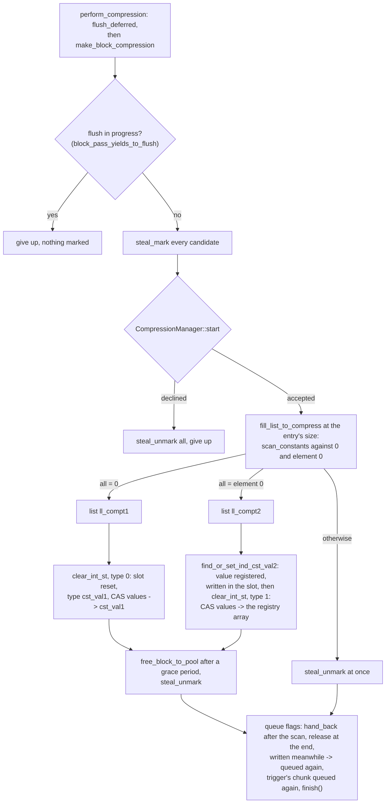
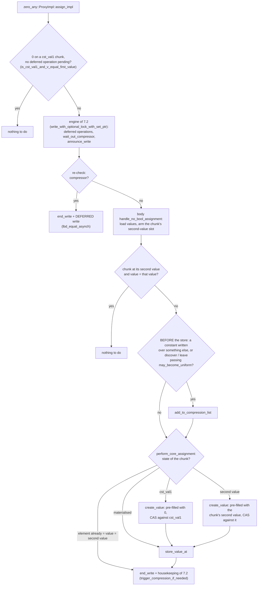

# The zero_any::Array algorithm

> French version: [algo_zero_any_fr.md](algo_zero_any_fr.md).

> Status: end of September 2026. This document describes what `zero_any` does **differently** from `zero_one_value`;
> the common machinery (proxies, deferred writes, read barrier, in-flight compression,
> range operations) is described in [algo_zero_one_value.md](algo_zero_one_value.md), and the
> dynamic geometry in [adaptive_rechunk.md](adaptive_rechunk.md). When in
> doubt, the code is the reference.

***

## 1. What `zero_any` compresses

`zero_one_value` compresses to zero or to **one** second value, declared for the whole array. `zero_any`
compresses to zero or to **any value**, chosen **chunk by chunk**: a chunk
uniform at 3.5 and its neighbour uniform at −1 are both compressed, without declaring anything.

| state | type (1 byte per chunk) | `values` points to |
|---|---|---|
| compressed to zero | 0 | the shared constant buffer `cst_val1` |
| compressed to a second value | 1 | the shared array of the **registry** filled with this value (§3) |
| materialised | — | a buffer owned by the chunk |

A chunk compressed to a second value therefore owns no buffer: it points to a
read-only array, shared by **all** the chunks, of all the arrays of the same type,
that have this value. The read is exactly the same as in the other variants.

The library: `chunk::chunk_zero_any` (it defines `CHUNK_VARIANT_ZERO_ANY`). Code: `chunk/zero_any_chunk.h`, `chunk/zero_any_array.h`,
`internal/zero_any_chunk_inline.h`, `internal/zero_any_array_inline.h`, `internal/zero_any_proxy.h`,
`internal/zero_any_proxy_inline.h`, `internal/tab_cst_val2_holder.h`.

## 2. Per-chunk metadata

Each array has, indexed by its number (`num_tab`), three rows with one entry per chunk:

| row | size per chunk | content |
|---|---|---|
| `tab_type_cst_val` | 1 byte | the constant type (0 or 1) |
| `tab_second_value` | `sizeof(T)` bytes by default | the chunk's second value |
| `tab_is_inside_chunk_list_to_compress` | 1 byte | "already in compression list" |

With the CMake option **`CHUNK_SECOND_VALUE_INDEXED`** (disabled by default), the second-value
slot of types larger than 4 bytes holds the **identifier** of the registry array
(4 bytes) instead of the value (8 for a `double`, 16 for a complex): −3.8% memory
on the reference run of 50 million chunks, but +3% write time (one more dependent
read on each write to a materialised chunk). Reserve it for workloads limited
by memory rather than by write throughput.

These rows make `zero_any` the variant with the most expensive metadata per chunk (16 bytes
of object, plus 2 bytes and `sizeof(T)`), and therefore the one that gains the most from growing its chunks:
see [adaptive_rechunk.md](adaptive_rechunk.md).

When a storage is destroyed (the array's end of life, or the old storage of a rechunk), its
three rows are **freed** (`zero_any::Proxy::clear_tab_is_int`), not just emptied. Until
September 2026, `clear()` kept their capacity, and each rechunk left the rows of
the old storage behind: 3.5 GB on the benchmark, with 15 rechunked arrays.

## 3. The second-value registry

`tab_cst_val2_holder.h`. For each element type, a registry **unique to the process**
(`GlobalVecHolder`) holds an array filled with each distinct second value encountered.

- It is organised as chained **segments of 64 slots**, rather than as a resizable
  array: registering a new value never invalidates a pointer that another
  thread holds.
- Finding a value that is **already known** (the case for every chunk after the first one for each
  value) is a **lock-free** lookup in a hashed index. Only a truly
  new value takes the insertion lock (`insert_mutex`).
- An array is **filled before it is published** (write with *release* semantics): a
  chunk adopts it only by installing it as its `values` pointer.
- To know whether a chunk is compressed to a second value, it is enough to test whether its
  pointer falls within the registry **region** (`region_contains`).
- A value, once registered, stays until the last array of the type is destroyed, **or**
  until `reclaim_second_values()` runs at a sequential point: it marks the values still
  referenced (chunks compressed to them, per-chunk second-value slots) over every array of
  the type and frees the others, whose identifiers are then reused. Without it, a workload
  that produces a very large number of distinct values makes the registry grow until its
  identifiers run out, which stops the run. In the benchmark, `CHUNK_BENCH_ULONG_BANDS`
  limits the number of distinct values of the `unsigned long` array, `CHUNK_LOG=compress=info`
  prints the state of the registry and `CHUNK_CST2_RECLAIM=N` reclaims every N iterations.

`find_or_set_ind_cst_val2(value, slot)` registers the value if needed, writes it into the
chunk's second-value slot, and returns the shared array to install.

## 4. When a chunk becomes a compression candidate

In addition to the criterion common to the two-constant variants (a write of one of the
chunk's constants over something else), `zero_any` puts a chunk in the list in two cases of
its own:

- **discovery**: a write of a non-zero value into a chunk that does not yet have a
  second value; this is how it discovers one;
- **change**: in a chunk that has a second value, a write of a value other than this
  second value, different from the value it replaces. The chunk may be becoming uniform at
  a third value, regardless of what the last write replaced: a region painted over another one ends
  with writes over values that are neither constant. Do not narrow it to writes that leave
  the second value: a chunk compressed once at V, then made uniform at W over other values,
  would never be put back in the list (`mark_path_validation`, scenario D).

Both cases are filtered by a **necessary condition** (`may_become_uniform`): two
other elements of the chunk (the first and the last, or their neighbours if one of them is
the written element) already hold the written value. Without this filter, a chunk of varied data
was put in the list, re-read, found non-uniform, removed, then put back in the list by the next
write: ~3 µs per write on `shrink_bench_omp_zero_any_256` at 64 threads.

## 5. The compression pass

Same sequence as for the other variants (reservation of the candidates, compression window,
re-read), with two lists at the end of the re-read (`fill_list_to_compress`, which compares
each element with the first element of the chunk):

- chunks **uniform at zero** are compressed to type 0: `values` goes back to `cst_val1`;
- chunks **uniform at another value** are compressed to type 1:
  `find_or_set_ind_cst_val2` registers the value and returns the shared array, which
  `clear_int_st` installs by CAS as the chunk's `values` pointer.

The freed buffer joins the thread's reuse list after the read sections' grace period. The
trigger threshold is
`somme_chunk_create / (50 × number of threads)`, with a floor of 500 candidates (constants of
`zero_any_chunk_def.h`).

The course of the pass, in the style of §8.4 of [algo_zero_one_value.md](algo_zero_one_value.md):

What differs from `zero_one_value`: one candidate list per rank
(`get_chunk2a_to_compress_potentially`), not one per second value; the second constant is the
chunk's element 0, registered only now; the chunk's metadata (slot, type) is written **before**
the CAS (`block_clear_common`). Sequential builds run the same pass, without the marks and
without `start` / `finish`.

## 6. The write

The write path is that of `zero_one_value` (§6 of [algo_zero_one_value.md](algo_zero_one_value.md)), with
these differences:

- the second value to compare against is **the chunk's**, read from its metadata row, and not
  the array's;
- no second-value shortcut before the engine: writing the chunk's second value is a no-op inside
  the write body, when the chunk is compressed to it (`handle_no_bool_assignment`) or the element
  already holds it (`perform_core_assignment`);
- the chunk is marked **before** the store (`mark_for_compression_before_store`), with the
  criteria of §4;
- writing a value different from its constant into a compressed chunk materialises it,
  pre-filled with **this constant**, behind `wait_before_materialise`;
- in sequential builds, the engine calls `perform_compression` after every write; it does
  nothing below half the trigger threshold.

The proxy finds the chunk's metadata rows through the array number. An
"armed" variant, where the write `operator[]` gave the proxy the row addresses directly,
was removed: its gain (~0.4% on `shrink_bench_omp_zero_any_256` at 64 threads) did not justify
the resynchronisation invariant it imposed on each reallocation of the rows.

The course of a write in an OpenMP build: the engine steps are those of §7.2 of
[algo_zero_one_value.md](algo_zero_one_value.md), compressed here; the rest is where `zero_any`
differs (for `bool`, `handle_bool_assignment` plays the same part, with `true` as the second
value).

`wait_before_materialise` returns at once on this path (the writer's own flag is on the chunk),
and a lost CAS in `create_value` recycles the buffer.

## 7. What `zero_any` does differently during a rechunk

The general sequence is the one in [adaptive_rechunk.md](adaptive_rechunk.md) §4, with
three differences:

- **the advisor counts as compressible** any uniform sub-block, at any value,
  since each chunk can register its own. With the rule of the other variants
  (only zero or the array's second value), its predictions towards finer sizes
  were off by +80%;
- **direct installation of constants**: a new chunk whose sources are all at
  the **same** second value receives it directly (registration in the registry, type 1,
  second-value slot), with no buffer and no copy. The fill phase goes from 35 to
  5 ms, and up to 640 MB of touched pages per array are avoided;
- **lazy affinity** by default: an array gets its own slabs only at its first
  rechunk, which makes a dynamic run start exactly like the static one at the same size.

## 8. Results

On `shrink_bench` (64 threads), dynamic `zero_any`, with all arrays handed to the
decider, ends at **6.0 GB**, compared with 7.3 GB for static 256 and 12.7 GB for static
64, whose memory it has at the start. It is the variant that benefits the most from the dynamic
geometry: its per-chunk metadata is the heaviest, and its chunks compressed to
varied values make the fine sizes useful at the start.
