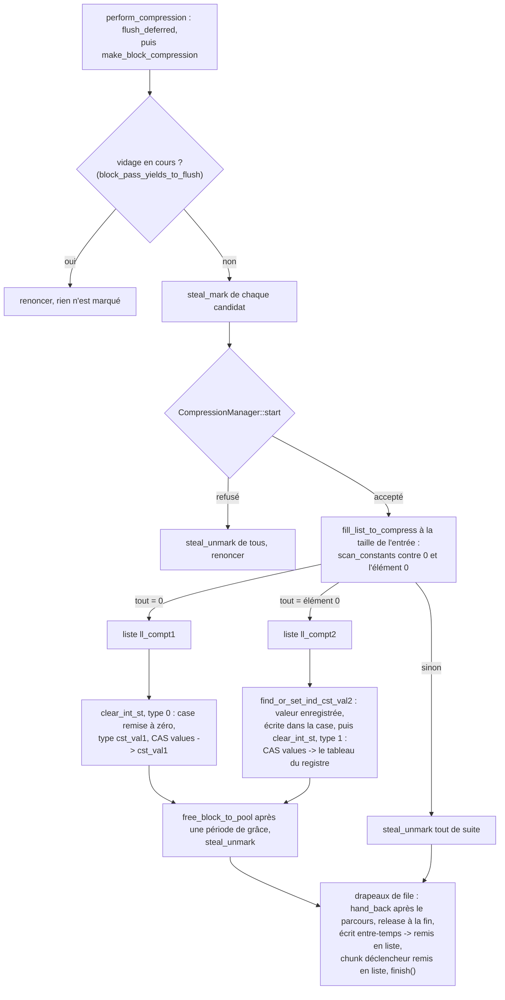
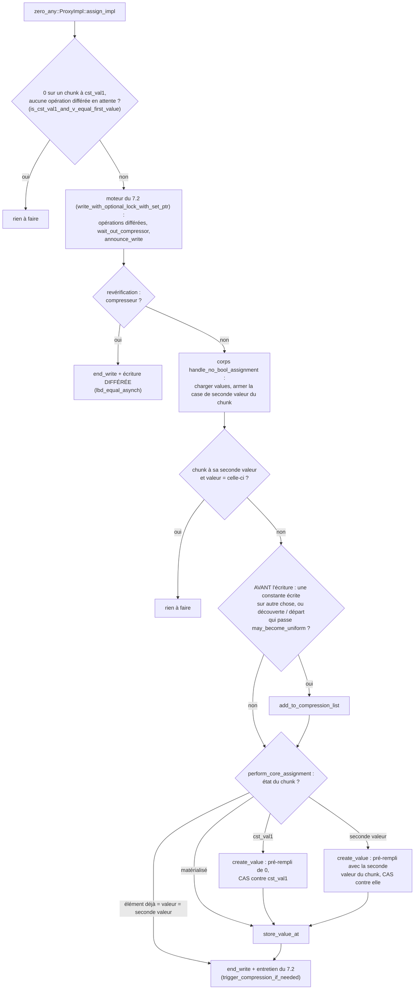

# L'algorithme de zero_any::Array

> English version: [algo_zero_any.md](algo_zero_any.md).

> État : fin septembre 2026. Ce document décrit ce que `zero_any` fait **autrement** que `zero_one_value` ;
> la machinerie commune (proxys, écritures différées, barrière de lecture, compression en vol,
> opérations sur plages) est décrite dans [algo_zero_one_value_fr.md](algo_zero_one_value_fr.md), et la
> géométrie dynamique dans [rechunk_adaptatif_fr.md](rechunk_adaptatif_fr.md). En cas de
> doute, c'est le code qui fait foi.

***

## 1. Ce que `zero_any` compresse

`zero_one_value` compresse à zéro ou à **une** seconde valeur, déclarée pour tout le tableau. `zero_any`
compresse à zéro ou à **n'importe quelle valeur**, choisie **chunk par chunk** : un chunk
uniforme à 3,5 et son voisin uniforme à −1 sont tous les deux compressés, sans rien déclarer.

| état | type (1 octet par chunk) | `values` pointe vers |
|---|---|---|
| compressé à zéro | 0 | le tampon constant partagé `cst_val1` |
| compressé à une seconde valeur | 1 | le tableau partagé du **registre** rempli de cette valeur (§3) |
| matérialisé | — | un tampon propre au chunk |

Un chunk compressé à une seconde valeur ne possède donc pas de tampon : il pointe vers un
tableau en lecture seule, partagé par **tous** les chunks, de tous les tableaux du même type,
qui ont cette valeur. La lecture est exactement celle des autres variantes.

La bibliothèque : `chunk::chunk_zero_any` (elle définit `CHUNK_VARIANT_ZERO_ANY`). Code : `chunk/zero_any_chunk.h`, `chunk/zero_any_array.h`,
`internal/zero_any_chunk_inline.h`, `internal/zero_any_array_inline.h`, `internal/zero_any_proxy.h`,
`internal/zero_any_proxy_inline.h`, `internal/tab_cst_val2_holder.h`.

## 2. Les métadonnées par chunk

Chaque tableau a, indexées par son numéro (`num_tab`), trois lignes d'une entrée par chunk :

| ligne | taille par chunk | contenu |
|---|---|---|
| `tab_type_cst_val` | 1 octet | le type de constante (0 ou 1) |
| `tab_second_value` | `sizeof(T)` octets par défaut | la seconde valeur du chunk |
| `tab_is_inside_chunk_list_to_compress` | 1 octet | « déjà en liste de compression » |

Avec l'option CMake **`CHUNK_SECOND_VALUE_INDEXED`** (désactivée par défaut), l'emplacement de
seconde valeur des types de plus de 4 octets contient l'**identifiant** du tableau du registre
(4 octets) au lieu de la valeur (8 pour un `double`, 16 pour un complexe) : −3,8 % de mémoire
sur le run de référence de 50 millions de chunks, mais +3 % de temps d'écriture (une lecture
dépendante de plus à chaque écriture d'un chunk matérialisé). À réserver aux calculs limités
par la mémoire plutôt que par le débit d'écriture.

Ces lignes font de `zero_any` la variante la plus chère en métadonnées par chunk (16 octets
d'objet, plus 2 octets et `sizeof(T)`), et donc celle qui gagne le plus à grossir ses chunks :
voir [rechunk_adaptatif_fr.md](rechunk_adaptatif_fr.md).

Quand un stockage est détruit (fin de vie du tableau, ou ancien stockage d'un rechunk), ses
trois lignes sont **libérées** (`zero_any::Proxy::clear_tab_is_int`), pas seulement vidées. Jusqu'en
septembre 2026, `clear()` gardait leur capacité, et chaque rechunk laissait les lignes de
l'ancien stockage derrière lui : 3,5 Go sur le banc, avec 15 tableaux rechunkés.

## 3. Le registre des secondes valeurs

`tab_cst_val2_holder.h`. Pour chaque type d'élément, un registre **unique au processus**
(`GlobalVecHolder`) contient un tableau rempli de chaque seconde valeur distincte rencontrée.

- Il est organisé en **segments de 64 emplacements** chaînés, plutôt qu'en tableau
  redimensionnable : enregistrer une nouvelle valeur n'invalide jamais un pointeur qu'un autre
  thread détient.
- Retrouver une valeur **déjà connue** (le cas de tous les chunks après le premier pour chaque
  valeur) est une recherche **sans verrou** dans un index haché. Seule une valeur réellement
  nouvelle prend le verrou d'insertion (`insert_mutex`).
- Un tableau est **rempli avant d'être publié** (écriture avec sémantique *release*) : un
  chunk ne l'adopte qu'en l'installant comme son pointeur `values`.
- Pour savoir si un chunk est compressé à une seconde valeur, il suffit de tester si son
  pointeur tombe dans la **région** du registre (`region_contains`).
- Une valeur enregistrée reste jusqu'à la destruction du dernier tableau du type, **ou**
  jusqu'à un appel à `reclaim_second_values()` en point séquentiel : il marque les valeurs
  encore référencées (chunks compressés à elles, emplacements de seconde valeur par chunk)
  sur tous les tableaux du type et libère les autres, dont les identifiants sont ensuite
  réutilisés. Sans lui, un calcul qui produit un très grand nombre de valeurs distinctes
  fait grossir le registre jusqu'à épuiser ses identifiants, ce qui arrête le run. Dans le
  banc, `CHUNK_BENCH_ULONG_BANDS` limite le nombre de valeurs distinctes du tableau
  `unsigned long`, `CHUNK_LOG=compress=info` affiche l'état du registre et
  `CHUNK_CST2_RECLAIM=N` libère toutes les N itérations.

`find_or_set_ind_cst_val2(valeur, emplacement)` enregistre la valeur si besoin, l'écrit dans
l'emplacement de seconde valeur du chunk, et rend le tableau partagé à installer.

## 4. Quand un chunk devient candidat à la compression

En plus du critère commun aux variantes à deux constantes (une écriture de l'une des
constantes du chunk par-dessus autre chose), `zero_any` met un chunk en liste dans deux cas qui
lui sont propres :

- **découverte** : une écriture d'une valeur non nulle dans un chunk qui n'a pas encore de
  seconde valeur ; c'est ainsi qu'il en découvre une ;
- **départ** : une écriture qui **quitte** la seconde valeur du chunk vers une valeur qui
  n'est ni zéro ni cette seconde valeur. Le chunk est peut-être en train de devenir uniforme à
  une troisième valeur ; sans ce cas, un chunk compressé une fois à V, puis devenu uniforme à W,
  n'était plus jamais remis en liste (100 sur 100 dans une sonde de septembre 2026).

Ces deux cas sont filtrés par une **condition nécessaire** (`may_become_uniform`) : deux
autres éléments du chunk (le premier et le dernier, ou leurs voisins si l'un d'eux est
l'élément écrit) contiennent déjà la valeur écrite. Sans ce filtre, un chunk de données variées
était mis en liste, relu, trouvé non uniforme, retiré, puis remis en liste par l'écriture
suivante : ~3 µs par écriture sur `shrink_bench_omp_zero_any_256` à 64 threads.

## 5. La passe de compression

Même déroulé que pour les autres variantes (réservation des candidats, fenêtre de compression,
relecture), avec deux listes à l'issue de la relecture (`fill_list_to_compress`, qui compare
chaque élément au premier élément du chunk) :

- les chunks **uniformes à zéro** sont compressés au type 0 : `values` repasse à `cst_val1` ;
- les chunks **uniformes à une autre valeur** sont compressés au type 1 :
  `find_or_set_ind_cst_val2` enregistre la valeur et rend le tableau partagé, que
  `clear_int_st` installe par CAS comme pointeur `values` du chunk.

Le tampon libéré rejoint la liste de réutilisation du thread après la période de grâce des
sections de lecture. Le seuil de déclenchement vaut
`somme_chunk_create / (50 × nombre de threads)`, avec un plancher de 500 candidats (constantes de
`zero_any_chunk_def.h`).

Le déroulé de la passe, dans le style du §8.4 de [algo_zero_one_value_fr.md](algo_zero_one_value_fr.md) :

Ce qui diffère de `zero_one_value` : une liste de candidats par rang
(`get_chunk2a_to_compress_potentially`), et non une par seconde valeur ; la seconde constante est
l'élément 0 du chunk, enregistré seulement à ce moment ; les métadonnées du chunk (case, type)
sont écrites **avant** le CAS (`block_clear_common`). Les builds séquentiels exécutent la même
passe, sans les marques et sans `start` / `finish`.

## 6. L'écriture

Le chemin d'écriture est celui de `zero_one_value` (§6 de [algo_zero_one_value_fr.md](algo_zero_one_value_fr.md)), à
ces différences près :

- la seconde valeur à comparer est celle **du chunk**, lue dans sa ligne de métadonnées, et non
  celle du tableau ;
- pas de raccourci de seconde valeur avant le moteur : écrire la seconde valeur du chunk est sans
  effet dans le corps de l'écriture, quand le chunk y est compressé (`handle_no_bool_assignment`)
  ou que l'élément la tient déjà (`perform_core_assignment`) ;
- le chunk est marqué **avant** l'écriture (`mark_for_compression_before_store`), selon les
  critères du §4 ;
- écrire dans un chunk compressé une valeur différente de sa constante le matérialise,
  pré-rempli avec **cette constante**, derrière `wait_before_materialise` ;
- en build séquentiel, le moteur appelle `perform_compression` après chaque écriture ; elle ne
  fait rien sous la moitié du seuil de déclenchement.

Le proxy trouve les lignes de métadonnées du chunk par le numéro du tableau. Une variante
« armée », où l'`operator[]` d'écriture donnait directement au proxy les adresses des lignes,
a été retirée : son gain (~0,4 % sur `shrink_bench_omp_zero_any_256` à 64 threads) ne justifiait pas
l'invariant de resynchronisation qu'elle imposait à chaque réallocation des lignes.

Le déroulé d'une écriture dans un build OpenMP : les étapes du moteur sont celles du §7.2 de
[algo_zero_one_value_fr.md](algo_zero_one_value_fr.md), résumées ici ; le reste est ce en quoi
`zero_any` diffère (pour `bool`, `handle_bool_assignment` joue le même rôle, avec `true` comme
seconde valeur).

`wait_before_materialise` rend la main tout de suite sur ce chemin (le drapeau de l'écrivain
lui-même est sur le chunk), et un CAS perdu dans `create_value` recycle le tampon.

## 7. Ce que `zero_any` fait autrement pendant un rechunk

Le déroulé général est celui de [rechunk_adaptatif_fr.md](rechunk_adaptatif_fr.md) §4, avec
trois particularités :

- **l'advisor compte comme compressible** tout sous-bloc uniforme, à n'importe quelle valeur,
  puisque chaque chunk peut enregistrer la sienne. Avec la règle des autres variantes
  (seulement zéro ou la seconde valeur du tableau), ses prévisions vers les tailles plus fines
  se trompaient de +80 % ;
- **l'installation directe des constantes** : un nouveau chunk dont toutes les sources sont à
  la **même** seconde valeur la reçoit directement (enregistrement dans le registre, type 1,
  emplacement de seconde valeur), sans tampon ni copie. La phase de remplissage passe de 35 à
  5 ms, et on évite jusqu'à 640 Mo de pages touchées par tableau ;
- **l'affinité paresseuse** par défaut : un tableau n'a ses propres slabs qu'à son premier
  rechunk, ce qui fait démarrer un run dynamique exactement comme le statique à la même taille.

## 8. Résultats

Sur `shrink_bench` (64 threads), `zero_any` dynamique, avec tous les tableaux confiés au
décideur, finit à **6,0 Go**, contre 7,3 Go pour le statique 256 et 12,7 Go pour le statique
64, dont il a la mémoire au départ. C'est la variante qui profite le plus de la géométrie
dynamique : ses métadonnées par chunk sont les plus lourdes, et ses chunks compressés à des
valeurs variées rendent les tailles fines utiles au départ.
