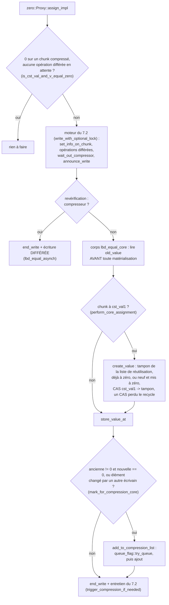
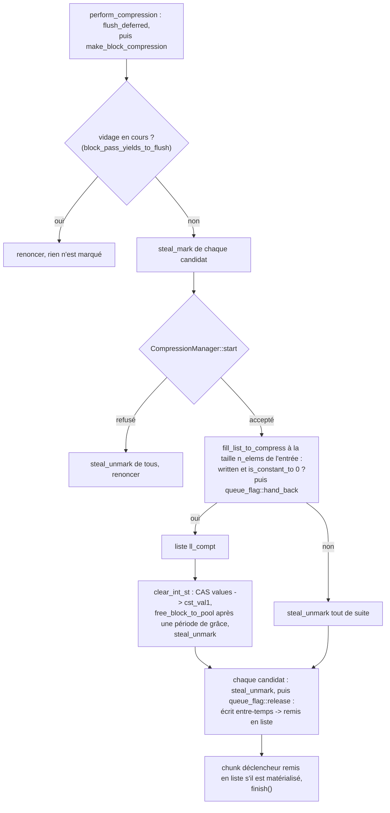

# L'algorithme de zero::Array

> English version: [algo_zero.md](algo_zero.md).

> État : fin septembre 2026. Ce document décrit ce que `zero` fait **autrement** que `zero_one_value` ; la
> machinerie commune (proxys, écritures différées, barrière de lecture, compression en vol,
> opérations sur plages) est décrite dans [algo_zero_one_value_fr.md](algo_zero_one_value_fr.md), et la
> géométrie dynamique dans [rechunk_adaptatif_fr.md](rechunk_adaptatif_fr.md). En cas de
> doute, c'est le code qui fait foi.

***

## 1. Ce que `zero` compresse

`zero` est la plus simple des trois variantes : un chunk est **compressé à zéro** (`T{}`) ou
**matérialisé**. Il n'y a pas de seconde valeur, ni par tableau (`zero_one_value`), ni par chunk
(`zero_any`).

| état | `values` pointe vers | test |
|---|---|---|
| compressé | le tampon constant partagé `cst_val1`, rempli de zéros | `is_cst_val1()` |
| matérialisé | un tampon propre au chunk | `written()`, c'est-à-dire `values != cst_val1` |

Le pointeur `values` sert donc à la fois de données et d'état. Un chunk ne connaît pas son
propre nombre d'éléments : la géométrie vit dans la politique de taille du tableau
(`size_policy_`), et c'est pourquoi les listes de candidats à la compression transportent le
nombre d'éléments de chaque chunk (voir `TChunk.h`).

La bibliothèque : `chunk::chunk_zero` (elle définit `CHUNK_VARIANT_ZERO`). Code : `chunk/zero_chunk.h`, `chunk/zero_array.h`,
`internal/zero_chunk_inline.h`, `internal/zero_array_inline.h`, `internal/zero_proxy.h`.

## 2. Ce que coûte un chunk

L'objet chunk fait 16 octets (dans les builds OpenMP, où le compteur de zéros du mode
séquentiel est un type vide, voir §4), plus un octet « déjà en liste de compression » et deux
octets du *dirty bitset* (un bit, dans un mot de 64 bits complété à 128 octets). Sans seconde valeur, `zero` n'a **aucune métadonnée de type ou de
valeur** par chunk : c'est la variante la plus économe en métadonnées, et celle dont la
mémoire est le plus faite de **données matérialisées**. Sur `shrink_bench` à 64 threads,
environ 38 Go de ses 40 Go sont des données.

## 3. Lecture et écriture

La lecture est celle de `zero_one_value` (§5 de [algo_zero_one_value_fr.md](algo_zero_one_value_fr.md)) : une valeur,
lue dans le tampon du chunk ou dans `cst_val1`, après la barrière de lecture.

L'écriture passe par le proxy `Proxy<T>` :

- écrire **zéro** dans un chunk compressé : rien à faire, sauf si une écriture différée est en
  attente sur le chunk (`pending_any()`) : l'écriture passe alors par le moteur ;
- écrire une **autre valeur** dans un chunk compressé : le chunk est **matérialisé** (un
  tampon pris dans la liste de réutilisation du thread, déjà à zéro puisqu'un chunk n'est
  compressé qu'entièrement nul, ou alloué et mis à zéro ; publié par CAS), puis la valeur est
  écrite ;
- écrire dans un chunk matérialisé : simple écriture.

Le déroulé d'une écriture dans un build OpenMP : les étapes du moteur sont celles du §7.2 de
[algo_zero_one_value_fr.md](algo_zero_one_value_fr.md), résumées ici ; le reste est ce que `zero`
fait à sa façon.

En build séquentiel, ni moteur ni liste de candidats : `assign_impl` tient lui-même le compteur
de zéros (`inc_nb_val_eq_zero`, `dec_nb_val_eq_zero`), compresse le chunk tout de suite quand il
devient entièrement nul (`manage_full_zero`), et sinon le matérialise (`create_value`) et écrit
directement.

## 4. Quand un chunk devient candidat à la compression

**Builds séquentiels** : chaque chunk tient un **compteur de zéros**
(`ChunkCounterPolicy`, `nb_val_eq_zero_`). Quand il atteint le nombre d'éléments du chunk, le
chunk est compressé tout de suite (`manage_full_zero`). Ce compteur doit être exactement
synchronisé avec le contenu : un compteur désynchronisé compresserait un chunk qui ne l'est
pas, d'où le soin mis à le propager dans les copies.

**Builds OpenMP** : pas de compteur. Une écriture qui fait passer un élément **d'une valeur
non nulle à zéro** (`should_mark_for_compression`) met le chunk dans la **liste de candidats**
du thread, sauf s'il y est déjà (l'octet « déjà en liste »). Le même chemin marque aussi le
chunk quand il détecte qu'un autre thread a écrit au même endroit en même temps (la valeur en
mémoire n'est plus celle attendue).

## 5. La passe de compression par bloc

Quand la liste d'un thread dépasse le seuil de déclenchement (§6), une passe
`make_block_compression` s'exécute :

1. si un vidage des écritures différées est en cours, la passe **renonce avant de toucher aux
   candidats** (`block_pass_yields_to_flush`, `block_pass_precheck.h`). À 128 threads sur
   Grace, marquer puis démarquer les candidats à chaque tentative refusée coûtait 10 millions
   de tours et doublait le temps du run ;
2. chaque candidat est **réservé** (`steal_mark`), avant l'ouverture de la fenêtre de
   compression (`CompressionManager::start()`), dont la barrière publie les réservations ;
3. `fill_list_to_compress` relit chaque candidat et ne garde que ceux qui sont **entièrement
   à zéro** ; les autres sont démarqués tout de suite, et le drapeau de file de chaque candidat
   parcouru est rendu (`queue_flag::hand_back`) ;
4. chacun de ceux-là est compressé (`clear_int_st` : `values` repasse à `cst_val1` par CAS, et
   le tampon rejoint la liste de réutilisation après la période de grâce des sections de
   lecture) ;
5. les réservations restantes sont levées, puis les drapeaux de file (`queue_flag::release`) :
   un candidat écrit entre-temps est remis en liste, de même que le chunk de l'écriture qui a
   déclenché la passe s'il est matérialisé.

Une liste de candidats mélange les chunks de **tous les tableaux** d'un même type, qui
peuvent avoir des tailles différentes après un rechunk : chaque chunk est compressé avec
**son** nombre d'éléments, porté par l'entrée de la liste.

Le déroulé de la passe, dans le style du §8.4 de [algo_zero_one_value_fr.md](algo_zero_one_value_fr.md) :

Ce qui diffère de `zero_one_value` : une liste de candidats par rang
(`chunk_to_compress_potentially_thr`), et non une par seconde valeur, et une seule constante
cible, donc une seule liste de sortie. Les builds séquentiels n'ont pas de passe
(`make_block_compression` y est vide) : c'est le compteur de zéros qui compresse (§4).

## 6. Le seuil de déclenchement

Il vaut `somme_chunk_create / (100 × nombre de threads)`, avec un plancher de 100 candidats
(`ChunkDef` : `factor_div_nb_chunk_for_compress`, `size_min_list_chunk_to_check_compress`).
`somme_chunk_create` est le nombre de chunks existants de ce type. Deux corrections de
septembre 2026 le maintiennent exact :

- il est **décrémenté** à la destruction d'un tableau (sans quoi il ne faisait que croître :
  seuil de 390 au début d'un run, ~42 000 à la fin, et presque plus aucune compression) ;
- le seuil est **recalculé** à la destruction comme à la création.

À 64 threads, le calcul tombe presque toujours sur le plancher : c'est lui qui fixe la
fréquence des passes.

## 7. Ce que `zero` fait autrement pendant un rechunk

Le déroulé général est celui de [rechunk_adaptatif_fr.md](rechunk_adaptatif_fr.md) §4. Deux
particularités viennent du volume de données de `zero` :

- **la reconstruction par tranches** (16) : chaque tranche
  libère les anciens chunks qu'elle a recopiés, et entre deux tranches, les réserves de
  l'ancienne taille sont vidées et les slabs vidés rendus au système. Pic de la
  reconstruction à 64 threads : +6,9 Go en une passe, +1,7 Go en 16 tranches ;
- **l'affinité immédiate par défaut** : chaque gros tableau a ses propres slabs dès sa
  création, pour que les tranches puissent vraiment les vider. En affinité paresseuse, le
  premier rechunk part de slabs partagés entre tableaux, qui ne se vident pas : pic de 45,6 Go
  au lieu de 41,2 Go, pour la même mémoire de fin.

## 8. Résultats et limites

Sur `shrink_bench` (64 threads), `zero` dynamique finit à **40,3 Go**, comme le statique 256
(40,2 Go), et 0,6 Go au-dessus du statique 1 024 (39,7 Go), la taille qu'il atteint. Deux
raisons à ce gain faible :

- ses métadonnées sont déjà faibles, et c'est surtout sur elles que le grossissement fait
  gagner ;
- après son rechunk, `zero` dynamique **ralentit** (1,5 à 2 fois par itération par rapport au
  statique 1 024), pour une raison encore inconnue : un build dynamique démarré directement à
  1 024 va aussi vite que le statique, et `zero_one_value` ne ralentit pas après ses rechunks.

Pour un cas comme celui du banc, un `zero` **statique** à la bonne taille reste aujourd'hui le
meilleur choix.
