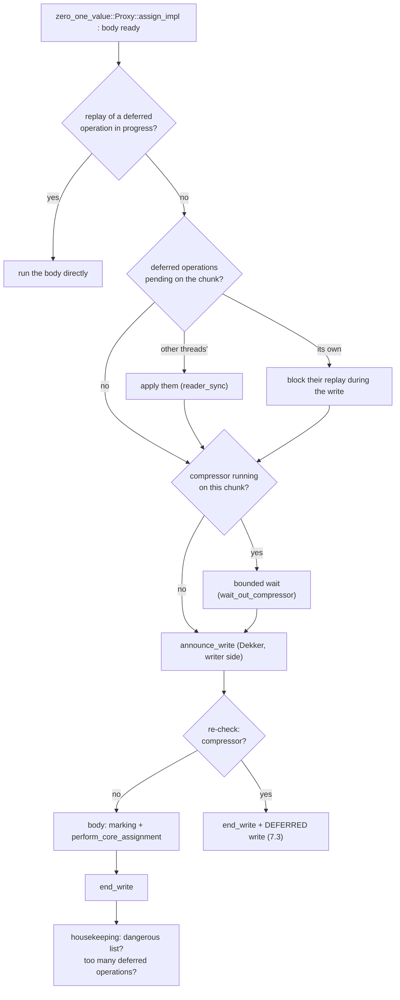
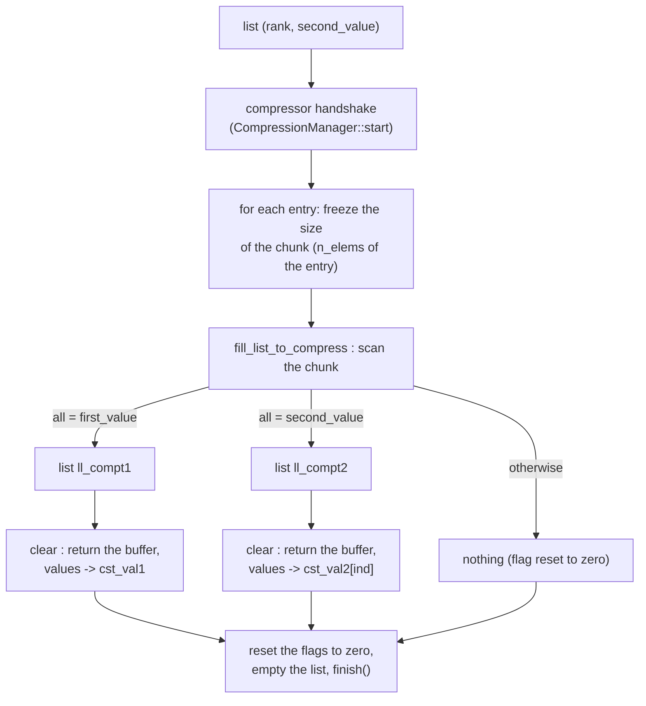

# The zero_one_value::Array algorithm

> French version: [algo_zero_one_value_fr.md](algo_zero_one_value_fr.md).

> Code status: early October 2026. Dynamic geometry is detailed in
> [adaptive_rechunk.md](adaptive_rechunk.md), lock-free synchronisation between
> writers, compressors and readers in [synchronisation_dekker.md](synchronisation_dekker.md),
> the measurement method in [performance_measurement.md](performance_measurement.md), and the
> documentation index in [README.md](README.md). This document replaces the old presentation, which described
> an earlier version (per-element locks, global __decalage_chunk, chunk size fixed
> at 64, parallelisation "without a satisfactory solution"). The function and file names
> cited are those of the current tree; when in doubt, the code is the reference.

***

## 1. Goal

`zero_one_value::Array<T>` is an array split into **chunks** (fixed-size blocks, a power of 2 or a multiple of 64)
that are **compressed** as soon as all their elements equal one of **two constants**:

- the **first value** `first_value` (0, the initialisation value);
- a **second value**, **common to the whole array**, declared by `set_second_value()`.

A compressed chunk has no buffer of its own: it points to a shared constant buffer.
That is where the memory saving comes from.

The three variants of the library differ by what they can compress:

| variant | compressible constants | second value metadata |
|---|---|---|
| `zero::Array` | `first_value` only | none |
| **`zero_one_value::Array`** | `first_value` **and one second value per array** | one entry per array |
| `zero_any::Array` | `first_value` and **one second value per chunk** | one entry per chunk |

`zero_one_value::Array` is therefore the right choice when the data have **a single dominant
non-zero value**: its metadata are lighter than those of `zero_any`.

---

## 2. Usage

```cpp
zero_one_value::Array<double> tab(n);
tab.set_second_value(1.0);      // declare it before the parallel phases

#pragma omp parallel for
for (long i = 0; i < n; ++i)
    tab[i] = f(i);              // write: goes through a proxy

double s = std::as_const(tab)[i];   // read: returns a T
```

The interface is close to a `std::vector`: `size()`, `resize()`, `at()`, constant iterators,
`swap()`, etc. Three points differ:

- **Non-const `operator[]` returns a proxy** (`zero_one_value::Proxy<T>`), not a reference. All writes
  go through it. The compound operators (`+=`, `*=`, …) are
  reimplemented on the proxy.
- **`set_second_value()` must be called outside a parallel region**, before the writes: it
  records the second value in the registry and creates the compression candidate
  lists for this value. An array that never declares a second value
  behaves like an `zero::Array` (compression to 0 only).
- **Range operations** (`fill_range`, `copy_range`, `fill_range_mt` in
  `array_chunk_range_ops.h`) write a range with one decision per chunk, and
  `fill_range_mt` can be called by several threads at once (section 10).

---

## 3. Geometry: chunk size and index split

The chunk size is held **by each array** (`size_policy_`, see
`chunk_size_policy.h`), not by a global variable:

- **fixed geometry**: the size is a compile-time constant, one library per
  size (`chunk_zero_one_value_256`, …, list `CHUNK_STATIC_SIZES`, the first one giving
  `CHUNK_DEFAULT_SIZE`);
- **dynamic geometry** (`CHUNK_DYNAMIC`, `_dyn` libraries): the size is set at
  run time and can **change during the lifetime of the array** (`rechunk_to()`, section 9),
  up to `chunk_dyn_max_size` (4096 by default).

The global index `i` is split by two single-cycle operations:

```cpp
const int num_chunk = i >> size_policy_.decalage();   // chunk number
const int num       = i &  size_policy_.modulo();     // position in the chunk
```

---

## 4. Chunk states and shared structures

### 4.1 Three states

Each `zero_one_value::Chunk<T>` essentially holds an atomic pointer `values`. Depending on its target,
the chunk is in one of three states:

| state | `values` points to | test |
|---|---|---|
| compressed to the first value | the constant buffer `cst_val1` (all 0) | `is_cst_val1()` |
| compressed to the second value | the constant buffer `cst_val2[ind]` | `is_cst_val2(ind)` |
| materialised | a private buffer, allocated for this chunk | `written(ind)` |

The constant buffers are **allocated only once** and shared by all the chunks
concerned. Their size is `cst_buffer_size` (the chunk size in fixed geometry,
`chunk_dyn_max_size` in dynamic geometry). There is one `cst_val2` buffer per declared second
value, identified by an **index** `ind`.

> Warning: `zero_one_value::Chunk::written()` **without argument** is reserved for `bool` and returns `false`
> for any other type. To know whether a non-boolean chunk is materialised, you need
> `written(ind)` with the index of the array's second value
> (`zero_one_value::Array::chunk_written(j)` does it).

### 4.2 The second value registry

The second value **is not stored in the array**: it lives in the shared registry
<tt>zero_one_value::Proxy\<T\>\::share_info_array</tt>, indexed by the **address** of the array. Each entry is an
`InfArrayT` triplet:

```
(second_value, ind, num_tab)
```

- `ind`: the index of the `cst_val2` constant buffer for this value;
- `num_tab`: the array number, which indexes the per-array metadata tables
  (for example the "already a compression candidate" flags).

The registry remains the source of truth, but each array keeps a **mirror** of it
(`zero_one_value::Array::inf_array`), re-read (`sync_registry_mirror()`) after the only three places that
write the registry: `create()`, `set_second_value()` and the rechunk identity swap.
The write `operator[]` **arms each proxy with the address of this mirror**
(`registry_mirror()`, `arm_inf_array()`): the write path copies the triplet instead of
searching the registry. In a check build (`any_check`), each read of the mirror
is compared with the registry.

---

## 5. Reading

The read operator returns a **value**, never a reference:

```cpp
CHUNK_FLATTEN CHUNK_FORCE_INLINE T operator[](IndType i) const noexcept
{
    const int num_chunk = i >> size_policy_.decalage();
    const int num       = i & size_policy_.modulo();
    const auto& chunk_t = chunk_list[num_chunk];
    sync_chunk(chunk_t, num_chunk, num);      // read barrier (OpenMP)
    return chunk_t[num];
}
```

Reading a compressed chunk costs nothing extra: the read goes to the constant buffer.

**The read barrier** (`sync_chunk`, compiled to nothing without OpenMP) guarantees that a
read sees the **deferred** writes (section 7.3) already issued on this chunk:

1. a **coarse filter** per chunk (the "dirty bitset"): a zero bit means that no
   deferred write has ever targeted this chunk, and the read returns immediately. This is
   by far the most frequent case;
2. otherwise, the chunk's **precise counter** of pending operations decides whether these
   operations must be applied (`reader_sync`) before reading.

There is also a const `operator()` (same read, useful when the context would otherwise call
the write operator) and a non-const `T& operator()(i)`, which gives a raw reference into
the buffer: **use it only on a materialised chunk**, since it bypasses the proxy.

---

## 6. Writing

### 6.1 The write `operator[]`: an armed proxy

```cpp
ProxyType operator[](IndType i) noexcept
{
    const int num_chunk = i >> size_policy_.decalage();
    const int num       = i & size_policy_.modulo();
    const ProxyType& val = chunk_list[num_chunk][num];
    val.set_this_and_num_chunk(&derived(), num_chunk, num_tab);   // array, chunk, num_tab
    val.arm_inf_array(derived().registry_mirror());                // zero_one_value: the mirror
    return val;
}
```

The proxy therefore knows, without any lookup, **which array**, **which chunk**, **which
position** and **which second value triplet** it concerns. Above all, it makes it possible to know
**the written value before deciding**: if it is a constant the chunk already holds,
there is nothing to do, and above all nothing to allocate.

### 6.2 Assignment (`assign_impl`)

```cpp
const T* values_loc = chunk.values_load();

// 1. first_value on a chunk already at first_value: nothing to do
if (is_cst_val1_and_v_equal_first_value(values_loc, v)) return v;

set_info_second_value_ind();   // second_value and ind, from the mirror

// 2. second_value on a chunk at cst_val2, or on an element that already holds it:
//    nothing to do -- unless deferred writes are pending on the chunk
//    (an older op replayed later would overwrite the value left in place)
if (!chunk.pending_any())
    if (v == second_value && (values_loc == chunk.get_cst_val2(ind) || values_loc[num] == second_value))
        return v;

// 3. otherwise: the write body, handed to the write engine
auto body = [this, &v] { mark_for_compression_if_needed(v); perform_core_assignment(v); };
const bool deferred = write_with_optional_lock_with_set_ptr(body);
if (deferred) { /* capture the operation to replay it later (7.3) */ }
```

### 6.3 The body: `perform_core_assignment`

- **second value written into a `cst_val1` chunk**: the chunk is materialised
  (`create_value()`, pre-filled with 0), then the value is written;
- **compressed chunk (either constant) and a different value**: the chunk is materialised,
  pre-filled **with the constant it is leaving**, then the value is written;
- **materialised chunk**: plain write into the buffer.

In **sequential** builds only, per-chunk counters (number of elements equal to
each constant) trigger compression directly when a chunk becomes uniform.
With OpenMP, these counters do not exist: the "in-flight" compression of section 8
takes care of it.

### 6.4 Materialisation: `create_value`

1. take a buffer from the **thread's reuse list** (buffers freed by previous
   compressions), or allocate one from the fast allocator
   (`fast_allocators`, section 9.1);
2. **pre-fill** it with the constant the chunk is leaving;
3. **publish it by CAS** on `values`. The CAS rejects an inconsistent transition (for
   example if another thread has materialised or compressed the chunk in the meantime); the loser
   returns its buffer.

---

## 7. OpenMP parallelism

The old version locked every write. The current version has **no lock on
the common write path**: it relies on three mechanisms.

### 7.1 The write engine and the asymmetric Dekker protocol

All writes go through `ProxyBase::write_with_optional_lock_impl`
(`proxy_base_inline.h`). The hazard to avoid: a thread writes into a chunk's buffer
while a compressor steals it and returns it to the reuse list. The engine applies
a **Dekker**-style handshake between writers and compressors
(`WriteCompressSyncPolicy`), without any lock:

- **writer side (frequent, light)**: the thread publishes the address of the chunk it writes in
  its flag (`announce_write`: a relaxed store followed by a plain compiler
  barrier), **re-checks** that the chunk is not reserved by a pass (its
  `steal_mark_` mark, read with *acquire*), writes, then lowers its flag (`end_write`). If the chunk
  is reserved, the write is deferred (7.3);
- **compressor side (rare, heavy)**: it marks its candidates, declares itself (`hard_inflight_`),
  calls `membarrier`, which makes every core of the process execute a full barrier and
  makes all the writers' announcements visible, then waits, in a bounded way, only for the
  writers whose flag designates a marked chunk. If it waits too long, it gives up its pass.

One of the two sides always sees the other: the two never go through together. Without
`membarrier` (kernel too old, seccomp, TSan build), the symmetric form puts a
`seq_cst` barrier on both sides. The algorithm, the proof of both forms, the compressor's "parked" and
"stealing" counters and the two other uses of the same building block (flushes and readers)
are detailed in [synchronisation_dekker.md](synchronisation_dekker.md).

### 7.2 The course of a write in the engine



### 7.3 Deferred writes

When a compressor is running on the chunk and the bounded wait was not enough,
the write is not lost: it is **captured** (a context allocated from a pool, which
holds the position and the operand) and placed in the thread's queue. It will be **replayed**
later:

- by a **read** of the chunk (read barrier, section 5);
- at OpenMP **barriers**: each rank flushes its own queue (`on_barrier_end`);
- at the **end of the parallel region** (`on_parallel_end` / `finalize_parallel_phase`), by a
  serial flush that only opens a region if operations remain;
- in the write path itself, when a thread's queue exceeds a threshold.

The replay freezes the geometry of the operation (in dynamic geometry, a chunk is materialised at
**its** size, not at that of the replaying thread).

At the end of the phase, each array's "dirty bitset" (the read barrier filter,
section 5) is reset to zero. Each bitset carries an extra word, "at least one bit has
been set", which only the queuing of a deferred write sets: an array without a deferred
write during the phase is not rewritten. Without this word, the reset rewrote one 128-byte
line per group of 64 chunks of each array, serially on the master, at each end
of phase: ~21 s of a ~30 s run on AMD Milan (GNU, 64 threads).

### 7.4 OMPT callbacks

With OMPT, the library hooks into the OpenMP runtime: `on_implicit_task` (caches the thread's
rank), `on_barrier_end` and `on_parallel_end` (replay of deferred operations and compression
passes). Without OMPT (libgomp), the calling code wraps its regions with
`begin_parallel_phase()` / `finalize_parallel_phase()`, and the end-of-region work is done
by the **master**, after the region: this is where a costly sequential step shows up
first (the other threads wait in `gomp_barrier_wait_end`).

---

## 8. "In-flight" compression

### 8.1 Why

Same example as in the old version, still valid:

```cpp
for (long i = 0; i < n; ++i)
    tab[i] = second_value;
```

At construction, all chunks are at `cst_val1`. The first write to each chunk
**materialises** it (it then holds `1 0 0 0 …`). Without compression during execution, the
loop would end with **the whole array allocated**, although every chunk has become uniform again.
In-flight compression returns these chunks to `cst_val2` as the loop goes.

### 8.2 Candidate lists

Each thread keeps **one list of candidate chunks per second value**:

```
ManagerChunk2::map_chunk2_to_compress_potentially_thr[rang][second_value]
```

Each entry holds `(chunk, num_chunk, num_tab, number of elements)`. The number of elements
is the one of the array's geometry **at the time of queuing**: the thread that
processes the entry may have another "ambient" size (after a rechunk).

**Queuing** (`mark_for_compression_if_needed`, in the write body): a chunk
enters the list when the write **turns an element into one of the two constants**
(`old != first && new == first`, or `old != second && new == second`), with two filters
placed before:

- a cheap **pre-check** (`pre_check_mark_for_compression_strict`): the
  written value is **one of the two constants, whatever the state of the chunk**. Until
  September 2026, it only accepted writing a constant on a chunk already at
  the other constant; a chunk materialised by an arbitrary value then rewritten element
  by element to a constant was then never queued, and stayed materialised.
  The cost of the widening is only paid by writes of a constant: one
  read of the old value, one comparison and, on the first one of each pass, the CAS
  on the flag;
- the existence of a **list for this second value on this rank**
  (`has_candidate_list`): an array that has never called `set_second_value()` has no
  list, and is never queued.

An atomic flag per chunk ("already a candidate", `tab_is_inside_chunk_list_to_compress`,
indexed by `num_tab`) guarantees that a chunk is queued **only once** until the
next pass.

### 8.3 Triggering

When a thread's list exceeds a threshold size
(`get_size_max_number_of_chunk_to_check_compress()`), it is marked **"dangerous"**.
After its next successful write, **this thread** launches the pass, on its slow
path (`run_slow_path` → `perform_compression`). Passes also take place at the end of the parallel
phase.

### 8.4 The pass: `make_block_compression_impl`



The **scan** (`fill_list_to_compress`) only concerns materialised chunks. It
compares each element with the two constants and stops as soon as both hypotheses are
refuted. A chunk uniform at 0 goes into `ll_compt1`, a chunk uniform at the second value
into `ll_compt2`.

The **release** (`clear` family) puts the buffer back into the thread's reuse list,
at the **chunk's own size**. This is what avoids putting a 4096-element buffer into
the pool of 512-element chunks when the list mixes an array and the temporary array of a
rechunk.

With **steal marks** (`use_chunk_steal_mark`), the compressor marks the chunks it
processes, and a writer only waits if **its** chunk is marked, instead of waiting for the end of
the whole pass.

---

## 9. Memory and dynamic geometry

### 9.1 Buffer allocation

Chunk buffers come from `fast_allocators`: **block arenas** (slabs) per
rank and per chunk size, with **reuse lists** fed by
compressions. A buffer freed by a rank other than its owner is set aside
("parked") then returned to its original pool. Large enough arrays (above
`alloc_affinity_min_bytes`, 16 MiB by default) can have their own set of allocators
(affinity key), which makes it possible to release their memory in one block when they are
rebuilt or destroyed; empty slabs are then returned to the system (except in a
`CHUNK_RECLAIM_EMPTY_SLABS=OFF` build).

For `zero_one_value`, this set is only created at the array's **first rechunk** (lazy affinity):
each set costs one started slab per rank and per size, i.e. ~780 MiB over the 16 arrays of
`shrink_bench` at 64 threads, and an array that is never rebuilt gets no benefit from it. A
dynamic run thus consumes, at the start, exactly like the static one at the same size
(`zero_one_value`: 19,999 vs 20,009 MB after initialisation). `CHUNK_ALLOC_AFFINITY_EAGER=1`
creates the set at creation. Details and measurements: [adaptive_rechunk.md](adaptive_rechunk.md) §5.

### 9.2 Rechunk (dynamic geometry)

`rechunk_to(new_size)` changes the chunk size of an existing array, for example on a
decision of the **decider** (`ChunkSizeAdvisor::analyze`, which estimates the memory at each size
from the state of the chunks). The steps:

1. at the old geometry: flush the array's deferred writes, then **compress its
   candidates** (the variant's `compress()`, serially, on the calling thread's rank,
   each entry with its own number of elements) before removing them from the lists. Until
   September 2026 they were only removed: a chunk queued by the write
   that had made it uniform then stayed materialised during the rebuild, was
   copied instead of being folded, and was never queued again. Measured on
   `rechunk_validation` (1 thread): `zero_one_value`, 0 → 2,408 chunks folded and 7,107 → 4,701 left
   materialised;
2. drain the reuse lists and prepare the pools for the new size;
3. build a **temporary array** at the new size (chunk initialisation in
   parallel);
4. **fill it in parallel** by slices (`rechunk_refill`, scheduling
   `guided,16`): a slice whose sources are all
   at the first value is skipped; otherwise the values are read then rewritten by
   `copy_range`, and a new chunk whose sources were all compressed is
   **folded** immediately (the variant's `compress()` on this chunk, which refuses if the
   sources' constants differ);
5. **swap identities**: `num_tab` and the registry keys change hands, and the
   mirror is re-read on both sides;
6. destroy the old storage.

The old storage is destroyed under its own identifier (`num_tab`), which nothing reuses:
everything indexed by it must be **freed**, not just emptied. For `zero_one_value`, these are
the "in compression list" indicators (one byte per chunk), freed at the end of
`clear_core()`, after the candidates are purged. The threshold that triggers compression
passes and the pool budget, which depend on the total number of chunks, are
recomputed on destruction as on creation. The decider, its criteria and the measured
results are described in [adaptive_rechunk.md](adaptive_rechunk.md).

`CHUNK_LOG=rechunk=debug` prints the time of each phase, `CHUNK_LOG=memory=debug` the folding
counters.

---

## 10. Range operations

`fill_range(a, first, last, v)` and `copy_range(a, first, last, src)` write a range by
making **one decision per chunk**: they materialise the chunk through the normal path if
needed, write the rest **directly into the buffer**, then only queue the
chunks that **may** be uniform (first, middle and last elements equal) **at a
value that `zero_one_value` can compress** (the first value or the array's second value).
They are **sequential**: no concurrent writer or compression on the array.
The rechunk uses `copy_range` to rebuild the new array.

`fill_range_mt(a, first, last, v)` can be called **by several threads at once**, on
disjoint indices (a chunk may be shared): it repeats, once per piece of
chunk, the steps of the write engine (section 7.2):

1. deferred operations pending on the chunk → this piece goes through the element-by-element
   path;
2. compressor running on the chunk → bounded wait, before announcing itself;
3. announcement as a writer (Dekker);
4. re-check (compressor, pending operations, chunk still materialised); at the
   slightest doubt, withdrawal and element-by-element path;
5. direct write into the buffer;
6. withdrawal;
7. queuing if the chunk may be uniform.

A non-materialised chunk is first materialised through the normal path, **outside the session** (a
proxy write inside the session would clear the thread's announcement when it
withdraws), and a chunk is **never freed** by `fill_range_mt`: another thread may
be writing other elements of the same buffer.

`copy_range_mt(a, first, last, src_first)` and `transform_range_mt(a, first, last, src_first, op)`
take the same steps (one engine, `internal::store_range_mt`). The values of a piece are
computed into a per-thread buffer **before step 3**: the caller's code -- an iterator,
possibly over another chunked array, or `op` -- never runs inside the session, where a long
computation would hold the compressor off and a proxy write would clear the announcement.
The queuing decision looks at the piece's own values: all equal, and a value the variant
can compress (a fill is such a piece, so the rule is `fill_range_mt`'s).

**Three points specific to `zero_one_value`**, fixed in September 2026, which previously justified
keeping it on the element-by-element path:

- the test "is this chunk materialised?" must call `written(ind)` with the array's second
  value index (`internal::materialised(a, ch, ind2)`): `written()` without argument
  is reserved for `bool` and returns `false` for other types;
- queuing (`internal::queue_for_compression`) must **load the second value** before
  adding the chunk (`set_info_on_chunk()`), since `zero_one_value`'s lists are indexed by
  it. Without that, the chunks landed in the list of `T{}`, which no pass drains;
- in counter mode (the serial builds), a direct store must **recount** the chunk's two
  counters, `nb_val_eq_first_value_` and `nb_val_eq_second_value_`, which zero_one_value::Proxy otherwise
  keeps up to date one write at a time (`internal::resync_counters`, as for `zero`'s count of
  zeros).

Only `bool` (bit-packed chunks) stays on the element-by-element path.

**The queuing decision in the `_mt` forms** never reads an element another thread may be
writing, except on `zero_any`. For `zero` and `zero_one_value` it looks only at the piece's own values: all
equal, and the first value (`zero`), or the first or second value (`zero_one_value`), as the
element-by-element path decides. `zero_any` reads three elements (0, S/2, S−1) to know whether the
chunk may be uniform: it writes these elements as relaxed atomics (`relaxed_element.h`:
`fill_span_relaxed_edges`, `may_be_uniform_relaxed`), which makes the read safe; for types
without lock-free atomics, it queues only a piece covering the whole chunk with one value. The
single-threaded forms (`fill_range`, `copy_range`) read those three elements plainly
(`may_be_uniform`): no other thread writes the array during the call.

**The wrong values of September 2026.** With the direct path open to `zero_one_value`,
`bench_and_test.py` reported on Grace wrong values **after compression**:
`rechunk_validation_zero_one_value_dyn` (`scale-64-to-tgt`, POST-FAIL) and the check mode of
`shrink_bench_zero_one_value_256` ("is_cst_val2 should be not"). Not a race between threads:
the re-chunk test fails identically on a single core in the serial Debug build, and the
failing Grace configurations were the serial ones. The cause was the counters of the third
point above: the direct paths (`fill_range`, `copy_range`, used by the re-chunk's rebuild)
stored past them, the stale counts reached the chunk size on a mixed chunk, and the pass
folded it to the first value, losing every element of the second. Since then the direct
stores recount the counters, and the `_mt` forms write inside a session announced to the
compressor (steps 3 to 6 above), on `zero_one_value` as on the other variants. Excluding `zero_one_value` from
`internal::raw_fillable_v`, the fallback considered at the time, is not needed.

---

## 11. Useful environment variables

The full list, with the macros and the CMake options, is in
[developer_settings.md](developer_settings.md). Those most relevant to
`zero_one_value`:

| variable | effect |
|---|---|
| `CHUNK_LOG=rechunk=debug` | rechunk phase times (`memory=debug`: foldings) |
| `CHUNK_OMPT_STATS=1` | statistics of synchronisation regions (OMPT build) |
| `shrink_bench --rechunk_dry_run` | the decider analyses and logs, but applies no rechunk (to measure the cost of the analyses; `RechunkPolicy::dry_run`) |
| `shrink_bench --rechunk_max_coarsen <n>` | maximum coarsening factor (4 by default; `RechunkPolicy::max_coarsen_factor`) |
| `CHUNK_ALLOC_AFFINITY_EAGER=1` | per-array allocator set from its creation (lazy by default for `zero_one_value`) |

For validation, the "forced deferred writes" test hook
(`chunk/internal/test_hooks.h`, compiled with the harnesses) sends one write in N
through the deferred path; `deferred_path_validation` turns it on (N = 7). The build
option `CHUNK_FORCE_DEFER_EVERY=N` forces it across the whole tree (use it at 32
threads at most).

CMake options related to benchmark performance:

| option | effect |
|---|---|
| `SHRINK_INTEL_LIBM` (ON) | x86-64, not icpx: links the executables against Intel's libm (`libimf`) if it is found (`INTEL_LIBM_DIR`, `$CMPLR_ROOT/lib`, or next to `icpx`). AMD Milan, GNU: 15.7 s → 12.4 s on `shrink_bench_zero_any_256` |
| `SHRINK_ARM_LIBM` (OFF) | aarch64, GNU/Clang: links ArmPL's `libamath` (`ARMPL_LIBM_DIR`). No gain measured on Grace (RHEL 9.6); kept to redo the measurement (`-DSHRINK_ARM_LIBM=ON -DARMPL_LIBM_DIR=<dir>`) |

---

## 12. Where to read the code

| topic | files |
|---|---|
| the array | `zero_one_value_array.h`, `internal/zero_one_value_array_inline.h`, `internal/second_value_array_base.h` |
| common base, read, `operator[]` | `internal/array_chunk_base.h`, `internal/array_chunk_base_inline.h` |
| the chunk, materialisation, compression | `zero_one_value_chunk.h`, `internal/zero_one_value_chunk_inline.h`, `internal/chunk_base.h` |
| the write proxy | `internal/zero_one_value_proxy.h`, `internal/zero_one_value_proxy_inline.h`, `internal/second_value_proxy_base.h` |
| the write engine | `internal/proxy_base.h`, `internal/proxy_base_inline.h` |
| Dekker, writers / compressors | `internal/write_compress_sync_policy.h` (explained in [synchronisation_dekker.md](synchronisation_dekker.md)) |
| readers and buffer reclamation | `internal/read_reclaim.h` |
| compressor, deferred writes | `internal/compression_manager.h` |
| geometry | `internal/chunk_size_policy.h` |
| rechunk, decider | `internal/array_chunk_rechunk_inline.h`, `chunk_size_advisor.h` |
| range operations | `array_chunk_range_ops.h` |
| validation harnesses | `examples/validation/` (`rechunk_validation`, `compress_roundtrip`, `deferred_path_validation`, `pool_accounting`, `fill_range_mt_validation`, …) |
