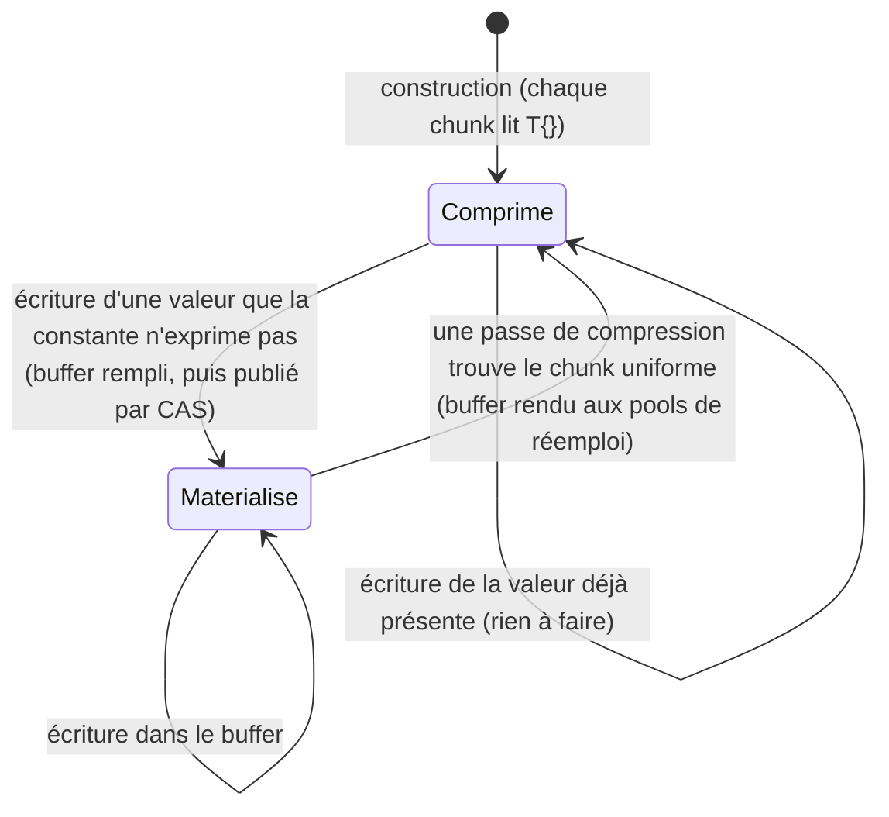
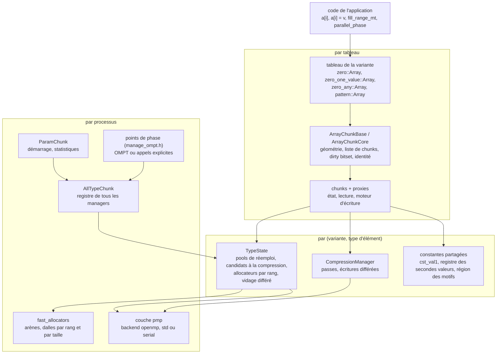
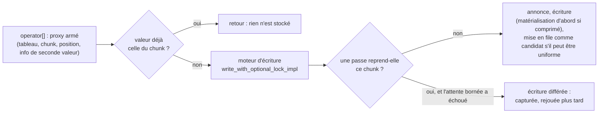

# Conception de shrink-array

> English version: [design.md](design.md).

> État : novembre 2026, `develop`. Ce document donne la **conception d'ensemble** : ce que la
> bibliothèque doit réaliser, comment elle est découpée, quelles décisions la tiennent et
> pourquoi, et ce qui a été écarté. C'est le point d'entrée de quiconque modifie la
> bibliothèque ; les mécanismes eux-mêmes sont décrits, en détail, dans les documents vers
> lesquels il renvoie (section 15). En cas de doute, le code fait foi.

***

## 1. Objectifs et non-objectifs

shrink-array donne aux codes C++ de calcul intensif des tableaux qui **se lisent et s'écrivent
comme un `std::vector`** et cessent de payer pour les parties qui contiennent une même valeur
répétée. Les exigences, dans l'ordre où elles contraignent la conception :

| # | exigence | ce qu'elle impose |
|---|---|---|
| R1 | **substitution directe** : `a[i] = v`, `a[i] += x`, boucle range-for, `resize`, `push_back` ; les boucles d'un code `std::vector` restent telles quelles | la compression est invisible : pas de traduction d'indice, pas d'étape « compresser » obligatoire, aucune perte |
| R2 | **mémoire** : un chunk qui ne contient qu'une valeur coûte quelques octets de métadonnées | un élément n'a pas d'adresse stable ; le stockage change sous le programme (matérialiser, comprimer) |
| R3 | **beaucoup de threads** : 10⁹ éléments, quelques centaines de threads, des écritures depuis chaque thread, y compris dans le même chunk | aucun verrou sur le chemin de lecture ni d'écriture ; le stockage change pendant que d'autres threads y accèdent |
| R4 | **tout type de valeur** : types arithmétiques, `std::complex`, énumérations, agrégats de l'utilisateur ; des types que la bibliothèque ne connaît pas à l'avance | le contrat d'élément est un concept, pas une liste ; l'état par type est créé au premier usage |
| R5 | **tous les threads** : OpenMP, les `std::thread` du programme, les tâches TBB ; OpenMP non imposé au consommateur | le travail parallèle propre à la bibliothèque passe par une couche de backend ; les bornes de phase sont un contrat, pas un callback OpenMP |
| R6 | **performance portable** : x86-64 et AArch64 (ordre mémoire faible : Grace), GCC, Clang, oneAPI, NVHPC | chaque ordre mémoire argumenté et vérifié ; ne pas compter sur l'ordre total des écritures de x86 |
| R7 | **C++20, Linux, CMake, Spack** | `membarrier`, `mmap`, `madvise` sont disponibles ; rien de plus récent que C++20 dans `develop` |

Ce que la bibliothèque ne fait **pas**, délibérément :

- `data()`, `T&`, itérateurs mutables : un chunk comprimé n'a pas de buffer (R2) ;
- `insert` / `erase` au milieu : ils décaleraient tous les chunks ;
- la compression avec perte, ou celle de données simplement régulières : un chunk n'est comprimé
  que s'il se reconstruit exactement à partir de données partagées et de quelques octets (zfp,
  Blosc2 et les autres sont comparés dans [alternatives_fr.md](alternatives_fr.md)) ;
- la mémoire distribuée : un processus, ses threads ; MPI est l'affaire de l'application ;
- les GPU : une conception à part ([conception_gpu_fr.md](conception_gpu_fr.md)), qui garde le
  format mais pas les protocoles d'échange.

## 2. L'idée centrale et ses conséquences

Un tableau est découpé en **chunks** de `S` éléments consécutifs (`S` une puissance de deux ou un
multiple de 64). Chaque chunk tient un pointeur atomique, `values`, qui désigne soit un **buffer
à lui** (le chunk est *matérialisé*), soit des **données partagées, en lecture seule**, d'où chaque
élément se recalcule (le chunk est *comprimé*) : le buffer constant de `T{}`, un buffer rempli
d'une seconde valeur ou, pour `pattern`, un motif auquel le chunk ajoute son décalage.

Quatre conséquences façonnent toute la bibliothèque :

1. **Une lecture est un chargement de `values` puis un chargement indexé.** Elle ne branche jamais
   sur l'état du chunk : les données partagées d'un chunk comprimé ont au moins autant d'éléments
   qu'un chunk, donc `chunk[num]` est la même instruction dans tous les états. Seul `pattern` ajoute le décalage, dans une branche compilée pour lui seul.
2. **Une écriture passe par un proxy.** L'`operator[]` non const renvoie un proxy qui connaît le
   tableau, le chunk et la position. Le proxy voit la valeur *avant* de la stocker : écrire la
   constante que le chunk contient déjà coûte une comparaison et n'alloue rien.
3. **La compression est différée et groupée.** Une écriture qui a pu rendre un chunk uniforme le
   met seulement en file comme *candidat* ; une *passe* parcourt les candidats plus tard et reprend
   les buffers. Dans un build threadé, aucune écriture ne comprime en ligne.
4. **Le stockage change sous les threads.** La matérialisation (un écrivain installe un buffer) et
   la compression (une passe en retire un) ont lieu pendant que d'autres threads lisent et
   écrivent. Le rendre sûr sans verrou, c'est là qu'est l'essentiel de la complexité (section 7).

## 3. Les parties

| partie | classes principales | fichiers | portée |
|---|---|---|---|
| les tableaux des variantes | `zero::Array`, `zero_one_value::Array`, `zero_any::Array`, `pattern::Array`, `ArrayChunkBits` | `chunk/zero_array.h`, `chunk/zero_one_value_array.h`, `chunk/zero_any_array.h`, `chunk/pattern_array.h`, `chunk/array_chunk_bits.h` | un objet par tableau |
| le tableau commun | `ArrayChunkBase`, `ArrayChunkCore`, `SecondValueArrayBase`, `RechunkSupport` | `internal/array_chunk_base.h`, `internal/array_chunk_core.h`, `internal/second_value_array_base.h`, `internal/array_chunk_rechunk.h` | bases de chaque tableau |
| chunks | `zero::Chunk`, `zero_one_value::Chunk`, `zero_any::Chunk`, `pattern::Chunk`, `ChunkBase` | `chunk/internal/zero_chunk.h`, `chunk/internal/zero_one_value_chunk.h`, `chunk/internal/zero_any_chunk.h`, `chunk/internal/pattern_chunk.h`, `internal/chunk_base.h` | un élément de la liste de chunks du tableau |
| proxies, moteur d'écriture | `ProxyBase`, `WriteCompressSyncPolicy`, les `Proxy` des variantes | `internal/proxy_base.h`, `internal/write_compress_sync_policy.h` | un temporaire par écriture |
| état par type | `TypeState` (façade), `ReusePools`, `CompressCandidates`, `CompressionManager` | `internal/type_state.h`, `internal/reuse_pools.h`, `internal/compress_candidates.h`, `internal/compression_manager.h` | un par (variante, type d'élément), statique |
| constantes partagées | `TabCstVal2Holder`, `GlobalVecHolder`, `MotifRegion` | `internal/tab_cst_val2_holder.h`, `internal/motif_region.h` | une par type d'élément |
| registre du processus, démarrage | `AllTypeChunk`, `ParamChunk` | `internal/all_type_chunk_decl.h`, `chunk/param_chunk.h` | un par processus |
| phases | `begin_parallel_phase`, `finalize_parallel_phase`, `parallel_phase` | `chunk/manage_ompt.h`, `chunk/private/manage_ompt.cpp` | une phase à la fois |
| backend, rangs | `pmp::Team`, `pmp::parallel_for` | `chunk/internal/PMP_CHUNK.h`, `fast_allocators/internal/pmp_loops.h`, `fast_allocators/internal/pmp_std.h` | tout le processus |
| allocation | arènes de dalles, allocateurs par rang | `fast_allocators/slab_arena.h`, `fast_allocators/tc_allocator.h` | tout le processus |
| géométrie dynamique | `ChunkSizeAdvisor`, `RechunkDecider`, `RechunkPolicy` | `chunk/chunk_size_advisor.h`, `chunk/rechunk_decider.h`, `internal/chunk_size_policy.h` | par tableau, piloté par le programme |

Le découpage par (variante, type d'élément) est la colonne vertébrale : tout ce que les tableaux
d'un même type doivent partager -- les pools où retourne un buffer comprimé, les listes de
candidats qu'une passe vide, le registre des secondes valeurs -- vit dans le manager de ce type,
et rien n'est partagé entre types.

Ce que voit un programme est bien plus étroit : les 18 en-têtes de `chunk/public/chunk/` hors
`internal/` (les tableaux, les opérations par plage, l'export et l'import d'états de chunks, le
démarrage et l'arrêt de la bibliothèque, les phases, la géométrie dynamique, la configuration, le
journal, les threads et la sortie). Eux et les noms d'[api_fr.md](api_fr.md) forment l'interface, figée dans
`scripts/public_api.txt` et vérifiée par `check_public_api` ; tout le reste, y compris les membres
des classes publiques qui nomment la machinerie (`ManagerType`, `ChunkListType`…), peut changer
d'une version à l'autre.

## 4. Polymorphisme statique

Les chemins chauds (une lecture, une écriture) doivent se compiler en une poignée
d'instructions ; les variantes sont donc assemblées à la compilation :

- **CRTP partout sur le chemin chaud.** `ArrayChunkBase<Derived>`, `ChunkBase<T, Derived>` et
  `ProxyBase` atteignent la variante par `derived()` ; aucun appel virtuel entre un `operator[]`
  et le stockage. Les particularités d'une variante sont des points d'accroche avec valeurs par
  défaut (les accroches `rechunk_*` de `RechunkHookDefaults`, par exemple).
- **Des politiques plutôt que des branches du préprocesseur.** Ce qui diffère entre un build
  threadé et un build série, ou entre géométrie statique et dynamique, est une classe de politique
  choisie par un paramètre template `bool` (`ChunkCounterPolicy` contre les politiques threadées,
  `DeferredReadGate`, `TypeStateParallelImpl`, `TypeStateDynImpl`). Les sélecteurs sont des
  valeurs `constexpr` de `build_config` et `chunk_config` (`chunk/config.h`), testées par
  `if constexpr` ; les `#ifdef` restants sont ceux que `if constexpr` ne peut pas remplacer (un
  include, une déclaration qui ne compile pas dans l'autre build), et les règles qui en décident
  sont écrites en tête de `examples/shrink_bench/bench_config.h`.
- **Du virtuel seulement là où c'est froid.** `AllTypeChunk` doit agir sur tous les managers du
  processus -- lancer les passes, vider les écritures différées, démonter -- sans connaître leurs
  types : il tient des pointeurs `TypeStateInterface` et appelle des virtuelles, aux bornes de phase
  seulement.
- **Des traits pour les familles, jamais le type exact.** `ChunkTraits` et `ArrayChunkTraits`
  (`chunk/internal/chunk_traits.h`) associent un chunk à son proxy et à son manager, un tableau à son
  chunk. Le code partagé par `zero_any` et `pattern` teste la famille (`is_zero_any_family_v`) et
  l'état motif (`has_motif_state_v`) : un nouveau membre tombe alors dans la bonne branche ou ne
  compile pas. Un membre qui n'existe que sur une variante s'atteint par un test `std::is_same_v`
  contre la classe déclarée dans `chunk_traits.h` plus un `static_assert`, jamais par un
  `requires` qui prendrait l'autre branche en silence.
- **Le type d'indice ne dédouble pas la machinerie.** `zero_any::Array<T, int>` et
  `zero_any::Array<T, long>` sont des types différents, mais chunks, proxies et managers ne sont
  paramétrés que par `T`. Ils voient le tableau à travers `ArrayChunkCore<ChunkType>`, de même
  disposition quel que soit le type d'indice ; le pointeur qu'ils tiennent est l'adresse de ce
  sous-objet (`registry_key()`).

La construction en famille est ce qui a rendu `pattern` peu coûteux : c'est le chunk, le tableau
et le proxy de `zero_any` (`zero_any::ChunkImpl`, `zero_any::ArrayImpl`, `zero_any::ProxyImpl`)
avec un état motif ajouté par les traits, et le code machine de `zero_any` est inchangé par son
existence.

## 5. Configuration à la compilation

Ce qui fixe le coût d'un accès est décidé quand la bibliothèque est construite, pas quand elle
tourne :

| choix | comment | pourquoi à la compilation |
|---|---|---|
| variante | une bibliothèque par variante (`chunk::chunk_zero`, `chunk::chunk_zero_one_value`, `chunk::chunk_zero_any`), qui définit `CHUNK_VARIANT_ZERO`, `CHUNK_VARIANT_ZERO_ONE_VALUE` ou `CHUNK_VARIANT_ZERO_ANY` ; `CHUNK_VARIANTS` | la variante change la disposition du chunk et le chemin d'écriture |
| géométrie | tailles statiques (`CHUNK_STATIC_SIZES`, bibliothèques `_256`, `_1024`…) ou dynamique (`CHUNK_BUILD_DYN`, bibliothèques `_dyn`, `CHUNK_DYNAMIC`) | une taille statique fait de `i >> shift` et `i & mask` des immédiats ; une dynamique les lit dans le tableau |
| backend de threads | `CHUNK_THREADS` : `openmp`, `std` ou `serial` | les structures par rang, les protocoles d'échange et les compteurs n'existent que dans les builds threadés |
| qui marque les phases | `CHUNK_OPT_OMPT` | avec OMPT le runtime marque les phases ; sans, c'est le programme |
| allocateur | fast allocators (par défaut) ou `CHUNK_STD_ALLOC` | l'allocateur standard est celui que comprend AddressSanitizer |
| vérifications | les builds de vérification (`any_check`, `CHUNK_DO_CHECK`) | les contrôles d'invariants et les assertions de protocole coûtent à chaque accès |

`pattern::Array` et `ArrayChunkBits` ne sont pas des bibliothèques à part : ils viennent
respectivement avec les bibliothèques `zero_any` et `zero_one_value`. Les fichiers CMake
génèrent les déclinaisons par taille et par variante et gardent les noms par défaut en alias ;
[variables_environnement_fr.md](variables_environnement_fr.md) liste les options.

## 6. Un accès, de l'appel à la mémoire

### 6.1 Lecture

`operator[] const` découpe l'indice (`num_chunk = i >> shift`, `num = i & mask`), passe la
**porte de lecture** (`sync_chunk` : un bit par chunk, le *dirty bitset*, dit si une écriture
différée peut être en attente sur lui ; presque toujours à zéro, la lecture continue ; sinon le
compteur du chunk décide s'il faut d'abord rejouer ses écritures en attente, `reader_sync`), puis
charge `values` et l'élément. Elle renvoie un `T`, jamais une référence.

### 6.2 Écriture

- **Matérialisation** (`create_value`) : un buffer vient de la liste de réemploi du thread ou de
  l'allocateur du rang, est rempli avec la constante que le chunk quitte, puis publié par un CAS
  sur `values`. Un lecteur voit l'ancienne constante ou le buffer complet ; le perdant d'une course
  au CAS recycle son buffer.
- **Candidats** : une écriture qui fait d'un élément une constante comprimable met le chunk en
  file une seule fois (un drapeau atomique par chunk) dans la liste de candidats du rang. Une liste
  qui dépasse son seuil fait lancer une passe à son rang, sur son chemin lent ; la fin de phase
  traite le reste.
- **Écritures différées** : quand une passe reprend le chunk, l'écriture n'est pas perdue : elle
  est capturée dans un contexte issu d'un pool, dans la file du thread, et rejouée par la
  prochaine lecture de ce chunk, à une barrière ou en fin de phase. Le rejeu garde la géométrie de
  l'opération.
- **Opérations par plage** (`fill_range`, `copy_range` et leurs formes `_mt`, `store_range_mt`) :
  une décision par chunk, le reste écrit directement dans le buffer, dans la même session annoncée
  qu'une écriture d'élément.

[algo_zero_one_value_fr.md](algo_zero_one_value_fr.md) suit ces étapes dans le code ; [algo_zero_fr.md](algo_zero_fr.md),
[algo_zero_any_fr.md](algo_zero_any_fr.md) et [algo_pattern_fr.md](algo_pattern_fr.md) disent ce que chaque variante fait
autrement.

### 6.3 Passe de compression

Une passe prend la liste de candidats d'un rang, s'annonce aux écrivains (section 7.3), compare
chaque chunk candidat aux constantes que la variante sait exprimer, fait pointer `values` des
chunks uniformes vers les données partagées, et rend leurs buffers aux pools de réemploi **à la
taille propre du chunk**. Dans les builds série, la même décision se prend en ligne à partir de
compteurs par chunk (`chunk_config::use_compression_with_counter`), puisqu'aucun autre thread ne
peut interférer.

## 7. Modèle de concurrence

### 7.1 Phases et points séquentiels

Le programme alterne **points séquentiels** et **phases parallèles** :

- pendant une **phase**, les threads du programme lisent et écrivent des éléments en même temps,
  à n'importe quels indices, voisins d'un même chunk compris ; la bibliothèque peut matérialiser,
  mettre en file, différer et lancer des passes ;
- en un **point séquentiel**, un seul thread est seul avec les tableaux : `resize`,
  `shrink_to_fit`, `assign`, un rechunk, les opérations par plage sans `_mt`, l'export et l'import
  d'états de chunks (`chunk/chunk_exchange.h`), `set_second_value`.

Le **contrat de phase** (`chunk/manage_ompt.h`) : chaque thread qui écrit appelle
`begin_parallel_phase()` avant sa première écriture (il met son rang en cache), et un thread
appelle `finalize_parallel_phase()` une fois tous les écrivains arrêtés : il vide la file
d'écritures différées de chaque rang et lance les passes restantes. Dans un build OMPT, c'est le
runtime OpenMP qui fait ces appels ; sinon `parallel_phase()`, l'adaptateur TBB
(`chunk/tbb_adaptor.h`) ou le programme. Tout ce qui a été différé y progresse, en un point sans
concurrence : c'est ce qui permet que toute attente à l'intérieur d'une phase soit bornée.

Une seule équipe de premier niveau écrit des tableaux à la fois (deux équipes concurrentes
partageraient les rangs, donc les files) : `phase_guard` le refuse dès qu'un tableau existe. Les
régions imbriquées conviennent ; deux niveaux d'imbrication **actifs**, non.

### 7.2 Rangs et structures par rang

Chaque structure par thread -- allocateurs, listes de réemploi, listes de candidats, files
différées, drapeaux d'écrivain et de vidage -- est un tableau indexé par le **rang** du thread dans
l'équipe active, dimensionné une fois à la capacité en threads (le plus grand du nombre de threads
OpenMP, du nombre de cœurs et d'un plancher de 256, relevée par `CHUNK_THREAD_CAPACITY`). Indexer
par rang plutôt que par `thread_local` garde ces structures accessibles au thread qui les vide en
un point séquentiel, et leur coût autour de 1 Kio par rang et par type d'élément. Le backend std
donne aux threads non OpenMP un rang dense, tiré d'un registre de même capacité.

### 7.3 Trois protocoles d'échange sans verrou

Le stockage change sous les threads de trois façons, chacune gardée par un **protocole de
Dekker** : deux acteurs s'annoncent chacun, puis regardent l'autre, de sorte qu'au moins l'un des
deux voie l'autre. Quand un côté est fréquent (un écrivain, un lecteur), le protocole est
**asymétrique** : le côté fréquent paie un store et une barrière du compilateur, le côté rare un
`membarrier()` qui fait exécuter une barrière complète à chaque cœur du processus. Entre une passe
et un vidage, tous deux rares, les deux côtés paient :

| protocole | premier côté | second côté | le danger |
|---|---|---|---|
| écrivains ↔ compresseur | écrivain : `announce_write`, revérifie le `steal_mark_` du chunk, écrit, `end_write` | passe : marque, `hard_inflight_`, `membarrier`, attente bornée des écrivains des chunks marqués | un écrivain qui stocke dans un buffer que la passe est en train de rendre |
| compresseur ↔ vidage | vidage : `announce_flush`, puis attend tant que `stealing_inflight_` est levé ; ne recule jamais | passe : après `stealing_inflight_`, un second regard sur les vidages ; recule si elle en voit un | un rejeu dans un chunk que la passe ramène à sa constante |
| lecteurs ↔ récupération | lecteur : `ReadSection` (numéro de séquence impair pendant une lecture) | passe dans une région : `PassScope`, `heavy_barrier()`, attente des lecteurs impairs | un lecteur qui charge dans un buffer déjà réemployé |

Sans `membarrier` (noyau trop ancien, seccomp, TSan), les deux côtés se replient sur des barrières
`seq_cst`. Toute attente est bornée et chaque côté a une issue -- un écrivain diffère, une passe
abandonne, un lecteur n'est attendu que pendant sa lecture en cours -- si bien qu'aucun thread ne
peut en bloquer un autre longtemps. La matérialisation n'a pas besoin de protocole : remplir, puis
publier par CAS. [synchronisation_dekker_fr.md](synchronisation_dekker_fr.md) donne l'algorithme, les
preuves et les règles pour modifier ce code.

### 7.4 Comment c'est vérifié

Les tests seuls ne tranchent pas un ordre mémoire faux : sur un processeur à ordre faible, il se
manifeste une fois sur des milliers d'exécutions. La conception s'appuie donc sur quatre niveaux
de preuve :

1. des **modèles réduits** de chaque protocole (`formal/`), explorés exhaustivement par GenMC
   sous RC11 et IMM, et calibrés par des mutations qu'ils doivent refuser
   ([formal_models_fr.md](formal_models_fr.md)) ;
2. des **builds de vérification** qui affirment les invariants du protocole à l'exécution
   (`any_check`) ;
3. des builds **ThreadSanitizer** et **AddressSanitizer** (le backend std et `CHUNK_STD_ALLOC`
   leur donnent un sens), et des harnais qui forcent les chemins rares
   (`deferred_path_validation`, `read_reclaim_validation`) ;
4. des **séries de stress** à nombres de threads aléatoires (`python/multi_launch_stress.py`) sur
   x86-64 et AArch64.

Changer un atomique ou un ordre dans un protocole, c'est changer son modèle aussi.

## 8. Mémoire

### 8.1 Trois sortes de mémoire

| sorte | où | proportionnelle à |
|---|---|---|
| **métadonnées** | l'objet chunk (16 octets dans un build OpenMP), le drapeau de candidat, le dirty bitset et, pour `zero_any`, l'octet de type de constante et l'emplacement de seconde valeur | le nombre de chunks, comprimés ou non |
| **buffers** | un par chunk matérialisé, issu des fast allocators | le nombre de chunks matérialisés × `S` |
| **données partagées** | le buffer de `T{}`, le registre des secondes valeurs, la région des motifs | le nombre de constantes ou de motifs distincts, par type d'élément |

Les petits chunks compriment finement mais multiplient les métadonnées ; les grands, l'inverse.
C'est ce compromis qui justifie une géométrie modifiable à l'exécution (section 9).

### 8.2 Les allocateurs

`fast_allocators` sert les buffers depuis des **dalles**, par rang et par taille de chunk,
découpées dans des **arènes** : de grandes réservations `mmap`, une par sorte d'objet (buffers de
chunks, opérations différées, leurs contextes : `ArenaKind`), jamais démappées. Des arènes
disjointes rendent impossible que la mémoire d'une opération libérée revienne comme buffer de
valeurs pendant que l'opération y vit encore ; ne jamais les démapper les fait survivre à tout
objet statique ou `thread_local` qui pourrait y libérer au démontage. Le prix : la mémoire libérée
reste résidente jusqu'à ce que `EmptySlabSweep` rende les pages des dalles vidées.

Autour d'elles, les **pools de réemploi** du manager gardent les buffers qu'une passe a rendus, par
rang, **clés par géométrie** (un buffer taillé pour une taille de chunk n'est jamais repris à une
autre). Un buffer libéré par un autre rang que son propriétaire est mis de côté puis rendu au pool
du propriétaire. Un tableau au-dessus de `CHUNK_ALLOC_AFFINITY_MIN_BYTES` (16 Mio par défaut) peut
avoir son propre jeu d'allocateurs (une *clé d'affinité*), pour que sa mémoire parte par dalles
entières quand il est reconstruit ou détruit -- d'emblée pour `zero`, à la demande (à son premier
rechunk) pour `zero_one_value` et `zero_any`, dont la mémoire est surtout faite de métadonnées.

### 8.3 Constantes partagées

- `zero` : un buffer constant de `T{}` par type d'élément.
- `zero_one_value` : la seconde valeur du tableau, un buffer par valeur déclarée, trouvé par le
  registre du type et recopié en miroir dans le tableau.
- `zero_any` : le **registre des secondes valeurs** du type d'élément, des segments chaînés de 64
  emplacements (enregistrer une valeur n'en déplace jamais une autre), une recherche hachée sans
  verrou pour une valeur connue, un verrou d'insertion pour une nouvelle ; les valeurs sont
  remplies avant d'être publiées. `reclaim_second_values()`, en un point séquentiel, libère les
  valeurs qu'aucun chunk ne désigne plus.
- `pattern` : la **région des motifs**, les motifs partagés par tous les chunks de même forme,
  admis quand un second chunk présente le même motif.

## 9. Géométrie dynamique

Dans les builds `_dyn`, chaque tableau a sa propre taille de chunk, qui peut changer en cours
d'exécution. Trois acteurs, séparés pour que la bibliothèque elle-même ne prenne aucune décision
d'après l'environnement :

- le **conseiller** (`ChunkSizeAdvisor`) estime la mémoire du tableau à chaque taille candidate à
  partir des états des chunks, en échantillonnant les chunks matérialisés là où une taille les
  coupe ;
- le **décideur** (`RechunkDecider`, réglages dans `RechunkPolicy`) décide quand et vers quelle
  taille, avec des règles de stabilité, de délai, d'anti-retour et de gain par coût, et apprend du
  gain réellement obtenu ;
- `rechunk_to()` reconstruit le stockage en un point séquentiel : comprimer les candidats en
  attente, construire un nouveau stockage à la nouvelle taille, le remplir en parallèle par
  tranches, replier les chunks dont toutes les sources étaient comprimées, échanger les identités
  (`num_tab`, clés du registre), détruire l'ancien stockage -- en libérant, pas en vidant, tout ce
  qui est indexé par son identité.

La mémoire de l'ancienne géométrie ne part que par dalle entière : c'est pourquoi les clés
d'affinité existent, et pourquoi un rechunk devrait couvrir tous les grands tableaux d'un type.
[rechunk_adaptatif_fr.md](rechunk_adaptatif_fr.md) donne les critères et les mesures.

## 10. Backends de threads

Le travail parallèle propre à la bibliothèque (tranches du rechunk, vidages en équipe, passes de
fin de phase, parcours du conseiller) est écrit une fois contre la couche `pmp` :
`pmp::parallel_for`, `pmp::team` avec un `pmp::Team` qui offre boucles statiques et dynamiques,
`barrier()`, `single()`, `masked()`. Trois backends l'implémentent :

| backend | `CHUNK_THREADS` | les threads de la bibliothèque | les threads de l'application |
|---|---|---|---|
| OpenMP | `openmp` | ceux d'OpenMP | ceux d'OpenMP (build OMPT : phases marquées automatiquement) |
| std | `std` | ses propres workers `std::jthread` | n'importe lesquels : `std::thread`, un pool, TBB via `chunk/tbb_adaptor.h` |
| série | `serial` | aucun | un seul |

La décision a été de garder deux backends threadés dans la bibliothèque et d'adapter TBB
au-dessus du backend std plutôt que d'ajouter un backend TBB : un programme TBB lie TBB, la
bibliothèque n'en dépend pas. [threading_backends.md](threading_backends.md) (en anglais) consigne
les étapes et le contrat de phase.

## 11. État du processus et durée de vie

- **Pas de liste de types.** Le premier tableau d'un type d'élément enregistre son manager auprès
  d'`AllTypeChunk` (`ensure_manager`), séquentiellement ; dès lors le type participe à chaque passe,
  chaque vidage et au démontage. Tout type qui satisfait `ArrayChunkElement` (trivialement
  copiable, comparable par égalité, constructible par défaut) convient, y compris les agrégats du
  programme.
- **Démarrage** : `ParamChunk::init_indexes()` est facultatif ; le premier tableau l'appelle.
- **Arrêt** : `release_chunk_pools()` et `destroy_block_chunk()` rendent les pools ; les arènes et
  les singletons qui servent au démontage sont immortels (`LazyImmortal`), pour que l'ordre de
  destruction des objets statiques ne puisse pas libérer une mémoire qu'un destructeur ultérieur
  utilise encore.
- **Un seul état de bibliothèque par processus**, partagé par tous les composants qui l'utilisent ;
  les conséquences pour les bibliothèques qui embarquent shrink-array sont dans
  [getting_started_fr.md](getting_started_fr.md), section 5.

## 12. Observabilité

| besoin | mécanisme |
|---|---|
| avertissements et erreurs | une ligne chacun sur stderr ; `CHUNK_LOG` monte un canal (`rechunk`, `memory`, `advisor`, `compress`, `ompt`), `CHUNK_LOG_FILE` redirige, `shrink_array::logging::set_sink()` les confie au programme |
| compteurs | le build `CHUNK_STATS` et `ParamChunk::chunk_stats()` : passes, abandons, écritures différées, réemploi, octets mis de côté |
| mémoire | mesurée exactement, pas par `VmRSS` seul ([mesures_performance_fr.md](mesures_performance_fr.md)) |
| autopsie d'une course | le journal circulaire des builds de débogage (`chunk/internal/ring_log_debug.h`) |
| invariants | les builds de vérification, qui s'arrêtent avec un message nommant la règle violée |

## 13. Décisions et alternatives écartées

| décision | alternative écartée | pourquoi |
|---|---|---|
| aucun verrou sur les chemins d'accès ; protocoles de Dekker asymétriques | un verrou par élément ou par chunk (les premières versions) | un verrou à chaque écriture ne passe pas à des centaines de threads |
| `membarrier` du côté rare | des barrières `seq_cst` des deux côtés | l'écrivain paierait une barrière complète à chaque écriture ; gardé comme repli |
| écritures différées quand une passe tient le chunk | faire attendre l'écrivain jusqu'à la fin de la passe | attente bornée et report gardent toute attente courte et permettent à une passe d'abandonner |
| période de grâce par passe pour les lecteurs | reporter tout réemploi de buffer à la fin de la région | une boucle qui comprime dans une région ferait tout réallouer |
| compression par lots, via les listes de candidats | comprimer en ligne à chaque écriture | en ligne, il faut des compteurs par chunk, que des écritures threadées ne peuvent pas garder exacts |
| taille de chunk par tableau, reconstruite par `rechunk_to()` | une taille de chunk globale | les tableaux d'un même programme veulent des tailles différentes, et une taille doit pouvoir changer |
| pools de réemploi clés par géométrie | une liste libre par rang | mélanger les géométries donnait à un chunk un buffer d'une autre taille |
| registre des secondes valeurs en segments | un vecteur redimensionnable | un redimensionnement invalide des pointeurs que d'autres threads tiennent |
| état par type créé au premier usage | une liste enregistrée des types d'éléments | les types du programme doivent fonctionner sans toucher à la bibliothèque |
| CRTP et politiques | des classes chunk et proxy virtuelles | un appel virtuel par accès, et pas d'inlining du chemin d'écriture |
| `ArrayChunkBits` comme type à part | spécialiser `Array<bool>` | l'erreur de `std::vector<bool>` : une spécialisation qui change le comportement derrière le type |
| `pattern` membre de la famille `zero_any`, par les traits | une copie des fichiers de `zero_any` | un seul moteur d'écriture à maintenir, le code de `zero_any` inchangé |
| backends derrière `pmp`, TBB par un adaptateur | OpenMP obligatoire, ou un backend TBB interne | OpenMP ne doit pas être imposé, et la bibliothèque ne doit pas dépendre de TBB |
| réglages du décideur dans `RechunkPolicy` | des variables d'environnement | c'est le programme, pas l'environnement, qui possède sa politique |

## 14. Limites connues

- **Coût d'accès** : dans des boucles qui ne font qu'accéder, une lecture coûte environ 1,9 fois
  celle d'un vecteur et une réécriture 7 à 16 fois ; le calcul autour des accès en absorbe une
  partie. Des données dont chaque chunk contient des valeurs variées n'y gagnent rien et coûtent
  un peu plus qu'un `std::vector`.
- **Points séquentiels** : tout ce qui reconstruit le stockage (`resize`, `shrink_to_fit`, un
  rechunk) s'exécute sans accès concurrent.
- **Une seule équipe de premier niveau à la fois**, un seul niveau d'imbrication actif ; une
  équipe plus large que la capacité en threads demande `CHUNK_THREAD_CAPACITY` avant le premier
  tableau.
- **Rechunk** : une crête mémoire transitoire pendant la reconstruction (réduite par le découpage
  en tranches), et des dalles libérées qui retournent à leur arène plutôt qu'à la nouvelle classe
  de taille.
- **Le registre des secondes valeurs** croît avec le nombre de valeurs distinctes jusqu'à ce que
  `reclaim_second_values()` passe.
- **`pattern::Array`, trois points ouverts** ([algo_pattern_fr.md](algo_pattern_fr.md) §10) :
  - *où placer l'offset* : aujourd'hui dans la case de seconde valeur du chunk, qui ne coûte aucun
    octet par chunk mais une ligne de cache de plus par lecture de motif ; dans l'objet chunk, il
    coûterait 8 octets par chunk et économiserait cette ligne. À trancher par une mesure avec
    `access_cost_pattern` sur des lectures dominées par les motifs ;
  - *la prévision des motifs par le conseiller* : le conseiller lit un chunk motif comme des
    données et ne prévoit aucune compression en motif aux autres tailles ; il n'est donc jamais
    optimiste, mais sous-estime l'intérêt d'un rechunk d'un tableau `pattern`. Une prévision sur
    les chunks échantillonnés coûte peu, mais elle change `ChunkSizeEstimate` -- une struct
    publique, donc l'API -- et le décideur ;
  - *les motifs plus courts qu'un chunk* (un pas qui ne divise pas la taille du chunk, un offset
    qui croît dans le chunk) ne sont pas couverts : `chunk[j] = P[j mod s] + (j div s) * pas`
    serait une seconde sorte de motif, à mesurer d'abord sur de vraies connectivités.
- **Les modèles** couvrent de petites configurations (quelques écrivains ou lecteurs, un chunk,
  une passe) : ils ne sont pas une preuve pour un nombre quelconque de threads.

## 15. Pour aller plus loin

| sujet | document |
|---|---|
| utiliser la bibliothèque : installation, CMake, premier programme, règles sur les threads | [getting_started_fr.md](getting_started_fr.md) |
| chaque appel, par tâche | [api_fr.md](api_fr.md) |
| choisir une variante, ce que coûte un chunk | [variantes_fr.md](variantes_fr.md) |
| l'algorithme, chemins de lecture et d'écriture, passes, écritures différées, opérations par plage | [algo_zero_one_value_fr.md](algo_zero_one_value_fr.md) |
| ce que `zero`, `zero_any` et `pattern` font autrement | [algo_zero_fr.md](algo_zero_fr.md), [algo_zero_any_fr.md](algo_zero_any_fr.md), [algo_pattern_fr.md](algo_pattern_fr.md) |
| les protocoles d'échange, leurs preuves, les règles pour les modifier | [synchronisation_dekker_fr.md](synchronisation_dekker_fr.md) |
| la vérification par modèles des protocoles | [formal_models_fr.md](formal_models_fr.md) |
| géométrie dynamique et rechunk | [rechunk_adaptatif_fr.md](rechunk_adaptatif_fr.md) |
| les backends de threads et le contrat de phase | [threading_backends.md](threading_backends.md) (en anglais) |
| la conception GPU | [conception_gpu_fr.md](conception_gpu_fr.md) |
| réglages, interrupteurs de développement | [variables_environnement_fr.md](variables_environnement_fr.md), [reglages_developpeur_fr.md](reglages_developpeur_fr.md) |
| mesurer mémoire et temps | [mesures_performance_fr.md](mesures_performance_fr.md) |
| règles de code, tests à lancer pour un changement | [contributing_fr.md](contributing_fr.md) |
