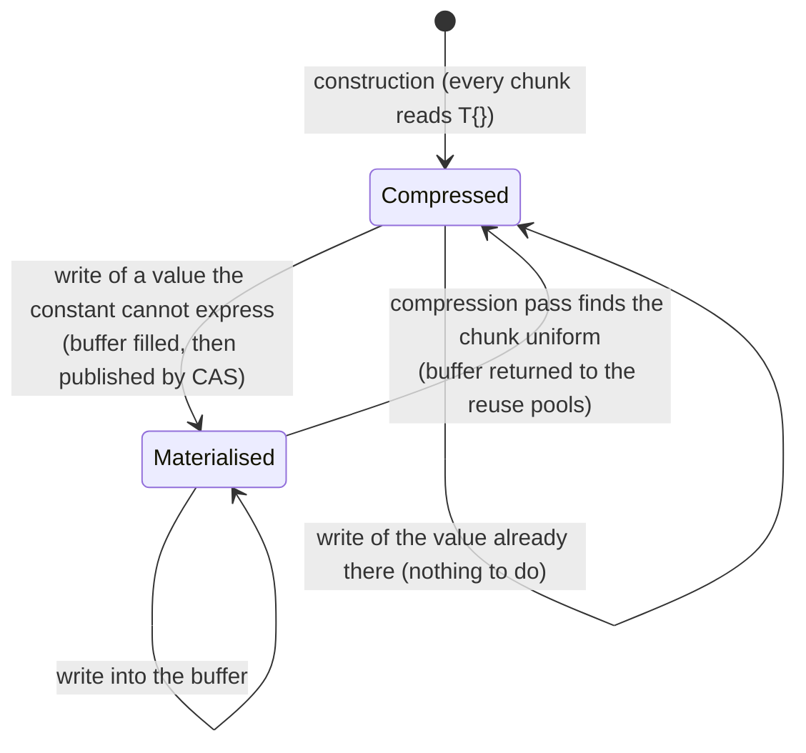
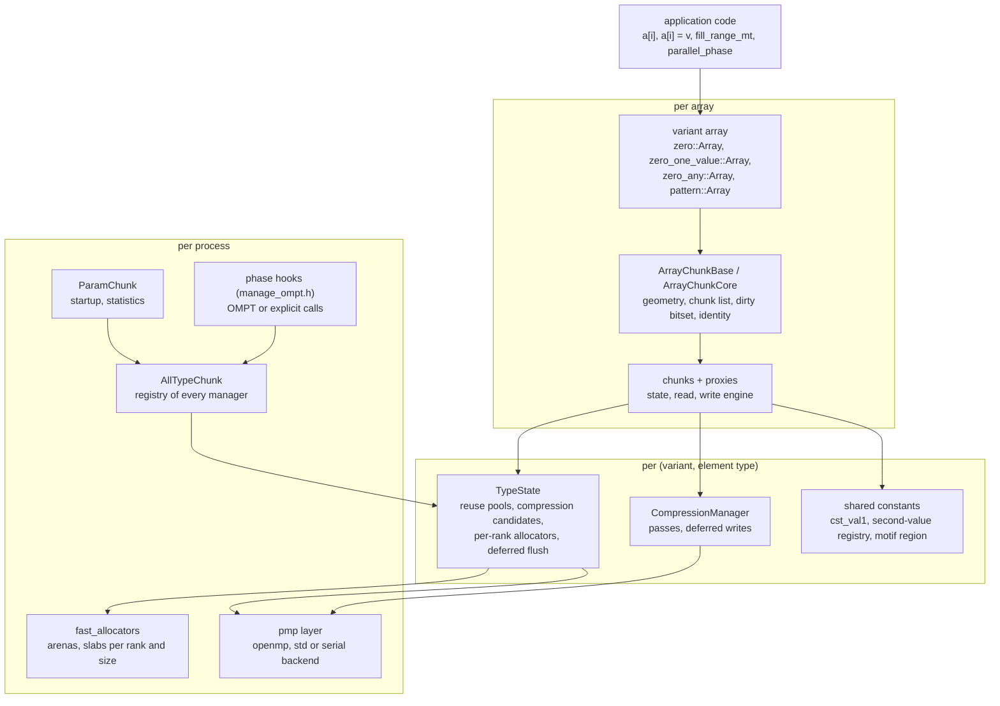
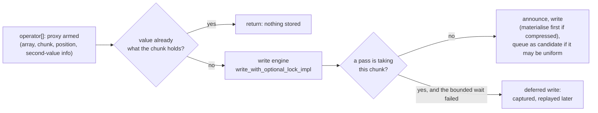

# Design of shrink-array

> French version: [conception_fr.md](conception_fr.md).

> Status: November 2026, `develop`. This document gives the **overall design**: what the library
> must achieve, how it is cut into parts, which decisions hold it together and why, and what
> was rejected. It is the entry point for anyone who changes the library; the mechanisms
> themselves are described, in detail, in the documents it points to (section 15). When in
> doubt, the code is the reference.

***

## 1. Goals and non-goals

shrink-array gives C++ HPC codes arrays that **read and write like a `std::vector`** and stop
paying for the parts that hold one repeated value. The requirements, in the order in which they
constrain the design:

| # | requirement | what it imposes |
|---|---|---|
| R1 | **drop-in**: `a[i] = v`, `a[i] += x`, range-for, `resize`, `push_back`; the loops of a `std::vector` code stay as they are | the compression is invisible: no index translation, no explicit "compress" step required, no loss |
| R2 | **memory**: a chunk that holds one value costs a few bytes of metadata | an element has no stable address; the storage changes under the program (materialise, compress) |
| R3 | **many threads**: 10⁹ elements, a few hundred threads, writes from every thread, also into the same chunk | no lock on the read or the write path; the storage changes while other threads access it |
| R4 | **any value type**: arithmetic types, `std::complex`, enums, user aggregates; types not known to the library in advance | the element contract is a concept, not a list; per-type state is created on first use |
| R5 | **any threads**: OpenMP, the program's own `std::thread`s, TBB tasks; OpenMP not imposed on the consumer | the library's own parallel work goes through a backend layer; the phase boundaries are a contract, not an OpenMP callback |
| R6 | **portable performance**: x86-64 and AArch64 (weakly ordered: Grace), GCC, Clang, oneAPI, NVHPC | every memory order argued and checked; no reliance on x86's total store order |
| R7 | **C++20, Linux, CMake, Spack** | `membarrier`, `mmap`, `madvise` are available; nothing newer than C++20 in `develop` |

What the library deliberately does **not** do:

- `data()`, `T&`, mutable iterators: a compressed chunk has no buffer (R2);
- `insert` / `erase` in the middle: they would shift every chunk;
- lossy compression, or compression of data that is merely smooth: a chunk is compressed only
  when it is exactly reproducible from shared data plus a few bytes (zfp, Blosc2 and the
  others are compared in [alternatives.md](alternatives.md));
- distributed memory: one process, its threads; MPI is the application's business;
- GPUs: a separate design ([gpu_design.md](gpu_design.md)), which keeps the format but not the
  handshakes.

## 2. The central idea and its consequences

An array is cut into **chunks** of `S` consecutive elements (`S` a power of two or a multiple of
64). Each chunk holds one atomic pointer, `values`, which names either a **buffer of its own**
(the chunk is *materialised*) or **shared, read-only data** from which every element can be
recomputed (the chunk is *compressed*): the constant buffer of `T{}`, a buffer filled with a
second value, or, for `pattern`, a motif to which the chunk adds its offset.

Four consequences shape the whole library:

1. **A read is a load of `values` and an indexed load.** It never branches on the chunk's state:
   a compressed chunk's shared data hold at least as many elements as a chunk, so `chunk[num]`
   is the same instruction for every state. Only `pattern` adds the offset, in a branch compiled for it alone.
2. **A write goes through a proxy.** The non-const `operator[]` returns a proxy that knows the
   array, the chunk and the position. The proxy sees the value *before* storing it: writing the
   constant a chunk already holds costs a comparison and allocates nothing.
3. **Compression is deferred and batched.** A write that may have made a chunk uniform only
   queues it as a *candidate*; a *pass* scans the candidates later and takes the buffers back.
   No write ever compresses inline in a threaded build.
4. **The storage changes under the threads.** Materialisation (a writer installs a buffer) and
   compression (a pass removes one) happen while other threads read and write. Making that safe
   without locks is where most of the complexity lies (section 7).

## 3. The parts

| part | main classes | files | scope |
|---|---|---|---|
| the variant arrays | `zero::Array`, `zero_one_value::Array`, `zero_any::Array`, `pattern::Array`, `ArrayChunkBits` | `chunk/zero_array.h`, `chunk/zero_one_value_array.h`, `chunk/zero_any_array.h`, `chunk/pattern_array.h`, `chunk/array_chunk_bits.h` | one object per array |
| the common array | `ArrayChunkBase`, `ArrayChunkCore`, `SecondValueArrayBase`, `RechunkSupport` | `internal/array_chunk_base.h`, `internal/array_chunk_core.h`, `internal/second_value_array_base.h`, `internal/array_chunk_rechunk.h` | bases of every array |
| chunks | `zero::Chunk`, `zero_one_value::Chunk`, `zero_any::Chunk`, `pattern::Chunk`, `ChunkBase` | `chunk/internal/zero_chunk.h`, `chunk/internal/zero_one_value_chunk.h`, `chunk/internal/zero_any_chunk.h`, `chunk/internal/pattern_chunk.h`, `internal/chunk_base.h` | an element of the array's chunk list |
| proxies, write engine | `ProxyBase`, `WriteCompressSyncPolicy`, the variants' `Proxy` | `internal/proxy_base.h`, `internal/write_compress_sync_policy.h` | a temporary per write |
| per-type state | `TypeState` (facade), `ReusePools`, `CompressCandidates`, `CompressionManager` | `internal/type_state.h`, `internal/reuse_pools.h`, `internal/compress_candidates.h`, `internal/compression_manager.h` | one per (variant, element type), static |
| shared constants | `TabCstVal2Holder`, `GlobalVecHolder`, `MotifRegion` | `internal/tab_cst_val2_holder.h`, `internal/motif_region.h` | one per element type |
| process registry, startup | `AllTypeChunk`, `ParamChunk` | `internal/all_type_chunk_decl.h`, `chunk/param_chunk.h` | one per process |
| phases | `begin_parallel_phase`, `finalize_parallel_phase`, `parallel_phase` | `chunk/manage_ompt.h`, `chunk/private/manage_ompt.cpp` | one phase at a time |
| backend, ranks | `pmp::Team`, `pmp::parallel_for` | `chunk/internal/PMP_CHUNK.h`, `fast_allocators/internal/pmp_loops.h`, `fast_allocators/internal/pmp_std.h` | process-wide |
| allocation | slab arenas, per-rank allocators | `fast_allocators/slab_arena.h`, `fast_allocators/tc_allocator.h` | process-wide |
| dynamic geometry | `ChunkSizeAdvisor`, `RechunkDecider`, `RechunkPolicy` | `chunk/chunk_size_advisor.h`, `chunk/rechunk_decider.h`, `internal/chunk_size_policy.h` | per array, driven by the program |

The split per (variant, element type) is the backbone: everything that must be shared between
the arrays of one type -- the pools a compressed buffer goes back to, the candidate lists a
pass drains, the registry of second values -- lives in that type's manager, and nothing is
shared across types.

What a program sees is much narrower: the 18 headers of `chunk/public/chunk/` outside `internal/`
(the arrays, the range operations, the export and import of chunk states, the start and stop of
the library, the phases, the dynamic geometry, the configuration, the log, the threads and the output). They and the names
of [api.md](api.md) are the interface, frozen in `scripts/public_api.txt` and checked by
`check_public_api`; everything else, including the members of the public classes that name the
machinery (`ManagerType`, `ChunkListType`...), can change in any release.

## 4. Static polymorphism

The hot paths (a read, a write) must compile to a handful of instructions, so the variants are
assembled at compile time:

- **CRTP everywhere on the hot path.** `ArrayChunkBase<Derived>`, `ChunkBase<T, Derived>` and
  `ProxyBase` reach the variant through `derived()`; there is no virtual call between an
  `operator[]` and the store. The variant's specifics are hooks with defaults (the `rechunk_*`
  hooks of `RechunkHookDefaults`, for instance).
- **Policies instead of preprocessor branches.** The parts that differ between a threaded and a
  serial build, or a static and a dynamic geometry, are policy classes selected by a `bool`
  template parameter (`ChunkCounterPolicy` against the threaded policies, `DeferredReadGate`,
  `TypeStateParallelImpl`, `TypeStateDynImpl`). The selectors are `constexpr` values of
  `build_config` and `chunk_config` (`chunk/config.h`), tested with `if constexpr`; the
  remaining `#ifdef`s are the ones `if constexpr` cannot replace (an include, a declaration
  that does not compile in the other build), and the rules that decide which are written at
  the top of `examples/shrink_bench/bench_config.h`.
- **Virtual dispatch only where it is cold.** `AllTypeChunk` must act on every manager of the
  process -- start the passes, flush the deferred writes, tear down -- without knowing their
  types: it holds `TypeStateInterface` pointers and calls virtuals, at phase boundaries only.
- **Traits for the families, never the exact type.** `ChunkTraits` and `ArrayChunkTraits`
  (`chunk/internal/chunk_traits.h`) map a chunk to its proxy and manager, an array to its chunk. Code
  shared by `zero_any` and `pattern` tests the family (`is_zero_any_family_v`) and the motif
  state (`has_motif_state_v`): a new member then lands in the right branch or fails to compile.
  A member that exists on one variant only is reached through a `std::is_same_v` test against
  the class declared in `chunk_traits.h` plus a `static_assert`, never through a `requires`
  that would silently pick the other branch.
- **The index type does not split the machinery.** `zero_any::Array<T, int>` and
  `zero_any::Array<T, long>` are different types, but the chunks, proxies and managers are
  templated on `T` alone. They see the array through `ArrayChunkCore<ChunkType>`, laid out the
  same whatever the index type; the pointer they hold is the address of that subobject
  (`registry_key()`).

The family construction is what made `pattern` cheap: it is `zero_any`'s chunk, array and proxy
(`zero_any::ChunkImpl`, `zero_any::ArrayImpl`, `zero_any::ProxyImpl`) with a motif state added
through the traits, and `zero_any`'s machine code is unchanged by its existence.

## 5. Build-time configuration

What decides the cost of an access is fixed when the library is built, not when it runs:

| choice | how | why at build time |
|---|---|---|
| variant | one library per variant (`chunk::chunk_zero`, `chunk::chunk_zero_one_value`, `chunk::chunk_zero_any`), which defines `CHUNK_VARIANT_ZERO`, `CHUNK_VARIANT_ZERO_ONE_VALUE` or `CHUNK_VARIANT_ZERO_ANY`; `CHUNK_VARIANTS` | the variant changes the chunk layout and the write path |
| geometry | static sizes (`CHUNK_STATIC_SIZES`, libraries `_256`, `_1024`...) or dynamic (`CHUNK_BUILD_DYN`, libraries `_dyn`, `CHUNK_DYNAMIC`) | a static size makes `i >> shift` and `i & mask` immediates; a dynamic one reads them from the array |
| threading backend | `CHUNK_THREADS`: `openmp`, `std` or `serial` | the per-rank structures, the handshakes and the counters exist only in threaded builds |
| phase driver | `CHUNK_OPT_OMPT` | with OMPT the runtime marks the phases; without it the program does |
| allocator | fast allocators (default) or `CHUNK_STD_ALLOC` | the standard allocator is what AddressSanitizer understands |
| checks | the check builds (`any_check`, `CHUNK_DO_CHECK`) | invariant checks and protocol assertions cost time on every access |

`pattern::Array` and `ArrayChunkBits` are not separate libraries: they come with the `zero_any`
and the `zero_one_value` libraries respectively. The CMake files generate the per-size and
per-variant declinations and keep the default names as aliases;
[environment_variables.md](environment_variables.md) lists the options.

## 6. An access, from the call to the memory

### 6.1 Read

`operator[] const` splits the index (`num_chunk = i >> shift`, `num = i & mask`), passes the
**read gate** (`sync_chunk`: a bit per chunk, the *dirty bitset*, says whether a deferred write
may be pending on it; almost always zero, the read goes straight on; otherwise the chunk's
counter decides whether to replay its pending writes first, `reader_sync`), then loads `values`
and the element. It returns a `T`, never a reference.

### 6.2 Write

- **Materialisation** (`create_value`): a buffer comes from the thread's reuse list or from the
  per-rank allocator, is filled with the constant the chunk is leaving, and is published by a
  CAS on `values`. A reader sees the old constant or the complete buffer; the loser of a CAS race
  recycles its buffer.
- **Candidates**: a write that turns an element into a compressible constant queues the chunk
  once (an atomic flag per chunk) in the rank's candidate list. A list that grows past its
  threshold makes its rank run a pass on its slow path; the phase end runs the rest.
- **Deferred writes**: when a pass is taking the chunk, the write is not lost: it is captured
  in a pooled context on the thread's queue and replayed by the next read of that chunk, at a
  barrier, or at the end of the phase. The replay keeps the geometry of the operation.
- **Range operations** (`fill_range`, `copy_range`, and their `_mt` forms, `store_range_mt`)
  make one decision per chunk and write the rest straight into the buffer, inside the same
  announced session as an element write.

[algo_zero_one_value.md](algo_zero_one_value.md) follows these steps in the code; [algo_zero.md](algo_zero.md),
[algo_zero_any.md](algo_zero_any.md) and [algo_pattern.md](algo_pattern.md) give what each variant does
differently.

### 6.3 Compression pass

A pass takes one rank's candidate list, announces itself to the writers (section 7.3), scans each
candidate chunk against the constants the variant can express, swings `values` of the uniform
ones to the shared data, and returns their buffers to the reuse pools **at the chunk's own size**.
In serial builds the same decision is taken inline from per-chunk counters
(`chunk_config::use_compression_with_counter`), since no other thread can interfere.

## 7. Concurrency model

### 7.1 Phases and serial points

The program alternates **serial points** and **parallel phases**:

- during a **phase**, the program's threads read and write elements concurrently, on any indices,
  including neighbours in one chunk; the library may materialise, queue, defer and run passes;
- at a **serial point**, one thread is alone with the arrays: `resize`, `shrink_to_fit`,
  `assign`, a rechunk, the range operations without `_mt`, the export and import of
  chunk states (`chunk/chunk_exchange.h`), `set_second_value`.

Building and destroying an array is neither: a thread may do it inside a phase, for a work
array of its own. That **cold path** writes state shared by every array of the element type
(the identity registry, the next `num_tab`, the outer per-array tables, the manager's totals),
so it takes one lock for the whole library (`internal/cold_path_lock.h`). The hot path takes
none: the tables it indexes by `num_tab` never move their rows (`internal/stable_table.h`), the
thresholds it reads are atomics, and the registry has a reader lock for the lookups made
outside the cold path (replays, check builds). A teardown inside a phase cannot walk the other
ranks' candidate lists and deferred queues, which their threads are appending to:
`internal/tab_users.h` records which ranks hold something of each array, and an array that
only the calling rank has used is torn down on that rank alone, with no pass over the other
arrays. Before its chunk list is freed, one grace period of `read_reclaim` covers a
compressor's `start()`, whose scan reads the chunk each writer announced. A `resize()` inside a
phase, by the thread that owns the array, must empty the candidate lists of that array's chunks
before it reallocates the chunk list; its pass takes no writer handshake, so it runs on that
array's candidates alone, the others set aside for its duration (`internal/own_candidates.h`).

The **phase contract** (`chunk/manage_ompt.h`): every thread that writes calls
`begin_parallel_phase()` before its first write (it caches its rank), and one thread calls
`finalize_parallel_phase()` once all writers have stopped: it drains every rank's deferred
queue and runs the remaining passes. An OMPT build has the OpenMP runtime make these calls;
otherwise `parallel_phase()`, the TBB adaptor (`chunk/tbb_adaptor.h`) or the program makes them.
Progress of everything deferred is guaranteed there, at a point without concurrency: this is
what lets every wait inside a phase be bounded.

One top-level team writes arrays at a time (two concurrent teams would share ranks, hence
queues): `phase_guard` refuses it once an array exists. Nested regions are fine; two **active**
nesting levels are not.

### 7.2 Ranks and per-rank structures

Every per-thread structure -- allocators, reuse lists, candidate lists, deferred queues, writer
and flush flags -- is an array indexed by the thread's **rank** in the active team, sized once at
the thread capacity (the largest of the OpenMP thread count, the number of cores and a floor of
256, raised by `CHUNK_THREAD_CAPACITY`). Indexing by rank rather than by `thread_local` keeps
the structures reachable from the thread that drains them at a serial point, and keeps their
cost at about 1 KiB per rank and element type. The std backend gives non-OpenMP threads a dense
rank from a registry of the same capacity.

### 7.3 Three lock-free handshakes

The storage changes under the threads in three ways, each guarded by a **Dekker handshake**:
two actors each announce themselves, then look at the other, so that at least one of them sees
the other. Where one side is frequent (a writer, a reader), the handshake is **asymmetric**: the
frequent side pays a store and a compiler barrier, the rare side a `membarrier()` that makes
every core of the process execute a full barrier. Between a pass and a flush, both rare, both
sides pay:

| handshake | first side | second side | the hazard |
|---|---|---|---|
| writers ↔ compressor | writer: `announce_write`, re-check the chunk's `steal_mark_`, write, `end_write` | pass: mark, `hard_inflight_`, `membarrier`, bounded wait on the writers of marked chunks | a writer storing into a buffer the pass is handing back |
| compressor ↔ flush | flush: `announce_flush`, then waits while `stealing_inflight_` is set; never backs off | pass: after `stealing_inflight_`, a second look at the flushes; backs off if it sees one | a replay into a chunk the pass is folding back to its constant |
| readers ↔ reclamation | reader: `ReadSection` (odd sequence number during a read) | pass inside a region: `PassScope`, `heavy_barrier()`, wait for odd readers | a reader loading from a buffer already reused |

Without `membarrier` (old kernel, seccomp, TSan) both sides fall back to `seq_cst` fences. Every
wait is bounded and every side has a way out -- a writer defers, a pass gives up, a reader is
waited for only while its read is in flight -- so no thread can block another for long.
Materialisation needs no handshake: fill, then publish by CAS.
[synchronisation_dekker.md](synchronisation_dekker.md) gives the algorithm, the proofs and the rules
for modifying this code.

### 7.4 How it is checked

Tests alone do not settle a wrong memory order: on a weakly ordered processor it shows up once in
thousands of runs. The design therefore has four levels of evidence:

1. **reduced models** of each handshake (`formal/`), explored exhaustively by GenMC under RC11
   and IMM, and calibrated by mutations they must refuse ([formal_models.md](formal_models.md));
2. **check builds** that assert the protocol invariants at run time (`any_check`);
3. **ThreadSanitizer** and **AddressSanitizer** builds (the std backend and `CHUNK_STD_ALLOC` make
   both meaningful), and harnesses that force the rare paths (`deferred_path_validation`,
   `read_reclaim_validation`);
4. **stress series** at random thread counts (`python/multi_launch_stress.py`) on x86-64 and
   AArch64.

A change to an atomic or to an order in a handshake is a change to its model too.

## 8. Memory

### 8.1 Three kinds of memory

| kind | where | proportional to |
|---|---|---|
| **metadata** | the chunk object (16 bytes in an OpenMP build), the candidate flag, the dirty bitset, and for `zero_any` the constant-type byte and the second-value slot | the number of chunks, compressed or not |
| **buffers** | one per materialised chunk, from the fast allocators | the number of materialised chunks × `S` |
| **shared data** | the `T{}` buffer, the second-value registry, the motif region | the number of distinct constants or motifs, per element type |

Small chunks compress finely but multiply the metadata; large chunks do the opposite. That
trade-off is why the geometry can change at run time (section 9).

### 8.2 The allocators

`fast_allocators` serves the buffers from **slabs**, per rank and per chunk size, carved from
**arenas**: large `mmap` reservations, one per kind of object (chunk buffers, deferred
operations, their contexts: `ArenaKind`), never unmapped. Disjoint arenas make it impossible for
a freed operation's memory to come back as a value buffer while the operation still lives there;
never unmapping them makes the arenas outlive every static and `thread_local` that may free into
them at teardown. The price is that freed memory stays resident until `EmptySlabSweep` drops the
pages of emptied slabs.

Around them, the manager's **reuse pools** keep the buffers a pass returned, per rank, **keyed by
geometry** (a buffer sized for one chunk size is never popped at another). A buffer freed by a
rank other than its owner is parked and returned to its owner's pool. An array above
`CHUNK_ALLOC_AFFINITY_MIN_BYTES` (16 MiB by default) can get its own allocator set (an
*affinity key*), so that its memory leaves in whole slabs when it is rebuilt or destroyed --
eagerly for `zero`, lazily (at its first rechunk) for `zero_one_value` and `zero_any`, whose memory is
mostly metadata.

### 8.3 Shared constants

- `zero`: one constant buffer of `T{}` per element type.
- `zero_one_value`: the array's second value, one buffer per declared value, found through the
  per-type registry and mirrored in the array.
- `zero_any`: the **second-value registry** of the element type, chained segments of 64 slots
  (registering a value never moves another), a lock-free hashed lookup for a known value, an
  insertion lock for a new one; values are filled before they are published.
  `reclaim_second_values()`, at a serial point, frees the values no chunk refers to any more.
- `pattern`: the **motif region**, the motifs shared by every chunk of that shape, admitted when
  a second chunk shows the same motif.

## 9. Dynamic geometry

In `_dyn` builds each array has its own chunk size, which can change during the run. Three actors,
kept apart so that the library itself takes no decision from the environment:

- the **advisor** (`ChunkSizeAdvisor`) estimates the array's memory at each candidate size from
  the chunk states, sampling the materialised chunks where a size cuts across them;
- the **decider** (`RechunkDecider`, settings in `RechunkPolicy`) decides when and to which size,
  with stability, cooldown, anti-reversal and gain-per-cost rules, and learns from the gain it
  actually obtained;
- `rechunk_to()` rebuilds the storage at a serial point: compress the pending candidates, build
  a new storage at the new size, refill it in parallel by slices, fold the chunks whose sources
  were all compressed, swap identities (`num_tab`, registry keys), destroy the old storage --
  freeing, not emptying, everything indexed by its identity.

The memory of the old geometry leaves only by whole slab: this is why the affinity keys exist,
and why a rechunk should cover every large array of a type. [adaptive_rechunk.md](adaptive_rechunk.md)
gives the criteria and the measurements.

## 10. Threading backends

The library's own parallel work (rechunk slices, team drains, passes at the phase end, the
advisor's scans) is written once against the `pmp` layer: `pmp::parallel_for`, `pmp::team` with
a `pmp::Team` that offers static and dynamic loops, `barrier()`, `single()`, `masked()`. Three
backends implement it:

| backend | `CHUNK_THREADS` | the library's threads | the application's threads |
|---|---|---|---|
| OpenMP | `openmp` | OpenMP's | OpenMP's (OMPT build: phases marked automatically) |
| std | `std` | `std::jthread` workers of its own | any: `std::thread`, a pool, TBB through `chunk/tbb_adaptor.h` |
| serial | `serial` | none | one |

The decision was to keep two threaded backends in the library and to adapt TBB on top of the std
backend rather than add a TBB backend: a TBB program links TBB, the library does not depend on it.
[threading_backends.md](threading_backends.md) records the steps and the phase contract.

## 11. Process-wide state and lifetime

- **No list of types.** The first array of an element type registers its manager with
  `AllTypeChunk` (`ensure_manager`), sequentially; from then on the type takes part in every
  pass, flush and teardown. Any type that satisfies `ArrayChunkElement` (trivially copyable,
  equality comparable, default constructible) works, including the program's own aggregates.
- **Startup**: `ParamChunk::init_indexes()` is optional; the first array calls it.
- **Shutdown**: `release_chunk_pools()` and `destroy_block_chunk()` give the pools back; the
  arenas and the singletons that serve teardown are immortal (`LazyImmortal`), so that static
  destruction order cannot free memory a later destructor still uses.
- **One library state per process**, shared by every component that uses it; the
  consequences for libraries that embed shrink-array are in [getting_started.md](getting_started.md),
  section 5.

## 12. Observability

| need | mechanism |
|---|---|
| warnings and errors | one line each on stderr; `CHUNK_LOG` raises a channel (`rechunk`, `memory`, `advisor`, `compress`, `ompt`), `CHUNK_LOG_FILE` redirects, `shrink_array::logging::set_sink()` hands them to the program |
| counters | the `CHUNK_STATS` build and `ParamChunk::chunk_stats()`: passes, aborts, deferred writes, reuse, parked bytes |
| memory | measured exactly, not through `VmRSS` alone ([performance_measurement.md](performance_measurement.md)) |
| post-mortem of a race | the ring log of the debug builds (`chunk/internal/ring_log_debug.h`) |
| invariants | the check builds, which stop with a message naming the broken rule |

## 13. Decisions and the alternatives rejected

| decision | rejected alternative | why |
|---|---|---|
| no lock on the access paths; asymmetric Dekker handshakes | a lock per element or per chunk (the first versions) | a lock on every write does not scale to hundreds of threads |
| `membarrier` on the rare side | `seq_cst` fences on both sides | the writer pays a full fence on every write; kept as the fallback |
| deferred writes when a pass holds the chunk | making the writer wait for the end of the pass | a bounded wait plus deferral keeps every wait short and lets a pass give up |
| grace period per pass for readers | deferring all buffer reuse to the end of the region | a loop that compresses inside a region would reallocate everything |
| compression in batches, by candidate lists | compressing inline at each write | inline needs per-chunk counters, which threaded writes cannot keep exact |
| chunk size per array, rebuilt by `rechunk_to()` | one global chunk size | arrays of one program want different sizes, and a size must be able to change |
| reuse pools keyed by geometry | one free list per rank | mixing geometries handed a buffer of one size to a chunk of another |
| second-value registry in segments | a resizable vector | a resize invalidates pointers other threads hold |
| per-type state created on first use | a registered list of element types | the program's own types must work without touching the library |
| CRTP and policies | virtual chunk and proxy classes | a virtual call per access, and no inlining of the write path |
| `ArrayChunkBits` as a type of its own | specialising `Array<bool>` | `std::vector<bool>`'s mistake: a specialisation that changes behaviour behind the type |
| `pattern` as a member of the `zero_any` family, through traits | a copy of the `zero_any` files | one write engine to maintain, `zero_any`'s code unchanged |
| backends behind `pmp`, TBB through an adaptor | OpenMP required, or a TBB backend inside | OpenMP must not be imposed, and the library must not depend on TBB |
| decider settings in `RechunkPolicy` | environment variables | the program, not the environment, owns its policy |

## 14. Known limits

- **Access cost**: in loops that only access, a read costs about 1.9 times a vector's and a
  rewrite 7 to 16 times; the computation around the accesses absorbs part of it. Data whose every
  chunk holds varied values gain nothing and cost a little more than a `std::vector`.
- **Serial points**: anything that rebuilds the storage (`resize`, `shrink_to_fit`, a rechunk) runs
  with no concurrent access.
- **One top-level team at a time**, one active nesting level; a team wider than the thread
  capacity needs `CHUNK_THREAD_CAPACITY` before the first array.
- **Rechunk**: a transient memory peak during the rebuild (reduced by slicing), and freed slabs
  that go back to their arena rather than to the new size class.
- **The second-value registry** grows with the number of distinct values until
  `reclaim_second_values()` runs.
- **`pattern::Array`, three open points** ([algo_pattern.md](algo_pattern.md) §10):
  - *where the offset lives*: in the chunk's second-value slot today, which costs no byte per
    chunk but one more cache line per motif read; in the chunk object it would cost 8 bytes per
    chunk and save that line. To be settled by a measurement with `access_cost_pattern` on
    motif-heavy reads;
  - *the advisor's motif forecast* sees only the windows made of motif and constant chunks
    (`ChunkSizeEstimate::motif`); it read a motif chunk as data until November 2026, and could
    then coarsen an array whose motifs do not survive the larger windows (x51 measured);
  - *motifs shorter than a chunk* (a stride that does not divide the chunk size, an offset that
    grows inside the chunk) are not covered: `chunk[j] = P[j mod s] + (j div s) * step` would be
    a second kind of motif, to be measured on real connectivities first.
- **The models** cover small configurations (a few writers or readers, one chunk, one pass): they
  are not a proof for any number of threads.

## 15. Where to read next

| topic | document |
|---|---|
| using the library: install, CMake, first program, the threading rules | [getting_started.md](getting_started.md) |
| every call, by task | [api.md](api.md) |
| choosing a variant, what a chunk costs | [variants.md](variants.md) |
| the algorithm, read and write paths, passes, deferred writes, range operations | [algo_zero_one_value.md](algo_zero_one_value.md) |
| what `zero`, `zero_any` and `pattern` do differently | [algo_zero.md](algo_zero.md), [algo_zero_any.md](algo_zero_any.md), [algo_pattern.md](algo_pattern.md) |
| the handshakes, their proofs, the rules for changing them | [synchronisation_dekker.md](synchronisation_dekker.md) |
| the model checking of the handshakes | [formal_models.md](formal_models.md) |
| dynamic geometry and rechunk | [adaptive_rechunk.md](adaptive_rechunk.md) |
| the threading backends and the phase contract | [threading_backends.md](threading_backends.md) |
| the GPU design | [gpu_design.md](gpu_design.md) |
| settings, developer switches | [environment_variables.md](environment_variables.md), [developer_settings.md](developer_settings.md) |
| measuring memory and time | [performance_measurement.md](performance_measurement.md) |
| code rules, tests to run for a change | [contributing.md](contributing.md) |
