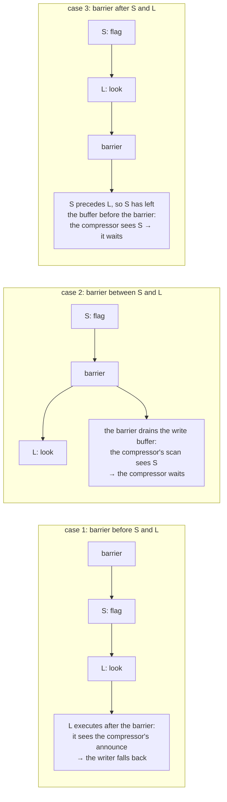
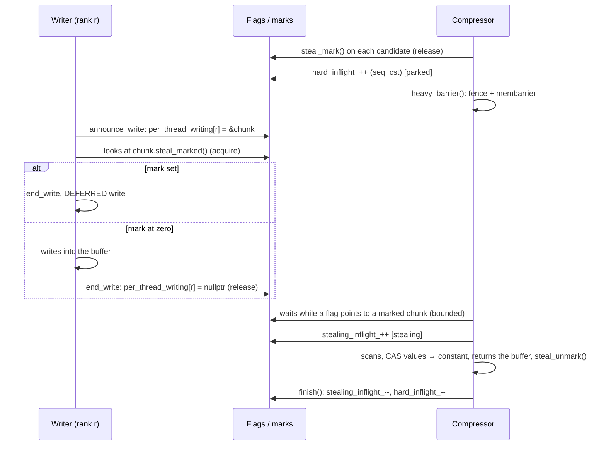

# Lock-free synchronisation: the Dekker protocol in shrink-array

> French version: [synchronisation_dekker_fr.md](synchronisation_dekker_fr.md).

> Status: early October 2026. This document explains how writers, compressors,
> deferred-write flushes and readers exclude each other **without a lock on the
> write path**. The overall machinery (proxies, deferred writes, in-flight
> compression) is described in [algo_chunk2.md](algo_chunk2.md) §7 and §8. The names used
> are those of the current tree; when in doubt, the code is the reference, in particular the
> comments in `internal/write_compress_sync_policy.h`, which carry the ordering proof.

***

## 1. The problem to solve

A materialised chunk owns a private buffer, referenced by its atomic pointer `values`. Two
kinds of actors touch it at the same time under OpenMP:

- the **writers**: each `tab[i] = v` loads `values`, then writes into the buffer. This path
  is the hottest in the library: billions of writes per run;
- the **compressor**: a compression pass rereads a candidate chunk, finds that it is
  uniform, replaces `values` with the pointer to the constant buffer (a CAS) and **returns the old
  buffer** to the reuse list, where another chunk can take it straight away.

Without care, the following interleaving loses a write, or corrupts another chunk:

| writer (thread A) | compressor (thread B) |
|---|---|
| loads `values` → buffer P | |
| | rereads P: everything is 0 |
| | CAS `values`: P → `cst_val1`, returns P |
| writes `v` into P | |
| | (P is reused by another chunk, which receives `v`) |

A lock per chunk or per array would solve the problem, but at an unacceptable price: it
would have to be taken on **every** write, while the compressor is **rare** (on the reference
benchmark, the compression gate sometimes does not open even once). So we need a mutual
exclusion whose frequent side costs almost nothing. This is the job of a
**Dekker**-style handshake, and of its **asymmetric** variant.

---

## 2. Dekker's algorithm

### 2.1 The principle

Dekker's algorithm (1965, published by Dijkstra) is the first mutual exclusion algorithm
between two threads that uses only memory reads and writes, with no
atomic instruction such as test-and-set. Its core fits in two flags:

```
// thread A                         // thread B
flag_A = 1;          // (1) announce flag_B = 1;
if (flag_B == 0)     // (2) look     if (flag_A == 0)
    critical_section();                   critical_section();
flag_A = 0;                           flag_B = 0;
```

Each thread first **announces** its intent, then **looks** whether the other has announced.
The argument is simple: whichever of the two writes its flag second necessarily sees the
first one's flag when it reads it afterwards. So it is **impossible for both to enter**.
It is possible, however, that neither enters (both see each other): the full algorithm
adds a "turn" variable to break the tie and guarantee that each one eventually gets through.

shrink-array only needs the "safety" half: never both at once. When the two
see each other, each side has a **fallback** that does not block: the writer **defers** its
write (§5.2), the compressor **gives up** its pass (§5.3). So there is no turn and no
unbounded wait.

### 2.2 Why it breaks on a modern processor

The proof above assumes that write (1) is visible to the other cores **before**
read (2) executes. This is not the case on a real processor: a write first goes
into the core's **write buffer** (*store buffer*), and the following read can
execute before the write leaves it. This store→load reordering is allowed **even
on x86** (TSO model), and all the more so on AArch64 and POWER:

| time | thread A | thread B |
|---|---|---|
| t1 | `flag_A = 1` (stays in A's write buffer) | `flag_B = 1` (stays in B's) |
| t2 | reads `flag_B` from memory: **0** | reads `flag_A` from memory: **0** |
| t3 | enters | enters |

Both enter. To prevent it, a **full barrier** is needed between the announce and the
look, which drains the write buffer before the read: `mfence` (or a `lock`
instruction) on x86, `dmb ish` on AArch64. In C++: a `seq_cst` `store` followed by a
`std::atomic_thread_fence(std::memory_order_seq_cst)`. A plain *release*/*acquire* pair
is not enough: it orders store→store and load→load, not store→load.

---

## 3. The symmetric version

This is the "textbook" form: **both sides** pay a full barrier.

```cpp
// writer (WriteCompressSyncPolicy::begin_write + announce_write, symmetric shape)
per_thread_writing[thr].v.store(chunk, std::memory_order_seq_cst);
std::atomic_thread_fence(std::memory_order_seq_cst);
if (must_defer_write(chunk)) { /* a compressor is there: fall back */ }

// compressor (CompressionManager::start)
hard_inflight_.fetch_add(1, std::memory_order_seq_cst);
std::atomic_thread_fence(std::memory_order_seq_cst);     // in dekker::heavy_barrier()
while (any_thread_writing_on_marked()) { /* bounded wait */ }
```

**The proof in the C++ memory model** ([atomics.order]): `seq_cst` fences are
all placed in a single total order S. Let A be the writer's announce, X its fence, Y
the compressor's fence, and B the compressor's read of the writer's flag. If X
precedes Y in S, then B sees A: the compressor sees the writer and waits for it. Otherwise, Y
precedes X, and by the same rule with roles swapped, the read made by the writer after X sees
the compressor's announce: the writer takes the slow path. Never both.

**The cost.** On AArch64, the writer pays `stlr` + `dmb ish` + `ldar` on **every** element
write (an `mfence` on x86): about 70% of the time of `write_with_optional_lock_impl`
in the profiles. Measured on `shrink_bench` chunk2a_256 with 6 threads on x86: +7% total time
compared with an engine without a handshake, against −7% for the asymmetric version.

The symmetric form remains the one used by **ThreadSanitizer** builds (TSan does not model
`membarrier` and would report races that do not exist) and by non-Linux
systems. It also serves as a **runtime fallback** when `membarrier` registration
fails (§4.3).

---

## 4. The asymmetric version

### 4.1 The idea: make the rare side pay

The two sides do not have the same frequency: billions of writes, a few compression
passes. The asymmetric version **removes the barrier from the frequent side** and makes the
rare side issue a much stronger barrier, which acts **on the other cores**.

This barrier is the Linux system call
**`membarrier(MEMBARRIER_CMD_PRIVATE_EXPEDITED)`**: the kernel sends an
inter-processor interrupt to each core running a thread of the process, each one executes a
full memory barrier there, and the call only returns once all of them have done so. The rare
side thus "borrows", at a given instant, the barrier that is missing from each writer's
instruction stream.

```cpp
// writer: asymmetric shape (announce_write)
per_thread_writing[thr].v.store(chunk, std::memory_order_relaxed);
std::atomic_signal_fence(std::memory_order_seq_cst);   // COMPILER barrier only
if (must_defer_write(chunk)) { ... }                   // ordinary load (acquire)

// compressor: dekker::heavy_barrier()
std::atomic_thread_fence(std::memory_order_seq_cst);
syscall(SYS_membarrier, MEMBARRIER_CMD_PRIVATE_EXPEDITED, 0, 0);
```

On AArch64, the writer's announce becomes a plain `str` followed by the `ldr`s of its look:
no processor barrier at all any more.

### 4.2 Why it is correct: the three cases

Fix one writer. Its announce S (the write of the flag) precedes its look L (the read of
the mark or of the counter) **in program order**; the compiler barrier guarantees
that the compiler has not swapped them. The compressor, for its part, announces itself (`seq_cst` write),
calls `membarrier`, then reads the writers' flags. The barrier that `membarrier` makes
the writer's core execute lands at some point in its instruction stream, and there are only
three possibilities:



In every case, at least one of the two sides sees the other: exactly Dekker's invariant.
This is the argument of the `membarrier(2)` man page, and the pattern of all
asymmetric exclusions in production: the HotSpot JVM *safepoints*,
.NET's `FlushProcessWriteBuffers`, Folly's `asymmetricHeavyBarrier`, liburcu.

Two details are essential:

- **the compiler barrier** (`atomic_signal_fence`): without it, the compiler may
  hoist read L above write S (they are two different locations), and
  the whole argument falls apart;
- **the `seq_cst` fence on the rare side stays** (`heavy_barrier()` issues it before the call):
  `membarrier(2)` requires the caller to have ordered its own announce before the call, and it is
  also what the symmetric form uses if the call is not available.

### 4.3 Registration and fallback

The "expedited" command must be registered once per process
(`MEMBARRIER_CMD_REGISTER_PRIVATE_EXPEDITED`). `dekker::register_membarrier()` does it from
`WriteCompressSyncPolicy::ensure_initialized()`, that is, in the constructor of the first
array of each variant, before any parallel write. The result is stored in
`dekker::membarrier_ready`, and **every writer announce checks it**:

| situation | form used |
|---|---|
| Linux, registration succeeded | asymmetric |
| Linux, registration refused (kernel < 4.14, seccomp) | symmetric, chosen **at run time** |
| TSan build (`CHUNK_TSAN_BUILD`), or non-Linux system | symmetric, chosen **at compile time** (`chunk_config::asymmetric_dekker = false`) |

So the protocol is never weaker than the symmetric form: it is only faster
when it can be. `ParamChunk::ChunkStats()` reports the form that ran
(`dekker::protocol_name()`).

### 4.4 The price, and the condition

A `membarrier` costs a few tens of microseconds at 64 threads: one interrupt on
each core of the process. This is negligible **as long as the rare side stays rare**. An engine
that sent all writes from a "dangerous" rank to the slow path (defer,
flush, try to compress, with an announce each time) would turn the
`membarrier` calls into a feedback loop: 4.7 s → 76 s on the benchmark. Hence several choices in the
library that have no other reason to exist:

- `start()` first looks, **before** its heavy barrier, whether a flush is in progress, and
  gives up straight away if so (during massive initialisation phases, this is
  96% of attempts: doing the `membarrier` first meant a storm of interrupts for
  compressions that did not happen);
- a flush announces **once for its whole loop**, not once per chunk: the
  initialisation phases flush tens of thousands of chunks per second per rank;
- a "dangerous" rank **writes** normally, and only launches its compression pass **after**
  its write (§5.2).

---

## 5. The library's three handshakes

The same building block is used three times, between different actors:

| frequent side (light) | rare side (heavy) | what is protected |
|---|---|---|
| the writer of an element | the compressor | the buffer the compressor steals and returns |
| — (the flush is itself rare) | the compressor ↔ the deferred-write flush | a write replay during a pass |
| the reader of an element | the pass that frees buffers inside a region | the buffer a reader is reading |

### 5.1 Who announces what, who looks at what



| actor | its flag (the announce) | what it looks at next |
|---|---|---|
| writer | `per_thread_writing[rank]` = address of the chunk being written | the chunk's **mark** (`steal_marked()`); without marks, `hard_inflight_ > 0` |
| compressor | the mark of each candidate, then `hard_inflight_` | the writer flags that point to a **marked** chunk |
| flush | `num_thread_flushing` (counter) | `stealing_inflight_` |
| compressor (2nd look) | `stealing_inflight_` | `num_thread_flushing` |
| reader | its sequence number, odd | — (it reads `values`) |
| reclaimer | — (it has already replaced `values`) | the readers' sequence numbers |

### 5.2 The writer side

`ProxyBase::write_with_optional_lock_impl` (`internal/proxy_base_inline.h`):

1. **Check no. 1**, a pure optimisation: if `must_defer_write(chunk)` is already true, wait
   a little (`wait_out_compressor`, bounded by `CHUNK_WRITE_WAIT_MAX_YIELDS` = 64 *yields*), **with no
   flag raised**: waiting this way does not close any compressor's window. A stale read
   here is harmless; check no. 2 is the one the proof covers.
2. **Announce**: `announce_write(rank, &chunk)` (§4.1).
3. **Check no. 2**: `must_defer_write(chunk)`.
   - False: the handshake is established, no compressor can touch `values` before
     `end_write`. The body of the write runs (marking for compression, then
     the write), then `end_write` (a *release* store of `nullptr`).
   - True: `end_write`, then the write is **deferred** (captured and put in the
     rank's queue, replayed later). It is never lost.
4. **Only after the write**, if the rank's candidate list has crossed the threshold ("dangerous"
   rank), this thread launches the compression pass
   (`run_slow_path(perform_compression)`), with the writer flag lowered.

The writer flag holds **the chunk's address**, not a boolean. This is what lets the
compressor wait only for the writers of the chunks **it has marked**: the others
keep writing while it scans. With a plain "is anyone writing?", all writers had to be
pushed aside to open the window at 64 threads: 350,000 waits of about forty
*yields* per reference run.

Each flag sits alone on its cache line (`alignas(128)`): a shared writer
counter, modified on every write, caused a storm of cache lines between cores.

### 5.3 The compressor side: parked, then stealing

`make_block_compression_impl` then `CompressionManager::start()`
(`internal/compression_manager_inline.h`):

1. if a flush is in progress, give up **before marking anything**
   (`block_pass_yields_to_flush`, `block_pass_precheck.h`);
2. **mark** each candidate (`steal_mark()`, *release* store);
3. `start()`: `hard_inflight_++` (`seq_cst`): the compressor is **parked**;
4. if a flush has announced itself in the meantime, give up (first look, with no proof value);
5. `heavy_barrier()`: fence, then `membarrier`;
6. wait, **in a bounded way**, until no writer flag points to a marked chunk. Beyond
   `CHUNK_COMPRESS_MAX_YIELDS` (10,000 *yields*), give up: the candidates stay in the list,
   they will be picked up by the next pass or by the pass between two regions, which runs with no
   concurrent writer. Giving up loses no compression;
7. `stealing_inflight_++`, fence: the compressor becomes **stealing**;
8. look again whether a flush is in progress (§5.4); if so, undo everything and give up;
9. scan each chunk, steal its buffer by CAS (`values` → constant), return it, unmark
   the chunk (`steal_unmark()`, *release*: a writer that then reads 0 sees the new state);
10. `finish()`: `stealing_inflight_--`, then `hard_inflight_--`.

**Why two counters.** `hard_inflight_` counts all compressors between `start()` and
`finish()`, **parked ones included**. `stealing_inflight_` only counts those
that have passed the gate and can steal a buffer. The materialisation of a chunk
(`create_value`, via `wait_before_materialise`) and the flushes wait **only** for the
stealing compressors (or the chunk's mark), **never** for the parked ones: a parked one waits for writers, a
writer in `create_value` would wait for the parked one, and flushes would wait for both, which is a
triangular deadlock. Both possible merges fail, hence the rule written in
`compression_manager.h`: **keep both counters**. The threads driving a pass are
not counted (only the CHUNK_STATS gate-driver statistic sees them), and such a
count **must never be waited on**.

`hard_inflight_` is **signed** on purpose: some aborts decrement it twice, and a
transient value of −1 leaves the `> 0` test false, whereas an unsigned one would jump to 4·10⁹ and
close the gate forever.

**Why the mark is read with *acquire*.** The heavy barrier publishes the **writers'**
announces to the compressor; it does not push the compressor's mark to a writer
already in flight. The mark travels in the other direction and needs its own
*release*/*acquire* pair: with a relaxed read, a writer could read it as zero after it
had been set, and write during the scan (confirmed by TSan). On AArch64, it is an
`ldar` instead of an `ldr`, on the chunk header line that the write loads anyway.
Never `seq_cst`: that read stalled behind the previous fence and dominated the
write engine's profile.

Every threaded build has the marks (`chunk_config::use_chunk_steal_mark`). The 8-byte build
without them (`SHRINK_SMALL_CHUNK`: global gate on `hard_inflight_`, the compressor waiting for
all writers) was removed; its gate is finding F1 of [formal_models.md](formal_models.md).

### 5.4 Compressor and deferred-write flush

A deferred write is **replayed** later by a flush (`flush_deferred`,
`flush_chunk_all_ranks`). The replay writes into the buffer **without** a writer handshake
(`in_flush_replay`: it is already in an exclusive section), so it must itself exclude the
compressors:

- **the flush**: `announce_flush()` (`num_thread_flushing++` in `seq_cst`, then
  `heavy_barrier()`), then waits while `stealing_inflight_ > 0`. It never backs off: the
  flush has priority;
- **the compressor**: after publishing `stealing_inflight_` (step 7), it looks at
  `num_thread_flushing` a second time (step 8) and backs off if it sees a flush.

It is this **second look** that forms the Dekker pair with the flush. The first one, taken
while the compressor was only parked, protects against nothing: a flush announced just after
saw `stealing_inflight_ == 0` and is already replaying. Without the second look, the compressor scanned
the constant from before the replay, the replay wrote, then the CAS put the chunk back on the
constant: the replayed write was lost (a wrong second value at one index of Chunk2A,
once in ~2,300 runs).

Between flushes, the exclusion is more classical: each rank has a lock (`xflush_lock_rank`),
taken by any thread that replays that rank's operations. A writer that writes directly
into a chunk where **its own** operations are pending takes its rank's lock
during its write: no concurrent replay of its operations can then get through, and they
stay in the queue.

### 5.5 Readers and buffer reclamation

A read (`ChunkBase::element_at`) loads `values`, then reads the element. A compression
pass launched **inside** a parallel region (by a dangerous rank, or by a `compress()`
called inside a region) steals and returns buffers while other threads are reading. The
writer/compressor handshake only waits for writers: a reader between its
load and its read could read a buffer already returned and reused.

`internal/read_reclaim.h` applies the same asymmetric building block, in the form of a **grace
period** (the technique of RCU and epoch-based schemes):

- **reader** (`ReadSection`): one sequence number per thread, **odd** during a
  read. Entry: plain store of the odd value, then the **light** side (compiler
  barrier, or full barrier in the symmetric form); exit: *release* store of the next even
  value;
- **reclaimer** (`PassScope`, around a pass inside a region): the returned buffers are
  **collected** instead of being freed. At the end of the pass, `heavy_barrier()`, then a read of
  each number: an even reader finished before, or will load `values` after the barrier and see
  the constant; an odd reader may hold an old pointer, and the reclaimer waits until
  its number changes. Then the buffers are returned, as before.
  its number changes. Then the buffers are returned, as before. (The entry store is a release
  too: a number that has moved to the next read's odd value must order the previous read's load
  before the release of the buffer, and by C++20 a relaxed store after a release store of the
  same thread would not -- [formal_models.md](formal_models.md), F3.)

One `membarrier` per **pass**, not per chunk; the wait only covers reads already in
flight (a few nanoseconds, barring preemption). Passes made between two regions do not
need it: no user read is running then. Beyond `CHUNK_READ_RECLAIM_SLOTS`
(1,024) reader threads, the following ones share a `seq_cst` counter, slower but correct.

### 5.6 Materialisation

Materialising a chunk (`create_value`) needs no handshake: the buffer is
**filled before it is published**, and publication is a single CAS from the constant to the
buffer. A reader sees the old constant or the complete buffer, never a half-filled
buffer; the loser of the CAS recycles its buffer. The only precaution, for a caller that holds
no writer flag (`alloc_chunk`, a flush replay): wait until no compressor can steal **this**
chunk (its mark, or `stealing_inflight_` without marks), otherwise the allocation could take
back the block that a pass is returning. A fast-path writer does not wait: a mark it sees after
its check no. 2 belongs to a pass **parked** on its own flag, which steals nothing before
`end_write`; waiting would make the two wait for each other until the compressor's yield budget
runs out ([formal_models.md](formal_models.md), F2).

---

## 6. Rules to follow when modifying this code

- **Always announce through the policy's verbs** (`announce_write`, `announce_flush`).
  `begin_write` and `begin_flush` are private: without the barrier that follows them, the handshake
  is wrong on weakly ordered processors.
- **Keep the compiler barrier** of the asymmetric form, and the program order
  announce → look.
- **All waits are bounded, and each side has a fallback** (defer,
  give up). Progress is guaranteed by the pass between two regions and by the end-of-phase
  flush, which run without concurrency.
- **Never wait on `hard_inflight_` (or on a count of pass drivers) from a path that may hold
  a writer flag or a rank lock**: only `stealing_inflight_` or the chunk's
  mark.
- **The rare side must stay rare.** Any change that multiplies compressor or flush
  announces multiplies the `membarrier` calls.
- **After any change**, rerun in a check build and under TSan the harnesses
  `deferred_path_validation` (forced deferred writes) and `read_reclaim_validation` (with
  and without `CHUNK_TEST_READ_DELAY_EVERY`, and under ASan with std-alloc), then a
  `multi_launch_stress.py` series: defects in this code show up once in thousands of
  runs.
- **The reduced model of the handshake** ([formal_models.md](formal_models.md), `formal/`) must
  still pass under GenMC with its mutations refused: a change to an atomic or to an order here
  is a change to the model too (its table maps every name to its line of the source).

Check builds (`any_check`) verify the protocol invariants and stop
with a `Dekker: ...` message if they are violated: flag raised right after the announce, still
raised during the body, lowered after `end_write`. They also commit a chunk's reservation
(`steal_commit()`, state 2) once the window is closed: a write into a chunk in that state
is a protocol violation.

## 7. Settings

| macro (`-D…`) | default | role |
|---|---|---|
| `CHUNK_WRITE_WAIT_MAX_YIELDS` | 64 | how long a writer waits in front of a compressor before deferring its write |
| `CHUNK_COMPRESS_MAX_YIELDS` | 10,000 | how long a parked compressor waits before giving up its pass (0: give up at the first writer seen) |
| `CHUNK_DEFERRED_DRAIN_THRESHOLD` | 4,096 | number of deferred writes of a rank beyond which it flushes its own queue |
| `CHUNK_READ_RECLAIM_SLOTS` | 1,024 | number of reader threads that each have their own sequence number |

The gate counters (passes started, aborts due to a flush, aborts on an overly
long wait, deferred writes) are in the `CHUNK_STATS` report (`ParamChunk::ChunkStats()`),
together with the form of the protocol that ran.

## 8. Where to read the code

| topic | file |
|---|---|
| the handshake, both forms, the proof | `internal/write_compress_sync_policy.h` (`dekker::`, `WriteCompressSyncPolicy`) |
| the choice of form | `config.h` (`chunk_config::asymmetric_dekker`, `tsan_build`) |
| the writer side | `internal/proxy_base_inline.h` (`write_with_optional_lock_impl`) |
| the compressor side, the counters | `internal/compression_manager.h`, `internal/compression_manager_inline.h` (`start`, `finish`, `wait_out_compressor`) |
| per-chunk marks | `internal/chunk_base.h` (`steal_mark_`) |
| the compression pass | `internal/chunk2_std_inline.h`, `internal/chunk2A_std_inline.h`, `internal/chunk_std_inline.h` (`make_block_compression*`), `internal/block_pass_precheck.h` |
| readers and reclamation | `internal/read_reclaim.h` |
