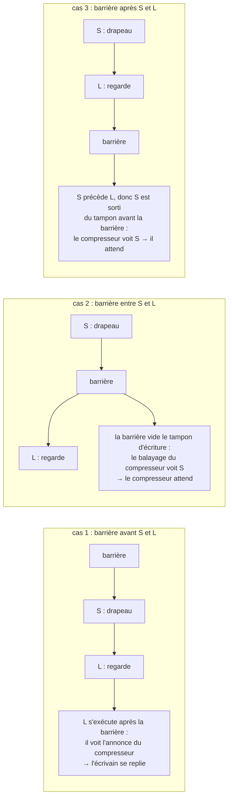
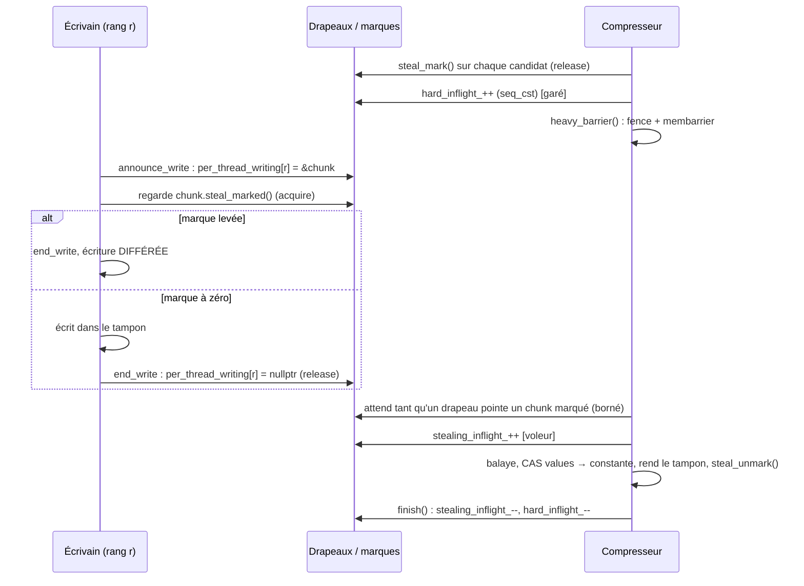

# Synchronisation sans verrou : le protocole de Dekker dans shrink-array

> English version: [synchronisation_dekker.md](synchronisation_dekker.md).

> État : début octobre 2026. Ce document explique comment les écrivains, les compresseurs,
> les vidages d'écritures différées et les lecteurs s'excluent mutuellement **sans verrou sur le
> chemin d'écriture**. La machinerie d'ensemble (proxys, écritures différées, compression en
> vol) est décrite dans [algo_chunk2_fr.md](algo_chunk2_fr.md) §7 et §8. Les noms cités sont
> ceux de l'arbre actuel ; en cas de doute, c'est le code qui fait foi, et en particulier les
> commentaires de `internal/write_compress_sync_policy.h`, qui portent la preuve d'ordonnancement.

***

## 1. Le problème à résoudre

Un chunk matérialisé possède un tampon privé, désigné par son pointeur atomique `values`. Deux
sortes d'acteurs le touchent en même temps sous OpenMP :

- les **écrivains** : chaque `tab[i] = v` charge `values`, puis écrit dans le tampon. Ce chemin
  est le plus chaud de la bibliothèque : des milliards d'écritures par run ;
- le **compresseur** : une passe de compression relit un chunk candidat, constate qu'il est
  uniforme, remplace `values` par le pointeur du tampon constant (un CAS) et **rend l'ancien
  tampon** à la liste de réutilisation, où un autre chunk peut le reprendre aussitôt.

Sans précaution, l'entrelacement suivant perd une écriture, ou corrompt un autre chunk :

| écrivain (thread A) | compresseur (thread B) |
|---|---|
| charge `values` → tampon P | |
| | relit P : tout vaut 0 |
| | CAS `values` : P → `cst_val1`, rend P |
| écrit `v` dans P | |
| | (P est réutilisé par un autre chunk, qui reçoit `v`) |

Un verrou par chunk ou par tableau réglerait la question, mais à un prix inacceptable : il
faudrait le prendre à **chaque** écriture, alors que le compresseur est **rare** (sur le banc
de référence, la porte de compression ne s'ouvre parfois pas une seule fois). Il faut donc une
exclusion mutuelle dont le côté fréquent ne coûte presque rien. C'est le rôle d'un protocole
de type **Dekker**, et de sa variante **asymétrique**.

---

## 2. L'algorithme de Dekker

### 2.1 Le principe

L'algorithme de Dekker (1965, publié par Dijkstra) est le premier algorithme d'exclusion
mutuelle entre deux threads qui n'utilise que des lectures et des écritures en mémoire, sans
instruction atomique de type test-and-set. Son cœur tient en deux drapeaux :

```
// thread A                         // thread B
flag_A = 1;          // (1) annonce   flag_B = 1;
if (flag_B == 0)     // (2) regarde   if (flag_A == 0)
    section_critique();                   section_critique();
flag_A = 0;                           flag_B = 0;
```

Chaque thread **annonce** d'abord son intention, puis **regarde** si l'autre s'est annoncé.
L'argument est simple : celui des deux qui écrit son drapeau en second voit forcément le
drapeau du premier quand il le lit ensuite. Il est donc **impossible que les deux entrent**.
Il est possible, en revanche, qu'aucun n'entre (les deux se voient) : l'algorithme complet
ajoute une variable « tour » pour départager et garantir que chacun finit par passer.

shrink-array n'a besoin que de la moitié « sûreté » : jamais les deux à la fois. Quand les deux
se voient, chaque côté a une **issue de repli** qui ne bloque pas : l'écrivain **diffère** son
écriture (§5.2), le compresseur **renonce** à sa passe (§5.3). Il n'y a donc ni tour ni
attente non bornée.

### 2.2 Pourquoi il casse sur un processeur moderne

La preuve ci-dessus suppose que l'écriture (1) est visible des autres cœurs **avant** que la
lecture (2) ne s'exécute. Ce n'est pas le cas sur un processeur réel : une écriture part
d'abord dans le **tampon d'écriture** (*store buffer*) du cœur, et la lecture suivante peut
s'exécuter avant qu'elle n'en sorte. Ce réordonnancement écriture→lecture est permis **même
sur x86** (modèle TSO), et à plus forte raison sur AArch64 et POWER :

| temps | thread A | thread B |
|---|---|---|
| t1 | `flag_A = 1` (reste dans le tampon d'écriture de A) | `flag_B = 1` (reste dans celui de B) |
| t2 | lit `flag_B` en mémoire : **0** | lit `flag_A` en mémoire : **0** |
| t3 | entre | entre |

Les deux entrent. Pour l'empêcher, il faut une **barrière complète** entre l'annonce et le
regard, qui vide le tampon d'écriture avant la lecture : `mfence` (ou une instruction
`lock`) sur x86, `dmb ish` sur AArch64. En C++ : un `store` `seq_cst` suivi d'un
`std::atomic_thread_fence(std::memory_order_seq_cst)`. Une simple paire *release*/*acquire*
ne suffit pas : elle ordonne écriture→écriture et lecture→lecture, pas écriture→lecture.

---

## 3. La version symétrique

C'est la forme « manuel » : **les deux côtés** paient une barrière complète.

```cpp
// écrivain (WriteCompressSyncPolicy::begin_write + announce_write, forme symétrique)
per_thread_writing[thr].v.store(chunk, std::memory_order_seq_cst);
std::atomic_thread_fence(std::memory_order_seq_cst);
if (must_defer_write(chunk)) { /* un compresseur est là : repli */ }

// compresseur (CompressionManager::start)
hard_inflight_.fetch_add(1, std::memory_order_seq_cst);
std::atomic_thread_fence(std::memory_order_seq_cst);     // dans dekker::heavy_barrier()
while (any_thread_writing_on_marked()) { /* attente bornée */ }
```

**La preuve dans le modèle mémoire C++** ([atomics.order]) : les barrières `seq_cst` sont
toutes rangées dans un ordre total unique S. Soit A l'annonce de l'écrivain, X sa barrière, Y
celle du compresseur et B la lecture, par le compresseur, du drapeau de l'écrivain. Si X
précède Y dans S, alors B voit A : le compresseur voit l'écrivain et l'attend. Sinon, Y
précède X, et par la même règle, rôles inversés, la lecture faite par l'écrivain après X voit
l'annonce du compresseur : l'écrivain prend le chemin lent. Jamais les deux.

**Le coût.** Sur AArch64, l'écrivain paie `stlr` + `dmb ish` + `ldar` à **chaque** écriture
d'élément (un `mfence` sur x86) : environ 70 % du temps de `write_with_optional_lock_impl`
dans les profils. Mesuré sur `shrink_bench` chunk2a_256 à 6 threads x86 : +7 % de temps total
par rapport à un moteur sans protocole, contre −7 % pour la version asymétrique.

La forme symétrique reste celle des builds **ThreadSanitizer** (TSan ne modélise pas
`membarrier` et signalerait des courses qui n'existent pas) et des systèmes qui ne sont pas
Linux. Elle sert aussi de **repli à l'exécution** quand l'enregistrement de `membarrier`
échoue (§4.3).

---

## 4. La version asymétrique

### 4.1 L'idée : faire payer le côté rare

Les deux côtés n'ont pas la même fréquence : des milliards d'écritures, quelques passes de
compression. La version asymétrique **retire la barrière du côté fréquent** et fait faire au
côté rare une barrière beaucoup plus forte, qui agit **sur les autres cœurs**.

Cette barrière est l'appel système Linux
**`membarrier(MEMBARRIER_CMD_PRIVATE_EXPEDITED)`** : le noyau envoie une interruption
inter-processeurs à chaque cœur qui exécute un thread du processus, chacun y exécute une
barrière mémoire complète, et l'appel ne rend la main qu'une fois que tous l'ont fait. Le côté
rare « emprunte » ainsi, à un instant donné, la barrière qui manque dans le flot
d'instructions de chaque écrivain.

```cpp
// écrivain : forme asymétrique (announce_write)
per_thread_writing[thr].v.store(chunk, std::memory_order_relaxed);
std::atomic_signal_fence(std::memory_order_seq_cst);   // barrière de COMPILATEUR seulement
if (must_defer_write(chunk)) { ... }                   // lecture ordinaire (acquire)

// compresseur : dekker::heavy_barrier()
std::atomic_thread_fence(std::memory_order_seq_cst);
syscall(SYS_membarrier, MEMBARRIER_CMD_PRIVATE_EXPEDITED, 0, 0);
```

Sur AArch64, l'annonce de l'écrivain devient un simple `str` suivi des `ldr` de son regard :
plus aucune barrière processeur.

### 4.2 Pourquoi c'est correct : les trois cas

Fixons un écrivain. Son annonce S (l'écriture du drapeau) précède son regard L (la lecture de
la marque ou du compteur) **dans l'ordre du programme** ; la barrière de compilateur garantit
que le compilateur ne les a pas permutés. Le compresseur, lui, s'annonce (écriture `seq_cst`),
appelle `membarrier`, puis lit les drapeaux des écrivains. La barrière que `membarrier` fait
exécuter au cœur de l'écrivain tombe à un instant de son flot d'instructions, et il n'y a que
trois possibilités :



Dans chaque cas, au moins un des deux côtés voit l'autre : exactement l'invariant de Dekker.
C'est l'argument de la page de manuel de `membarrier(2)`, et le schéma de toutes les
exclusions asymétriques en production : les *safepoints* de la JVM HotSpot,
`FlushProcessWriteBuffers` de .NET, `asymmetricHeavyBarrier` de Folly, la liburcu.

Deux détails sont indispensables :

- **la barrière de compilateur** (`atomic_signal_fence`) : sans elle, le compilateur peut
  remonter la lecture L au-dessus de l'écriture S (ce sont deux emplacements différents), et
  tout l'argument tombe ;
- **la barrière `seq_cst` du côté rare reste** (`heavy_barrier()` la fait avant l'appel) :
  `membarrier(2)` exige que l'appelant ait ordonné sa propre annonce avant l'appel, et c'est
  aussi ce que la forme symétrique utilise si l'appel n'est pas disponible.

### 4.3 Enregistrement et repli

La commande « expedited » doit être enregistrée une fois par processus
(`MEMBARRIER_CMD_REGISTER_PRIVATE_EXPEDITED`). `dekker::register_membarrier()` le fait depuis
`WriteCompressSyncPolicy::ensure_initialized()`, c'est-à-dire au constructeur du premier
tableau de chaque variante, avant toute écriture parallèle. Le résultat est rangé dans
`dekker::membarrier_ready`, et **chaque annonce d'écrivain le consulte** :

| situation | forme utilisée |
|---|---|
| Linux, enregistrement réussi | asymétrique |
| Linux, enregistrement refusé (noyau < 4.14, seccomp) | symétrique, choisie **à l'exécution** |
| build TSan (`CHUNK_TSAN_BUILD`), ou système non Linux | symétrique, choisie **à la compilation** (`chunk_config::asymmetric_dekker = false`) |

Le protocole n'est donc jamais plus faible que la forme symétrique : il est seulement plus
rapide quand il peut l'être. `ParamChunk::chunk_stats()` indique la forme qui a tourné
(`dekker::protocol_name()`).

### 4.4 Le prix, et la condition

Un `membarrier` coûte quelques dizaines de microsecondes à 64 threads : une interruption sur
chaque cœur du processus. C'est négligeable **tant que le côté rare reste rare**. Un moteur
qui enverrait toutes les écritures d'un rang « dangereux » vers le chemin lent (différer,
vider, tenter de compresser, avec une annonce à chaque fois) transformerait les
`membarrier` en boucle de rétroaction : 4,7 s → 76 s sur le banc. D'où plusieurs choix de la
bibliothèque qui n'ont pas d'autre raison d'être :

- `start()` regarde d'abord, **avant** sa barrière lourde, si un vidage est en cours, et
  renonce tout de suite si c'est le cas (pendant les phases d'initialisation massives, c'est
  96 % des tentatives : faire le `membarrier` avant, c'était une tempête d'interruptions pour
  des compressions qui n'avaient pas lieu) ;
- un vidage annonce **une fois pour toute sa boucle**, pas une fois par chunk : les phases
  d'initialisation vident des dizaines de milliers de chunks par seconde et par rang ;
- un rang « dangereux » **écrit** normalement, et ne lance sa passe de compression qu'**après**
  son écriture (§5.2).

---

## 5. Les trois protocoles de la bibliothèque

La même brique sert trois fois, entre des acteurs différents :

| côté fréquent (léger) | côté rare (lourd) | ce qui est protégé |
|---|---|---|
| l'écrivain d'un élément | le compresseur | le tampon que le compresseur vole et rend |
| — (le vidage est lui-même rare) | le compresseur ↔ le vidage des écritures différées | l'application d'une écriture différée pendant une passe |
| le lecteur d'un élément | la passe qui libère des tampons dans une région | le tampon qu'un lecteur est en train de lire |

### 5.1 Qui annonce quoi, qui regarde quoi



| acteur | son drapeau (l'annonce) | ce qu'il regarde ensuite |
|---|---|---|
| écrivain | `per_thread_writing[rang]` = adresse du chunk écrit | la **marque** du chunk (`steal_marked()`) ; sans marques, `hard_inflight_ > 0` |
| compresseur | la marque de chaque candidat, puis `hard_inflight_` | les drapeaux d'écrivain qui pointent un chunk **marqué** |
| vidage | `num_thread_flushing` (compteur) | `stealing_inflight_` |
| compresseur (2e regard) | `stealing_inflight_` | `num_thread_flushing` |
| lecteur | son numéro de séquence, impair | — (il lit `values`) |
| récupérateur | — (il a déjà remplacé `values`) | les numéros de séquence des lecteurs |

### 5.2 Le côté écrivain

`ProxyBase::write_with_optional_lock_impl` (`internal/proxy_base_inline.h`) :

1. **Contrôle n° 1**, pure optimisation : si `must_defer_write(chunk)` est déjà vrai, attendre
   un peu (`wait_out_compressor`, borné à `CHUNK_WRITE_WAIT_MAX_YIELDS` = 64 *yields*), **sans
   drapeau levé** : attendre ainsi ne ferme la fenêtre d'aucun compresseur. Une lecture
   périmée ici est sans danger, le contrôle n° 2 est celui que la preuve couvre.
2. **Annonce** : `announce_write(rang, &chunk)` (§4.1).
3. **Contrôle n° 2** : `must_defer_write(chunk)`.
   - Faux : le protocole a abouti, aucun compresseur ne peut toucher `values` avant
     `end_write`. Le corps de l'écriture s'exécute (marquage pour la compression, puis
     écriture), puis `end_write` (un store *release* de `nullptr`).
   - Vrai : `end_write`, puis l'écriture est **différée** (capturée et mise dans la file du
     rang, appliquée plus tard). Elle n'est jamais perdue.
4. **Après l'écriture seulement**, si la liste de candidats du rang a franchi le seuil (rang
   « dangereux »), c'est ce thread qui lance la passe de compression
   (`run_slow_path(perform_compression)`), drapeau d'écrivain baissé.

Le drapeau d'écrivain contient **l'adresse du chunk**, pas un booléen. C'est ce qui permet au
compresseur de n'attendre que les écrivains des chunks **qu'il a marqués** : les autres
continuent d'écrire pendant qu'il balaye. Avec un simple « quelqu'un écrit-il ? », il fallait
écarter tous les écrivains pour ouvrir la fenêtre à 64 threads : 350 000 attentes d'une
quarantaine de *yields* par run de référence.

Chaque drapeau est seul sur sa ligne de cache (`alignas(128)`) : un compteur partagé
d'écrivains, modifié à chaque écriture, provoquait une tempête de lignes de cache entre cœurs.

### 5.3 Le côté compresseur : garé, puis voleur

`make_block_compression_impl` puis `CompressionManager::start()`
(`internal/compression_manager_inline.h`) :

1. si un vidage est en cours, renoncer **avant de marquer quoi que ce soit**
   (`block_pass_yields_to_flush`, `block_pass_precheck.h`) ;
2. **marquer** chaque candidat (`steal_mark()`, store *release*) ;
3. `start()` : `hard_inflight_++` (`seq_cst`) : le compresseur est **garé** ;
4. si un vidage s'est annoncé entre-temps, renoncer (premier regard, sans valeur de preuve) ;
5. `heavy_barrier()` : barrière, puis `membarrier` ;
6. attendre, **de façon bornée**, qu'aucun drapeau d'écrivain ne pointe un chunk marqué. Au-delà
   de `CHUNK_COMPRESS_MAX_YIELDS` (10 000 *yields*), renoncer : les candidats restent en liste,
   ils seront repris à la passe suivante ou par la passe entre deux régions, qui tourne sans
   écrivain concurrent. Renoncer ne perd aucune compression ;
7. `stealing_inflight_++`, barrière : le compresseur devient **voleur** ;
8. regarder à nouveau si un vidage est en cours (§5.4) ; si oui, tout défaire et renoncer ;
9. balayer chaque chunk, voler son tampon par CAS (`values` → constante), le rendre, démarquer
   le chunk (`steal_unmark()`, *release* : un écrivain qui lit ensuite 0 voit le nouvel état) ;
10. `finish()` : `stealing_inflight_--`, puis `hard_inflight_--`.

**Pourquoi deux compteurs.** `hard_inflight_` compte tous les compresseurs entre `start()` et
`finish()`, **garés compris**. `stealing_inflight_` ne compte que ceux
qui ont passé la porte et peuvent voler un tampon. La matérialisation d'un chunk
(`create_value`, via `wait_before_materialise`) et les vidages attendent **seulement** les
voleurs (ou la marque du chunk), **jamais** les garés : un garé attend les écrivains, un
écrivain dans `create_value` attendrait le garé, et les vidages attendraient les deux, soit un
interblocage en triangle. Les deux fusions possibles échouent, d'où la règle écrite dans
`compression_manager.h` : **garder les deux compteurs**. Les threads qui pilotent une passe
ne sont pas comptés (seule la statistique CHUNK_STATS « gate driver » les voit), et un tel
compte **ne doit jamais être attendu**.

`hard_inflight_` est **signé** à dessein : certains abandons le décrémentent deux fois, et une
valeur transitoire de −1 laisse le test `> 0` faux, alors qu'un non signé passerait à 4·10⁹ et
fermerait la porte pour toujours.

**Pourquoi la marque est lue en *acquire*.** La barrière lourde publie les annonces des
**écrivains** au compresseur ; elle ne pousse pas la marque du compresseur vers un écrivain
déjà en vol. La marque voyage dans l'autre sens et a besoin de sa propre paire
*release*/*acquire* : en lecture relâchée, un écrivain pouvait la lire à zéro après qu'elle
avait été posée, et écrire pendant le balayage (confirmé par TSan). Sur AArch64, c'est un
`ldar` au lieu d'un `ldr`, sur la ligne d'en-tête du chunk que l'écriture charge de toute façon.
Jamais `seq_cst` : cette lecture-là bloquait derrière la barrière précédente et dominait le
profil du moteur d'écriture.

Tout build multi-thread a les marques (`chunk_config::use_chunk_steal_mark`). Le build à 8 octets
qui s'en passait (`SHRINK_SMALL_CHUNK` : porte globale sur `hard_inflight_`, le compresseur
attendant tous les écrivains) a été retiré ; sa porte est le constat F1 de
[formal_models_fr.md](formal_models_fr.md).

### 5.4 Compresseur et vidage des écritures différées

Une écriture différée est **appliquée** plus tard par un vidage (`flush_deferred`,
`flush_chunk_all_ranks`). L'application écrit dans le tampon **sans** le protocole des écrivains
(`in_flush_replay` : elle est déjà dans une section exclusive), donc elle doit elle-même exclure les
compresseurs :

- **le vidage** : `announce_flush()` (`num_thread_flushing++` en `seq_cst`, puis
  `heavy_barrier()`), puis attente tant que `stealing_inflight_ > 0`. Il ne recule jamais : le
  vidage a la priorité ;
- **le compresseur** : après avoir publié `stealing_inflight_` (étape 7), il regarde
  `num_thread_flushing` une seconde fois (étape 8) et recule s'il voit un vidage.

C'est ce **second regard** qui forme la paire de Dekker avec le vidage. Le premier, pris
pendant que le compresseur n'était que garé, ne protège de rien : un vidage annoncé juste après
a vu `stealing_inflight_ == 0` et applique déjà. Sans le second regard, le compresseur balayait
la constante d'avant l'application, l'application écrivait, puis le CAS remettait le chunk sur la
constante : l'écriture appliquée était perdue (une seconde valeur fausse à un indice de Chunk2A,
une fois sur ~2 300 runs).

Entre vidages, l'exclusion est plus classique : chaque rang a un verrou (`xflush_lock_rank`),
pris par tout thread qui applique les opérations de ce rang. Un écrivain qui écrit directement
dans un chunk où **ses propres** opérations sont en attente prend le verrou de son rang
pendant son écriture : aucune application concurrente de ses opérations ne peut alors passer, et elles
restent en file.

### 5.5 Lecteurs et récupération des tampons

Une lecture (`ChunkBase::element_at`) charge `values`, puis lit l'élément. Une passe de
compression lancée **dans** une région parallèle (par un rang dangereux, ou un `compress()`
appelé dans une région) vole et rend des tampons pendant que d'autres threads lisent. Le
protocole écrivain/compresseur n'attend que les écrivains : un lecteur entre son
chargement et sa lecture pouvait lire un tampon déjà rendu et réutilisé.

`internal/read_reclaim.h` applique la même brique asymétrique, sous la forme d'une **période de
grâce** (la technique de RCU et des schémas à époques) :

- **lecteur** (`ReadSection`) : un numéro de séquence par thread, **impair** pendant une
  lecture. Entrée : store ordinaire de la valeur impaire, puis le côté **léger** (barrière de
  compilateur, ou barrière complète en forme symétrique) ; sortie : store *release* de la valeur
  paire suivante ;
- **récupérateur** (`PassScope`, autour d'une passe dans une région) : les tampons rendus sont
  **collectés** au lieu d'être libérés. En fin de passe, `heavy_barrier()`, puis lecture de
  chaque numéro : un lecteur pair a fini avant, ou chargera `values` après la barrière et verra
  la constante ; un lecteur impair peut tenir un ancien pointeur, et le récupérateur attend que
  son numéro change. Puis les tampons sont rendus, comme avant. (L'écriture d'entrée est elle
  aussi un release : un numéro passé à la valeur impaire de la lecture suivante doit ordonner la
  lecture précédente avant la libération du tampon, et en C++20 une écriture relaxed après une
  écriture release du même thread ne le ferait pas -- [formal_models_fr.md](formal_models_fr.md),
  F3.)

Un `membarrier` par **passe**, pas par chunk ; l'attente ne porte que sur les lectures déjà en
vol (quelques nanosecondes, sauf préemption). Les passes faites entre deux régions n'en ont pas
besoin : aucune lecture utilisateur ne tourne alors. Au-delà de `CHUNK_READ_RECLAIM_SLOTS`
(1 024) threads lecteurs, les suivants partagent un compteur `seq_cst`, plus lent mais correct.

### 5.6 La matérialisation

Matérialiser un chunk (`create_value`) ne demande pas de protocole : le tampon est
**rempli avant d'être publié**, et la publication est un seul CAS de la constante vers le
tampon. Un lecteur voit l'ancienne constante ou le tampon complet, jamais un tampon à moitié
rempli ; le perdant du CAS recycle son tampon. La seule précaution, pour un appelant qui ne
tient pas de drapeau d'écrivain (`alloc_chunk`, l'application d'un flush) : attendre qu'aucun
compresseur ne puisse voler **ce** chunk (sa marque, ou `stealing_inflight_` sans marques),
sans quoi l'allocation pourrait reprendre le bloc qu'une passe est en train de rendre. Un
écrivain du chemin rapide n'attend pas : une marque qu'il voit après son regard n° 2 appartient
à une passe **parquée** sur son propre drapeau, qui ne vole rien avant `end_write` ; attendre
ferait s'attendre les deux jusqu'à épuisement du budget de yields du compresseur
([formal_models_fr.md](formal_models_fr.md), F2).

---

## 6. Règles à respecter en modifiant ce code

- **Toujours annoncer par les verbes de la politique** (`announce_write`, `announce_flush`).
  `begin_write` et `begin_flush` sont privés : sans la barrière qui les suit, le protocole
  est faux sur les processeurs faiblement ordonnés.
- **Garder la barrière de compilateur** de la forme asymétrique, et l'ordre du programme
  annonce → regard.
- **Toutes les attentes sont bornées, et chaque côté a une issue de repli** (différer,
  renoncer). Le progrès est garanti par la passe entre deux régions et par le vidage de fin de
  phase, qui tournent sans concurrence.
- **Ne jamais attendre `hard_inflight_` (ni un compte des pilotes de passe) depuis un chemin qui peut tenir
  un drapeau d'écrivain ou un verrou de rang** : seulement `stealing_inflight_` ou la marque du
  chunk.
- **Le côté rare doit rester rare.** Toute modification qui multiplie les annonces de
  compresseur ou de vidage multiplie les `membarrier`.
- **Après toute modification**, relancer en build de vérification et sous TSan les harnais
  `deferred_path_validation` (écritures différées forcées) et `read_reclaim_validation` (avec
  et sans `CHUNK_TEST_READ_DELAY_EVERY`, et sous ASan en std-alloc), puis une série
  `multi_launch_stress.py` : les défauts de ce code se manifestent une fois sur des milliers de
  runs.
- **Le modèle réduit du protocole** ([formal_models_fr.md](formal_models_fr.md), `formal/`) doit
  toujours passer sous GenMC avec ses mutations refusées : un changement d'atomique ou d'ordre ici
  est aussi un changement du modèle (sa table fait correspondre chaque nom à sa ligne du source).

Les builds de vérification (`any_check`) contrôlent les invariants du protocole et s'arrêtent
sur un message `Dekker: ...` s'ils sont violés : drapeau levé juste après l'annonce, toujours
levé pendant le corps, baissé après `end_write`. Ils engagent aussi la réservation d'un chunk
(`steal_commit()`, état 2) une fois la fenêtre fermée : une écriture dans un chunk dans cet état
est une violation du protocole.

## 7. Réglages

| macro (`-D…`) | défaut | rôle |
|---|---|---|
| `CHUNK_WRITE_WAIT_MAX_YIELDS` | 64 | attente d'un écrivain devant un compresseur avant de différer son écriture |
| `CHUNK_COMPRESS_MAX_YIELDS` | 10 000 | attente d'un compresseur garé avant de renoncer à sa passe (0 : renoncer au premier écrivain vu) |
| `CHUNK_DEFERRED_DRAIN_THRESHOLD` | 4 096 | nombre d'écritures différées d'un rang au-delà duquel il vide sa file lui-même |
| `CHUNK_READ_RECLAIM_SLOTS` | 1 024 | nombre de threads lecteurs ayant chacun leur numéro de séquence |

Les compteurs de la porte (passes démarrées, abandons pour un vidage, abandons sur attente
trop longue, écritures différées) sont dans le rapport `CHUNK_STATS` (`ParamChunk::chunk_stats()`),
avec la forme du protocole qui a tourné.

## 8. Où lire le code

| sujet | fichier |
|---|---|
| le protocole, les deux formes, la preuve | `internal/write_compress_sync_policy.h` (`dekker::`, `WriteCompressSyncPolicy`) |
| le choix de la forme | `config.h` (`chunk_config::asymmetric_dekker`, `tsan_build`) |
| le côté écrivain | `internal/proxy_base_inline.h` (`write_with_optional_lock_impl`) |
| le côté compresseur, les compteurs | `internal/compression_manager.h`, `internal/compression_manager_inline.h` (`start`, `finish`, `wait_out_compressor`) |
| les marques par chunk | `internal/chunk_base.h` (`steal_mark_`) |
| la passe de compression | `internal/chunk2_std_inline.h`, `internal/chunk2A_std_inline.h`, `internal/chunk_std_inline.h` (`make_block_compression*`), `internal/block_pass_precheck.h` |
| lecteurs et récupération | `internal/read_reclaim.h` |
